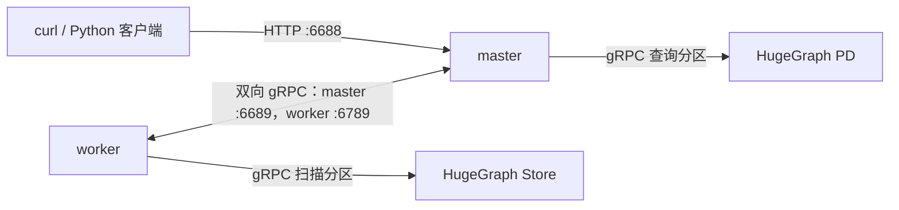
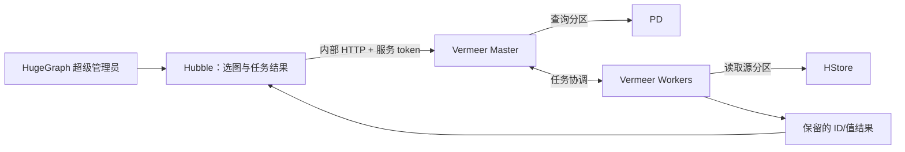

使用 [Helm 与 Hubble](#24-通过-hubble-提交与集成)可完成一体化 HStore 工作流；需要自行编排时使用原生 API。
本指南跟随当前源码构建，已发布镜像可能缺少部分算法或结果预览能力。部署时请固定兼容的 Hubble 与 Vermeer 镜像版本或摘要。

- [通过 Hubble 加载并计算](#24-通过-hubble-提交与集成) — 使用 Chart 管理的连接及 HugeGraph 登录。
- [调用原生任务 API](#二任务创建类-rest-api) — 使用 Vermeer 服务凭据提交加载与计算。
- [检查健康与就绪](#四集群监控与遥测cluster-monitoring--telemetry) — 区分 Worker 注册、任务可用性与进程指标。
{.cards .td-cards-list}

<span id="一vermeer-概述"></span>

## 一、Vermeer 概述 {#1-overview-of-vermeer}

<span id="11-运行架构"></span>

### 1.1 运行架构 {#11-architecture}

Vermeer 是使用 Go 编写的内存优先图计算框架：一次加载图后，可反复执行 OLAP 计算。
当前由一个 Master 调度多个 Worker；耗时取决于图规模、算法参数及可用资源。

master 是负责通信、转发、汇总的节点，计算量和占用资源量较少。worker 是计算节点，用于存储图数据和运行计算任务，占用大量内存和 cpu。grpc 和 rest 模块分别负责内部通信和外部调用。

启动时，程序先设置内置默认值，再读取工作目录下 `config/<env>.ini` 的 `[default]` 节，最后由显式命令行参数覆盖对应配置；例如 `--env=master` 读取 `config/master.ini`。Docker 镜像把仓库中的配置复制到 `/go/bin/config/`，并以 `/go/bin/` 为工作目录。挂载宿主机目录到 `/go/bin/config` 会遮住镜像自带文件，因此该目录必须包含实际使用的 ini 文件。普通 INI 配置键不会自动映射环境变量。部署专用凭据设置还支持
`VERMEER_PD_PASSWORD_FILE`、`VERMEER_PD_PEERS`、`VERMEER_HUGEGRAPH_CREDENTIALS_FILE` 及文档中的签名因子／密码文件设置。

默认端口如下：

| 角色 | 配置键 | 默认地址 | 用途 |
|---|---|---|---|
| master | `http_peer` | `0.0.0.0:6688` | REST API；宿主机客户端访问此端口 |
| master | `grpc_peer` | `0.0.0.0:6689` | worker 连接 master 的 gRPC 端口 |
| worker | `http_peer` | `0.0.0.0:6788` | worker HTTP 服务 |
| worker | `grpc_peer` | `0.0.0.0:6789` | worker gRPC 监听地址，同时会通告给 master 供节点间通信 |

Docker 示例只把 master 的 HTTP 端口发布到宿主机回环地址 `127.0.0.1:6688:6688`；master 和 worker 的 gRPC 端口留在容器网络内部。



<span id="12-运行方法"></span>

### 1.2 运行方法 {#12-running-vermeer}

> [!DETAILS]- Helm：与 HugeGraph、Hubble 一起部署 Vermeer
> 在 HugeGraph 仓库根目录启用 Vermeer，与 HStore 组件一起部署：
>
> ```bash
> helm install hugegraph ./helm/hugegraph -n hugegraph --create-namespace \
>   -f helm/hugegraph/values-single.yaml \
>   --set vermeer.enabled=true --set vermeer.mode=standalone \
>   --wait --timeout 20m
> ```
>
> `standalone` 将独立的 Master、Worker 容器放入同一 Pod；独立 Master 与多个 Worker Pod 则使用
> `vermeer.mode=cluster` 并设置 `vermeer.worker.replicas`。两种拓扑都要求认证。
> easy 默认通过 NodePort 开放需认证的原生 HTTP/UI，strict 默认 ClusterIP。
> UI 登录使用 `<release>-vermeer-admin` Secret 的 `password`，自动化和 Hubble 使用服务 token。
>
> 保持已有 `metadataCluster`（Chart 默认 `hg-test`）在 Server 与 Store 间一致；修改此值不会迁移数据，
> 可能导致加载时出现 `Schema missing`。Chart 会配置 Hubble 的 Master 地址和服务 token。
> 继续按 [Hubble 工作流](#24-submit-and-integrate-via-hubble)操作；访问方式、镜像固定及持久化见
> [Helm 可选引擎](/cn/docs/quickstart/hugegraph/hugegraph-helm/#optional-engines)。

> [!WARNING]
> 生产环境必须启用 HugeGraph Server [认证与授权](/cn/docs/config/config-authentication/)、IP 白名单和最小权限授权，并保留 `audit-*.log` 审计记录。Server Auth 不会保护 Vermeer、PD 和 Store 的独立接口；这些 HTTP、gRPC 端口必须限制在可信网络及调用方范围内，Vermeer 对外入口需配置访问控制。
>
> 独立手动部署时，默认 `master.ini` 配置为 `auth=none`，下方 Docker 示例仅发布至回环地址；若需远程访问，务必在配置文件中启用 `auth=token`。Helm 部署在两种模式下均要求 Token 鉴权，easy 默认仅通过 NodePort 开放原生 HTTP/UI。

下面两种 Docker 启动方式都需要先准备一个宿主机配置目录。请在 Vermeer 仓库根目录执行，将项目提供的 [`master.ini`](https://github.com/apache/hugegraph-computer/blob/master/vermeer/config/master.ini) 和 [`worker.ini`](https://github.com/apache/hugegraph-computer/blob/master/vermeer/config/worker.ini) 模板复制到该目录；挂载会覆盖镜像里的 `/go/bin/config`，所以不要把空目录或整个用户主目录挂进去：

```shell
CONFIG_DIR="$HOME/vermeer-config"
mkdir -p "$CONFIG_DIR"
cp config/master.ini config/worker.ini "$CONFIG_DIR/"
```

`master.ini` 保留 HTTP/gRPC 监听地址 `0.0.0.0:6688` 和 `0.0.0.0:6689`。Compose 示例为网络分配固定地址 `172.20.0.10`（master）和 `172.20.0.11`（worker），因此将复制后的 `worker.ini` 中这些配置设为：

```ini
[default]
http_peer=0.0.0.0:6788
grpc_peer=172.20.0.11:6789
master_peer=172.20.0.10:6689
run_mode=worker
worker_group=$
```

此单 worker 示例将 `worker_group` 设为 `$`，表示未绑定命名组时使用的通用组；请在 ini 文件中原样写入美元符号。仓库模板默认是 `worker_group=default`，若保留命名组，需先将它绑定到任务所在的空间或图，再提交任务。例如默认空间为 `$DEFAULT` 时，可执行：

```shell
curl --fail --show-error -X POST \
  'http://localhost:6688/admin/workers/alloc/default/%24DEFAULT'
```

该接口响应 `errcode=0` 表示绑定成功；启用 token 鉴权时还需带上授权请求头。`master_peer` 必须指向 worker 所在网络能访问的 master gRPC 地址。`grpc_peer` 同时用于 worker 监听和向 master 通告自己的地址，不能设为不可从其他容器访问的 `0.0.0.0`。如果更改网络子网或地址，需同步修改此处的 IP；多个 worker 还需要各自唯一且可互相访问的 `grpc_peer` 地址。

#### Docker Compose {#vermeer-compose}

在 Vermeer 仓库根目录运行。可以修改仓库已有的 `docker-compose.yaml`，也可以使用下面的配置。仓库文件当前将整个 `~/` 挂载到配置目录且没有发布 master HTTP 端口，运行前必须按示例更换挂载路径并增加端口映射：

```yaml
services:
  vermeer-master:
    image: hugegraph/vermeer:latest
    container_name: vermeer-master
    ports:
      - "127.0.0.1:6688:6688"
    volumes:
      - /home/user/vermeer-config:/go/bin/config:ro
    command: --env=master
    networks:
      vermeer_network:
        ipv4_address: 172.20.0.10 # master 固定地址

  vermeer-worker:
    image: hugegraph/vermeer:latest
    container_name: vermeer-worker
    volumes:
      - /home/user/vermeer-config:/go/bin/config:ro
    command: --env=worker
    networks:
      vermeer_network:
        ipv4_address: 172.20.0.11 # worker 固定地址

networks:
  vermeer_network:
    driver: bridge
    ipam:
      config:
        - subnet: 172.20.0.0/24 # 按需更换子网
```

把 `/home/user/vermeer-config` 换成上面实际的配置目录绝对路径。若修改 `vermeer_network` 的子网或固定 IP，也要同步更新 `worker.ini` 中的 `grpc_peer` 和 `master_peer`。不要复用默认 `worker.ini` 的 `grpc_peer=0.0.0.0:6789` 作为容器间通告地址。

先选择发布镜像或从当前源码构建镜像，再启动 Compose：

```bash {tab="发布镜像"}
docker pull hugegraph/vermeer:latest
```

```bash {tab="源码镜像"}
docker build -t hugegraph/vermeer:latest .
```

```bash
docker compose up -d
```

查看日志 / 停止 / 删除：

```shell
docker compose logs -f
docker compose down
```

#### 分别运行 Docker 命令 {#vermeer-docker-run}

将 `CONFIG_DIR` 设为上面准备的配置目录，并确保复制后的 `worker.ini` 已按固定容器地址设置 `grpc_peer` 和 `master_peer`。该示例中的 `CONFIG_DIR` 需替换为实际的绝对路径。

使用与 [Compose 方式](#vermeer-compose)相同的发布镜像或源码构建镜像。

创建自定义 bridge 网络（一次性操作）：

```shell
docker network create --driver bridge \
  --subnet 172.20.0.0/24 \
  vermeer_network
```

运行 master（调整 CONFIG_DIR 为您的绝对配置路径，可以根据实际情况调整IP）：

```shell
CONFIG_DIR=/home/user/vermeer-config

docker run -d \
  --name vermeer-master \
  --network vermeer_network --ip 172.20.0.10 \
  -p 127.0.0.1:6688:6688 \
  -v ${CONFIG_DIR}:/go/bin/config:ro \
  hugegraph/vermeer:latest \
  --env=master
```

运行 worker：

```shell
docker run -d \
  --name vermeer-worker \
  --network vermeer_network --ip 172.20.0.11 \
  -v ${CONFIG_DIR}:/go/bin/config:ro \
  hugegraph/vermeer:latest \
  --env=worker
```

查看日志 / 停止 / 删除：

```shell
docker logs -f vermeer-master
docker logs -f vermeer-worker

docker stop vermeer-master vermeer-worker
docker rm vermeer-master vermeer-worker

# 删除自定义网络（如果需要）
docker network rm vermeer_network
```

#### 从源码构建 {#vermeer-source-build}

参照 [Vermeer README](https://github.com/apache/hugegraph-computer/tree/master/vermeer) 编译。
使用 `go.mod` 记录的工具链（当前为 Go 1.23.7）；更高版本的工具链不代表所有依赖都已兼容。
首次准备资源与依赖还需 Node.js/npm、`curl` 和 `unzip`。在 `vermeer/` 目录运行：

```bash
export GOTOOLCHAIN=go1.23.7
make
```

默认构建先生成嵌入式 UI 资源，再编译可执行文件。本地 API 开发可使用
`GOTOOLCHAIN=go1.23.7 go build -tags=dev` 从磁盘读取 UI 文件；开发构建成功不代表打包 UI 资源已经验证。

单机试跑使用自带的 `config/master.ini` 与 `config/worker.ini`。将 Worker 的配置设为
`master_peer=127.0.0.1:6689`、`grpc_peer=127.0.0.1:6789`、`worker_group=$`；这里不使用 Docker 示例中的容器 IP。
在 Vermeer 根目录的两个终端分别启动：

```bash
./vermeer --env=master
```

```bash
./vermeer --env=worker
```

多主机部署则需公告所有参与节点均可访问的地址。

启动 master 后，在宿主机验证 HTTP 端口：

```shell
curl --fail --show-error http://localhost:6688/graphs
```

请求应返回 HTTP 200，JSON 响应中的 `errcode` 为 `0`。

<span id="13-身份认证token-工具与部署凭据"></span>

### 1.3 身份认证、Token 工具与部署凭据 {#13-authentication-token-tooling-and-deployment-credentials}

当在 `master.ini` 中启用 `auth=token`（或命令行参数 `-auth token`）时，应将 Master 签名因子保存在受保护的独立文件（`0600` 权限）中，
而非放置在启动参数内。基于文件的认证机制采用 **v2 HMAC-SHA256** Base58 编码 token，具备恒定时间 MAC 校验能力，防止降级为不安全的旧协议。

<span id="1-生成基于文件的签名因子"></span>

#### 1. 生成基于文件的签名因子 {#1-generating-file-backed-signing-factor}

启动 Master 前先生成签名因子文件：

```bash
umask 077
openssl rand -hex 32 > config/token-factor
```

配置环境变量 `VERMEER_AUTH_TOKEN_FACTOR_FILE=/path/to/token-factor`，或在 `master.ini` 中设置 `auth_token_factor_file`。环境变量优先级高于 INI 文件，
两者均高于行内 `auth_token_factor`。文件必须为有效的 UTF-8 编码且至少包含 16 个有效字符，不可全为空白字符。配置无效或不可读的文件会导致 Master
在监听网络端口前直接退出（Fail-Closed），绝不会静默回退至行内或默认签名因子。

<span id="2-使用-gobinvermeer-token-生成认证-token"></span>

#### 2. 使用 `/go/bin/vermeer-token` 生成认证 Token {#2-generating-auth-tokens-with-gobinvermeer-token}

Vermeer 运行时容器镜像已内置打包 `/go/bin/vermeer-token` CLI 工具（源自 `cmd/vermeer-token`）。该工具无需运行 Master 或访问 Kubernetes API，
即可直接生成合法的 v2 Base58 token：

```bash {tab="Docker 命令"}
docker run --rm --user "$(id -u):$(id -g)" -v "$PWD/config:/tokens" \
  --entrypoint /go/bin/vermeer-token \
  hugegraph/vermeer:latest -user admin -space '$DEFAULT' \
  -factor-file /tokens/token-factor -output-file /tokens/admin-token -i -quiet
```

```bash {tab="Go 源码"}
go run ./cmd/vermeer-token -user admin -space '$DEFAULT' \
  -factor-file config/token-factor -output-file config/admin-token -i -quiet
```

参数说明：
- `-user`：用户名（默认：`foo`）。
- `-space`：图空间名称（默认：`bar`；系统默认空间填写 `$DEFAULT`）。
- `-factor-file`：签名因子文件路径（必填；不再接受行内 `-factor`）。
- `-output-file`：以 `0600` 权限将 Base58 token 原子写入指定文件，不会向标准输出打印密钥。
- `-quiet`：在未指定 `-output-file` 时仅输出 token 字符串，方便脚本捕获。
- `-client`：客户端标识（默认：`hg`）。
- `-i`：生成永不过期的永久 token（普通 token 默认 24 小时过期）。

调用 REST 接口时，将 token 填入 HTTP 请求头：
```bash
curl -H "Authorization: Bearer <token>" http://localhost:6688/graphs
```

<span id="3-kubernetes-secret-密码文件与凭据隔离"></span>

#### 3. Kubernetes Secret 密码文件与凭据隔离 {#3-kubernetes-secret-password-files-and-credential-isolation}

为了方便直接挂载 Kubernetes Secret 原始密码文件而无需封装为 JSON，Worker 支持通过密码文件注入连接凭据：

- 配置 `VERMEER_HUGEGRAPH_USERNAME` 与 `VERMEER_HUGEGRAPH_PASSWORD_FILE`（或在 `worker.ini` 中配置 `hugegraph_username` 与 `hugegraph_password_file`）。
  两项配置必须成对提供；若任一项配置后文件缺失或不可读，数据加载将直接失败。
- 密码文件内容被原样读取，完整保留引号、反斜杠、空格及末尾换行符。
- 若同时配置了显式 JSON 凭据文件（`VERMEER_HUGEGRAPH_CREDENTIALS_FILE` 或 `hugegraph_credentials_file`），JSON 文件拥有更高优先级。
- PD 认证凭据：支持挂载 `VERMEER_PD_PASSWORD_FILE`（或 `pd_password_file`）。使用部署凭据时，必须同时配置 `VERMEER_PD_PEERS`（`pd_peers`），
  确保 Worker 仅通过受信任的 PD 节点发现 Schema。
- 部署凭据仅在进程内部加载时使用，绝不会持久化至任务元数据中，也不会通过查询接口泄露。
- 可通过 `grpc_dial_timeout` 或 `VERMEER_GRPC_DIAL_TIMEOUT`（默认 `5s`）设定 Worker 建立 gRPC 连接的超时阈值。

### 1.4 升级 Master 与 Worker {#vermeer-upgrade}

Master 仅允许**运行时报送的版本字符串完全一致**的 Worker 注册。混合版本部署可能出现
`registration denied: inconsistent registration version`；镜像标签相同不代表运行版本已核实一致。
跨版本升级需安排不可用窗口：

1. 暂停新的加载与计算提交，等待已有任务结束或取消任务，然后卸载计算图。
1. 保存配置、认证材料和需要保留的输出文件，协调部署版本匹配的 Master 与全部 Worker。
1. 在[集群快照](#41-cluster-health-snapshot-get-apiv1admincluster)核对报送版本与 Worker 注册，
   再确认[调用方空间的可用性](#42-space-worker-availability-probe-get-apiv1workersavailability)。
1. 重新加载源图并完成小规模计算后再恢复提交。PVC 文件不会自动恢复内存图与保留结果。
{.steps}

Chart 部署步骤见 [Helm 运维](/cn/docs/quickstart/hugegraph/hugegraph-helm-operations/#vermeer-upgrade)。

<span id="二任务创建类-rest-api"></span>

## 二、任务创建类 rest api {#2-task-creation-rest-api}

<span id="21-简介"></span>

### 2.1 简介 {#21-introduction}

先提交 `load` 任务，等待图加载完成，再提交 `compute` 任务。
同一张已加载的图可重复计算，不会因任务完成而自动删除。

异步接口在任务完成前返回任务信息（包括 ID）。同步接口等待任务成功或失败；
调用方及代理的 HTTP 超时需覆盖这段等待时间。

查询 `task.status`：加载成功为 `loaded`，计算成功为 `complete`，失败为 `error`，取消为 `canceled`，
其余状态仍在等待或执行中。图在加载中或错误状态时不能用于计算；删除图要求图处于可删除状态且当前未被使用。

可以使用的 url 如下：

- 异步接口：`POST http://master_ip:port/tasks/create`，从响应的 `task.id` 取得任务 ID。
- 同步接口：`POST http://master_ip:port/tasks/create/sync`，等待该任务结束后返回。
- 查询单个任务：`GET http://master_ip:port/task/{task_id}`；响应中的 `errcode` 为 `0` 表示查询成功，再按 `task.status` 判断业务状态。异步任务应在客户端设置轮询截止时间；到时只停止客户端等待，不会自动取消服务端任务。
- 查询保留结果：`GET http://master_ip:port/tasks/value/{task_id}`（或 `/api/v1/tasks/value/{id}`）。
- 集群健康与遥测快照：`GET http://master_ip:port/api/v1/admin/cluster`（需管理员 token；参见[第四节](#四集群监控与遥测cluster-monitoring--telemetry)）。
- 图空间计算可用性探针：`GET http://master_ip:port/api/v1/workers/availability`（图空间粒度就绪检测）。

原生客户端使用 `POST /api/v1/tasks/create`，请求包含 `graph`、`task_type`（`load`、`reload` 或 `compute`）及扁平的字符串 `params` 映射。
计算算法名填写 `params["compute.algorithm"]`，不是顶层 `algorithm`。
响应中的原生 `task.id` 通过 `GET /api/v1/task/{id}` 查询状态，通过 `GET /api/v1/tasks/value/{id}` 查询保留结果。

原生结果行使用 `ID` 和 `Value` 字段，计算请求需设置 `output.need_query=1` 才保留可查询值。
原生分页返回 `cursor`，没有总数或 `has_more`；按返回游标继续，直到 `message:"EOF"` 或最终空页。
最后一页刚好填满 `limit` 时，可能需要再请求一次才能观察到 EOF。Hubble 包装层则额外窥读一条，提供 `has_more`。

`POST /api/v1/tasks` 不提交任务：修复后返回 HTTP 405 和 `Allow: GET`；旧构建可能返回误导性的 `{"code":200}`，但实际并未创建任务。
详见 [原生 API 示例](https://github.com/apache/hugegraph-computer/blob/master/vermeer/README.md#api-overview)。

Vermeer Master HTTP 遵循 Helm 模式默认值：easy 为 NodePort，strict 为 ClusterIP；RPC 与 Worker 端口保持内部访问。
原生 UI 管理员使用 `<release>-vermeer-admin` 中的密码。自动化 API 使用服务 token，放入 `Authorization: Bearer <token>`，
UI 管理密码不能当作该 token。Chart 会自动为 Hubble 配置服务 token。

<span id="22-加载图数据"></span>

### 2.2 加载图数据 {#22-loading-graph-data}

以下示例列出常用的加载参数；引擎会按具体加载器读取参数，未被加载器使用的键不会改变行为。

每个加载任务选择一种数据源。以下 JSON 请求体提交到 `POST /api/v1/tasks/create`，
认证方式与完整 curl 示例相同。

#### 本地文件 {#vermeer-load-local}

先体验四个顶点组成的有向环。在 Worker 可读目录中保存以下两个 UTF-8 文件，**不含表头**：

```csv {title="vertices.csv"}
1
2
3
4
```

```csv {title="edges.csv"}
1,2
2,3
3,4
4,1
```

`load.vertex_files` 与 `load.edge_files` 是 JSON 编码的字符串，将 Worker 上报的 `grpc_peer` 地址的主机部分映射到文件。
以下请求假设本地 Worker 上报 `127.0.0.1`；将 `/absolute/data` 替换为 Worker 实际可读的目录。
若沿用 Compose 示例，将文件挂载到 Worker 的 `/data`，路径改为 `/data/vertices.csv`、`/data/edges.csv`，映射键改为 `172.20.0.11`。
路径由 Worker 读取，不是 HTTP 调用方或 Master 读取。

```bash
curl -X POST http://localhost:6688/api/v1/tasks/create \
  -H 'Content-Type: application/json' \
  -d '{
    "task_type":"load",
    "graph":"docs_ring",
    "params":{
      "load.type":"local",
      "load.parallel":"1",
      "load.delimiter":",",
      "load.vertex_backend":"mem",
      "load.vertex_files":"{\"127.0.0.1\":\"/absolute/data/vertices.csv\"}",
      "load.edge_files":"{\"127.0.0.1\":\"/absolute/data/edges.csv\"}",
      "load.use_out_degree":"1",
      "load.use_outedge":"1"
    }
  }'
```

等待返回的加载任务成功后，使用 `graph:"docs_ring"` 提交计算。
该四顶点四边示例采用默认 PageRank 参数并给予足够迭代预算时，四个顶点的分数均为 `0.25`。
开启 token 认证的部署还需添加服务凭据；这些本地回环示例假设 `auth=none`。

#### HugeGraph / HStore {#vermeer-load-hugegraph}

**request 示例：**

将请求中的地址、图名和凭据替换为实际连接信息。

```json
{
  "task_type": "load",
  "graph": "testdb",
  "params": {
    "load.parallel": "1",
    "load.type": "hugegraph",
    "load.hg_pd_peers": "[\"<pd-address-reachable-from-vermeer>:8686\"]",
    "load.hugegraph_name": "DEFAULT/hugegraph2/g",
    "load.hugegraph_username": "admin",
    "load.hugegraph_password": "<your-password-here>",
    "load.use_out_degree": "1",
    "load.use_outedge": "1"
  }
}
```

Vermeer master 使用 `load.hg_pd_peers` 连接 PD 并查询分区，worker 再连接 PD 返回的 Store 地址读取数据。因此这些服务地址必须能从对应的 Vermeer 容器或主机访问；在 Docker 容器里，`127.0.0.1` 指向容器自身，不能用来代替宿主机或另一容器的地址。

#### HDFS {#vermeer-load-hdfs}

**request 示例：**

```json
{
  "task_type": "load",
  "graph": "testdb",
  "params": {
    "load.parallel": "1",
    "load.type": "hdfs",
    "load.hdfs_namenode": "name_node1:9000",
    "load.hdfs_conf_path": "/path/to/conf",
    "load.krb_realm": "EXAMPLE.COM",
    "load.krb_name": "user@EXAMPLE.COM",
    "load.krb_keytab_path": "/path/to/keytab",
    "load.krb_conf_path": "/path/to/krb5.conf",
    "load.hdfs_use_krb": "1",
    "load.vertex_files": "/data/graph/vertices",
    "load.edge_files": "/data/graph/edges",
    "load.use_out_degree": "1",
    "load.use_outedge": "1"
  }
}
```

<span id="23-输出计算结果"></span>

### 2.3 输出计算结果 {#23-outputting-computation-results}

当前有实际写入器的结果方式为 `local`、`hdfs` 和 `hugegraph`，通过 `output.type` 指定；`none` 表示不写出结果。源码保留 `afs` 类型常量，但当前主线没有注册 AFS 加载器或写入器。指定 `output.need_statistics` 为 `1` 时，统计结果会写入任务信息；统计算子的适用范围取决于对应算法实现。

以下示例列出常用的计算和结果输出参数；算法支持的参数以 Vermeer 当前实现为准。

request 示例：

```bash
curl -X POST http://localhost:6688/api/v1/tasks/create \
  -H 'Content-Type: application/json' \
  -d '{
    "task_type":"compute",
    "graph":"docs_ring",
    "params":{
      "compute.algorithm":"pagerank",
      "compute.parallel":"1",
      "compute.max_step":"20",
      "pagerank.damping":"0.85",
      "pagerank.diff_threshold":"0.00001",
      "output.type":"local",
      "output.file_path":"./data/pagerank-example",
      "output.need_query":"1"
    }
  }'
```

`output.type=local` 写入执行该任务的 Worker 本地文件系统。容器部署时，若需在宿主机读取文件，应挂载输出目录。
只保留可查询结果、不写输出文件时，使用 `output.type=none` 与 `output.need_query=1`。
这两种选择都不会将 PageRank 分数写回 HugeGraph 源图。

将下面的 `123` 替换为计算响应中的 `task.id`，等待 `task.status:"complete"`，再查询值：

```bash
curl http://localhost:6688/api/v1/task/123
curl 'http://localhost:6688/api/v1/tasks/value/123?cursor=0&limit=2'
```

示例环图返回 `ID`/`Value` 对，分数均等价于 `0.25`（JSON 可能使用科学记数法）。
这里使用计算任务 ID，不是先前加载任务的 ID；重启进程后缓存结果可能丢失。


#### 写回结果的属性类型 {#vermeer-result-types}

原生 `output.type=hugegraph` 写入器按算法输出类型创建属性键。
`output.hugegraph_property` 指定属性名；留空时默认使用 `compute.algorithm`。
升级或切换环检测模式后，复用默认属性前需先检查已有 Schema：

| 算法 / 模式 | 当前属性类型 | 需要迁移的已有属性 |
|---|---|---|
| `triangle_count` | `LONG` | 旧版的 `INT` 结果属性 |
| `cycle_detection`，`cycle.mode=boolean` | `INT`（`0` / `1`） | 旧版的 `TEXT` 结果属性 |
| `cycle_detection`，`cycle.mode=all` 或 `limit` | `TEXT` | 曾用于 boolean 模式的属性 |
{.wide}

使用所需类型的新属性名，例如 `output.hugegraph_property=triangle_count_v2` 或 `cycle_membership_v2`。
先通过小任务验证写回及取值，再迁移应用查询；旧属性应保留到其使用方完成迁移。
写入器不会替已有属性转换类型。Hubble 默认的 `output.type=none` 仅保留结果，不修改 Server Schema。

<span id="24-通过-hubble-提交与集成"></span>

### 2.4 通过 Hubble 提交与集成 {#24-submit-and-integrate-via-hubble}

最短的一体化路径是 **Helm → Hubble → Vermeer**。Chart 自动提供内部服务地址和只读 token 文件，
Hubble 的 Server 登录身份与引擎服务凭据分别管理。请配套使用当前 Hubble 与 Vermeer 构建。
安装及镜像选择见 [Helm 可选引擎](/cn/docs/quickstart/hugegraph/hugegraph-helm/#optional-engines)。

1. **部署 HStore 并开启 Vermeer。** Hubble 保持 PD 模式。Helm 单节点预设仍使用 PD + Store + Server，支持直连加载；
   RocksDB 单机 Server 不提供这条路径。Vermeer 不需要 Computer Operator 或其 CRD。
1. **在 Hubble 选择源图。** 使用 HugeGraph 超级管理员登录，选择 GraphSpace 和图。
   直接扫描 Store 绕过 Server 类型级权限，因此普通图只读权限不足以使用该集成；匿名部署沿用其匿名访问策略。
1. **加载计算副本。** 打开【OLAP 图计算（Vermeer）】，加载或重新加载选中的图。
   等待加载任务成功、图状态变为 `loaded`；收到任务 ID 不代表已经就绪。
1. **提交算法。** 首次可选择 PageRank，使用参数表单并保留返回的任务身份。
   计算异步执行，切换到另一个算法不会取消已接受的任务。
1. **读取结果并释放资源。** 查看任务的分页值或有界预览。卸载计算副本前先完成或取消任务；
   源图变化后，需要重新加载才能让下一次计算使用更新数据。
{.steps}



#### 加载、计算与卸载 API {#hubble-task-apis}

先使用已登录 Hubble 的 cookie 提交选中图的加载任务：

```bash
curl -b hubble.cookies -X POST 'http://localhost:8088/api/v1.3/vermeer/task' \
  -H 'Content-Type: application/json' \
  -d '{"graphspace":"DEFAULT","graph":"hugegraph","task_type":"load"}'
```

已有计算副本需要刷新时使用 `task_type:"reload"`。Hubble 接受 `load.parallel` 等调优参数，
但 PD 地址、源图及凭据由后端统一解析。`POST /api/v1.3/vermeer/task` 不提交算法计算。
等待加载完成后，通过图级端点提交 PageRank：

```bash
curl -b hubble.cookies -X POST \
  'http://localhost:8088/api/v1.3/graphspaces/DEFAULT/graphs/hugegraph/algorithms/vermeer' \
  -H 'Content-Type: application/json' \
  -d '{"params":{"compute.algorithm":"pagerank","compute.parallel":1,"compute.max_step":10,"pagerank.damping":0.85,"pagerank.diff_threshold":0.00001}}'
```

响应 envelope 的 `data.task_id` 是后续调用依据。以下均以原生任务 `123` 为例：

| 入口 | ID 与查询示例 | 含义 |
|---|---|---|
| Vermeer 原生 API | `123`，使用 `/api/v1/task/123` | 正数原生任务 ID |
| Hubble API | `-123`，使用 `/api/v1.3/graphspaces/DEFAULT/graphs/hugegraph/async-tasks/-123` | 有符号路由 ID，必须保留负号 |
| Hubble 任务列表 | `Vermeer #123` | 界面身份，与 `Server #123` 区分；可用对应完整身份搜索 |

不要将 Hubble 的负数路由 ID 发给 Server 的 `/tasks/{id}` 或 Vermeer 原生 API。
成功后调用 `GET .../async-tasks/-123/values?cursor=0&limit=100`，按返回的 `cursor` 继续，直到 `has_more` 为 false。
该包装接口接受 1 到 10000 的 `limit`。最后一页刚好填满也会返回 `has_more:false`，不要仅按条数猜测是否还有下一页。

卸载内存图使用 `DELETE /api/v1.3/vermeer/DEFAULT-hugegraph`，请求体为
`{"graphspace":"DEFAULT","graph":"hugegraph"}`。先完成或取消活动任务。
该操作只删除 Vermeer 计算副本，不删除 HugeGraph 源图。当前加载页提供加载/重新加载按钮，卸载使用管理员 API。

#### 读取有界预览与并发任务结果 {#hubble-result-preview}

OLAP 结果区提供图、表格与连通样本视图。计算结果是 **ID/值对**，不是可编辑的 Server 顶点。
预览每次加载 12 条，最多展示 300 条；更多保留结果通过异步任务和分页结果 API 获取。

图视图展示样本 ID 及计算值。可选连边来自**当前已加载的 Vermeer 图**，不是 Server，也不一定是历史任务计算时的图快照。
每页连边查找最多扫描 3000 条、返回 30 条边，不能证明完整诱导子图。

连边补充要求 Vermeer 构建实现 `POST /api/v1/graphs/{graph}/preview-edges`；当前原生源码基线没有该路由，
因此 Hubble 保留可读的计算值，并提示邻接关系不可用。

连通样本最多展示六个相连的样本顶点，并非再次执行图路径查询。连边不可用时，合法的表格值仍可阅读；预览无边不代表原图没有边。

其他算法提交或完成时，已接受的任务仍可在结果区独立选择。
页面按 GraphSpace 和图在内存中记住近期任务，刷新页面会清除这些选择记录；这不是持久化任务存储。
切图、切算法不会混合结果；返回算法时可以恢复其最近一次已接受的任务，不会重新执行。
结果缺失、已过期、过大或任务失败有各自反馈；任务成功不保证缓存值仍然存在。

Hubble 提交计算时固定 `output.type=none`、`output.need_query=1`，保留可查询结果，不生成 Worker 本地输出文件，
也不把分数写回 HugeGraph 属性。即使任务元数据或 PVC 文件保留，重启 Vermeer 仍可能丢失内存结果。
原生 API 调用方可自行选择显式输出方式，见[输出配置](#23-输出计算结果)。

```gallery
 # 选择 Vermeer，并加载选中的 HStore 图
 # 查看样本结果；完整保留分页结果从任务入口获取
```

#### Hubble 算法目录与限制 {#hubble-algorithm-catalog}

当前原生适配器接受以下 19 个算法标识。下方原生接口示例与 Hubble 图级计算端点要求的 `params` 对象不可直接互换。

| 类别 | `compute.algorithm` |
|---|---|
| 中心性 | `pagerank`、`ppr`、`degree`、`closeness_centrality`、`betweenness_centrality` |
| 连通分量与社区 | `wcc`、`scc`、`lpa`、`slpa`、`louvain`、`louvain_weighted` |
| 结构与遍历 | `triangle_count`、`kcore`、`clustering_coefficient`、`sssp`、`depth`、`cycle_detection`、`kout` |
| 相似度 | `jaccard` |
{.wide .expand}

请使用所选算法自己的参数，例如 PPR 使用 `ppr.source`，Jaccard 必填 `jaccard.source`，K-out 的
`kout.direction` 可为 `in`、`out` 或 `both`。Hubble 接受 `compute.*`、当前算法命名空间及 `output.need_statistics`；
Louvain 变体还使用 `louvain.*`，环检测使用 `cycle.*` 和成对过滤字段。任意输出路径和调用方提供的 Server 凭据均被拒绝。

当前 Hubble 加载路径不能验证加权/过滤所需属性是否可用。
通过该适配器使用时，`louvain.edge_weight_property` 留空，环检测属性过滤表达式保持空白；
选择加权表单并不代表已加载源边权重。原生 Vermeer 的属性加载能力不改变这条界限。
请按[原生引擎步数预算](#vermeer-step-budgets)设置参数，即使表单允许更小的值。
当前三角形计数与聚集系数都至少需要 3 步，而 Hubble 聚集系数表单仍可能接受 2。
Louvain 最少 2 步，加权 Louvain 最少 3 步；部分图需要更多步才能完成。

**Computer 兼容入口**仍需显式选择，展开后才检查当前图的能力；Vermeer 不可用时不会自动切换。
Computer 的任务参数、任务身份和部署方式各自独立。

<span id="三支持的算法"></span>

## 三、支持的算法 {#3-supported-algorithms}

以下 JSON 片段用于替换[完整原生计算请求](#23-outputting-computation-results)中的**整个 `params` 对象**。
保留已经加载的 `graph`（CSV 示例为 `docs_ring`）与 `task_type=compute`，提交至 `POST /api/v1/tasks/create`。
片段会保留查询结果但不写输出文件。指定起点的示例使用 CSV 中的顶点 ID `1`；其他图应替换为实际存在的 ID。

### 步数预算与完整输出 {#vermeer-step-budgets}

`compute.max_step` 默认值为 10。最低允许值仅表示可以执行，不保证收敛或完整输出。

| 算法 | 原生引擎下限 / 完成条件 |
|---|---|
| 三角形计数、聚集系数 | 至少 3 步 |
| 中介中心性 | 至少 2 步；贡献回传可能需要更多步 |
| 环检测 | 至少 2 步；另行限制搜索长度和环数 |
| Louvain / 加权 Louvain | 至少 2 / 3 步；必须完成最终社区发布 |
| 紧密中心性 | 所有顶点完成距离扩展 |
{.wide}

紧密中心性与中介中心性会拒绝不完整输出，不会发布部分分数。
任务报 `increase compute.max_step` 时，增加预算并重新提交；Louvain 最终发布未完成时同理。
读取保留结果前先检查任务状态和错误。先在小图使用中心性采样率 `1` 核验正确性，
再按需降低以近似计算；两种中心性算法采样的对象不同。

### 3.1 PageRank

PageRank 算法又称网页排名算法，是一种由搜索引擎根据网页（节点）之间相互的超链接进行计算的技术，用来体现网页（节点）的相关性和重要性。

- 如果一个网页被很多其他网页链接到，说明这个网页比较重要，也就是其 PageRank 值会相对较高。
- 如果一个 PageRank 值很高的网页链接到其他网页，那么被链接到的网页的 PageRank 值会相应地提高。

PageRank 算法适用于网页排序、社交网络重点人物发掘等场景。

`params` 示例：

```json
{
  "compute.algorithm": "pagerank",
  "compute.parallel": "1",
  "output.type": "none",
  "compute.max_step": "10",
  "output.need_query": "1"
}
```

<span id="32-wcc弱连通分量"></span>

### 3.2 WCC（弱连通分量） {#32-wcc-weakly-connected-components}

弱连通分量，计算无向图中所有联通的子图，输出各顶点所属的弱联通子图 id，表明各个点之间的连通性，区分不同的连通社区。

`params` 示例：

```json
{
  "compute.algorithm": "wcc",
  "compute.parallel": "1",
  "output.type": "none",
  "compute.max_step": "10",
  "output.need_query": "1"
}
```

<span id="33-lpa标签传播"></span>

### 3.3 LPA（标签传播） {#33-lpa-label-propagation-algorithm}

标签传递算法，是一种图聚类算法，常用在社交网络中，用于发现潜在的社区。

`params` 示例：

```json
{
  "compute.algorithm": "lpa",
  "compute.parallel": "1",
  "output.type": "none",
  "compute.max_step": "10",
  "output.need_query": "1"
}
```

<span id="34-degree-centrality度中心性"></span>

### 3.4 Degree Centrality（度中心性） {#34-degree-centrality}

度中心性使用 `degree.direction=in`、`out` 或 `both` 统计关联边，衡量局部连接程度。
它不表示基于最短路径的中心性，应按分析问题选择方向。

`params` 示例：

```json
{
  "compute.algorithm": "degree",
  "compute.parallel": "1",
  "output.type": "none",
  "degree.direction": "both",
  "output.need_query": "1"
}
```

<span id="35-closeness-centrality紧密中心性"></span>

### 3.5 Closeness Centrality（紧密中心性） {#35-closeness-centrality}

当前 Vermeer 对有向图计算**入向紧密中心性**，使用其他可达顶点到当前顶点的距离。
`closeness_centrality.sample_rate=1` 时不采样剔除入边。设能到达当前顶点的其他顶点数为 `r`，
它们的最短路径距离之和为 `D`，基础分数为 `r / D`。
默认 `closeness_centrality.wf_improved=1` 还会乘以 `r / (N - 1)`，`N` 为已加载顶点总数；
设为 `0` 可关闭此修正。没有其他可达顶点或图中至多一个顶点时，分数为 `0`。

采样率必须是 `(0, 1]` 内的有限数。较低采样率采样的是**入向邻接边**，得到采样图上的分数，
与中介中心性采样源顶点不同。当前分布式实现检查全局完成状态；距离扩展耗尽步数预算时任务失败，
并要求增大 `compute.max_step`。

`params` 示例：

```json
{
  "compute.algorithm": "closeness_centrality",
  "compute.parallel": "1",
  "output.type": "none",
  "closeness_centrality.sample_rate": "1",
  "output.need_query": "1",
  "compute.max_step": "20",
  "closeness_centrality.wf_improved": "1"
}
```

<span id="36-betweenness-centrality中介中心性算法"></span>

### 3.6 Betweenness Centrality（中介中心性算法） {#36-betweenness-centrality}

中介中心性通过 Brandes 算法度量顶点对其他顶点间最短路径的贡献。
`betweenness_centrality.sample_rate=1` 使用所有源顶点；`(0, 1)` 内的有限采样率会确定性地选取部分**源顶点**，
并按采样率调整贡献，得到没有固定误差保证的近似结果。

`betweenness_centrality.use_endpoint` 接受 `0`（默认，不计端点）或 `1`（计入端点）。
分数分别以 `(N - 1)(N - 2)` 或 `N(N - 1)` 归一化，并按采样率调整；
顶点数不足以使用对应分母时，分数为 `0`。
原生引擎最少需要 2 步，但传播和贡献回传可能需要更多步。
贡献回传未完成时会报 `increase compute.max_step`，不会返回部分分数。

`params` 示例：

```json
{
  "compute.algorithm": "betweenness_centrality",
  "compute.parallel": "1",
  "output.type": "none",
  "betweenness_centrality.sample_rate": "1",
  "output.need_query": "1",
  "compute.max_step": "20",
  "betweenness_centrality.use_endpoint": "0"
}
```

<span id="37-triangle-count三角形计数"></span>

### 3.7 Triangle Count（三角形计数） {#37-triangle-count}

三角形计数以 `LONG` 输出包含每个顶点的三角形数量。它将邻接关系视为无向，
去除自环与重复邻居，要求 `compute.max_step >= 3`。
写回旧版本已创建的属性前，请先完成[结果类型迁移](#vermeer-result-types)。

`params` 示例：

```json
{
  "compute.algorithm": "triangle_count",
  "compute.parallel": "1",
  "output.type": "none",
  "output.need_query": "1",
  "compute.max_step": "3"
}
```

### 3.8 K-Core

K-Core 反复剔除剩余无向邻居数低于 `kcore.degree_k` 的顶点。
输出为剩余度数，被剔除顶点为 `0`；它不是仅挑选原始度数恰好等于 K 的顶点。

`params` 示例：

```json
{
  "compute.algorithm": "kcore",
  "compute.parallel": "1",
  "output.type": "none",
  "kcore.degree_k": "2",
  "output.need_query": "1"
}
```

<span id="39-sssp单元最短路径"></span>

### 3.9 SSSP（单元最短路径） {#39-sssp-single-source-shortest-path}

SSSP 沿出边计算从 `sssp.source` 到其他顶点的**无权跳数距离**：起点为 `0`，不可达顶点为 `-1`。
起点 ID 必须存在于已加载图中；此实现不计算加权最短路径。

`params` 示例：

```json
{
  "compute.algorithm": "sssp",
  "compute.parallel": "1",
  "output.type": "none",
  "sssp.source": "1",
  "output.need_query": "1"
}
```

### 3.10 KOUT

以一个点为起点，获取这个点的 k 层的节点。

`params` 示例：

```json
{
  "compute.algorithm": "kout",
  "compute.parallel": "1",
  "output.type": "none",
  "kout.source": "1",
  "compute.max_step": "6",
  "output.need_query": "1"
}
```

### 3.11 Louvain

Louvain 算法是一种基于模块度的社区发现算法。其基本思想是网络中节点尝试遍历所有邻居的社区标签，并选择最大化模块度增量的社区标签。在最大化模块度之后，每个社区看成一个新的节点，重复直到模块度不再增大。

顶点顺序、并行执行及随机遍历都可能使多次运行的社区分配不同。
应结合数据比较社区划分和模块度，不要假定社区 ID 相同。

`params` 示例：

```json
{
  "compute.algorithm": "louvain",
  "compute.parallel": "1",
  "compute.max_step": "1000",
  "louvain.threshold": "0.0000001",
  "louvain.resolution": "1.0",
  "louvain.step": "10",
  "output.type": "none",
  "output.need_query": "1"
}
```

<span id="312-jaccard-相似度系数"></span>

### 3.12 Jaccard 相似度系数 {#312-jaccard-similarity-coefficient}

Jaccard index , 又称为 Jaccard 相似系数（Jaccard similarity coefficient）用于比较有限样本集之间的相似性与差异性。Jaccard 系数值越大，样本相似度越高。用于计算一个给定的源点，与图中其他所有点的 Jaccard 相似系数。

`params` 示例：

```json
{
  "compute.algorithm": "jaccard",
  "compute.parallel": "1",
  "compute.max_step": "2",
  "jaccard.source": "1",
  "output.type": "none",
  "output.need_query": "1"
}
```

### 3.13 Personalized PageRank

个性化的 pagerank 的目标是要计算所有节点相对于用户 u 的相关度。从用户 u 对应的节点开始游走，每到一个节点都以 1-d 的概率停止游走并从 u 重新开始，或者以 d 的概率继续游走，从当前节点指向的节点中按照均匀分布随机选择一个节点往下游走。用于给定一个起点，计算此起点开始游走的个性化 pagerank 得分。适用于社交推荐等场景。

由于计算需要使用出度，需要在读取图时需要设置 load.use_out_degree 为 1。

`params` 示例：

```json
{
  "compute.algorithm": "ppr",
  "compute.parallel": "1",
  "compute.max_step": "10",
  "ppr.source": "1",
  "ppr.damping": "0.85",
  "ppr.diff_threshold": "0.00001",
  "output.type": "none",
  "output.need_query": "1"
}
```

<span id="314-全图-kout"></span>

### 3.14 全图 Kout {#314-global-kout}

旧示例使用 `compute.algorithm=kout_all` 计算所有顶点的 K-out 数量。当前原生算法注册表没有 `kout_all`，
Hubble 也不接受它，请勿向当前构建提交这类旧请求。
单个起点的遍历可使用 [`kout`](#310-kout)，但它不等价于全图逐顶点计算。

<span id="315-集聚系数-clustering-coefficient"></span>

### 3.15 集聚系数 clustering coefficient {#315-clustering-coefficient}

局部聚集系数度量一个顶点的无向邻居之间的连接程度。
与三角形计数一样，它忽略边方向、自环与重复邻居，要求 `compute.max_step >= 3`。

`params` 示例：

```json
{
  "compute.algorithm": "clustering_coefficient",
  "compute.parallel": "1",
  "compute.max_step": "3",
  "output.type": "none",
  "output.need_query": "1"
}
```

<span id="316-scc强连通分量"></span>

### 3.16 SCC（强连通分量） {#316-scc-strongly-connected-components}

在有向图的数学理论中，如果一个图的每一个顶点都可从该图其他任意一点到达，则称该图是强连通的。在任意有向图中能够实现强连通的部分我们称其为强连通分量。它表明各个点之间的连通性，区分不同的连通社区。

`params` 示例：

```json
{
  "compute.algorithm": "scc",
  "compute.parallel": "1",
  "output.type": "none",
  "compute.max_step": "200",
  "output.need_query": "1"
}
```

### 3.17 Depth {#vermeer-depth}

`compute.algorithm=depth` 对已加载的图计算深度概要，不提供调用方指定的 `depth.source` 参数。
使用表单中的 `compute.parallel` 与 `compute.max_step` 控制计算；它与指定起点的 K-out 或最短路径查询不同。

### 3.18 SLPA {#vermeer-slpa}

`compute.algorithm=slpa` 执行 Speaker-Listener 标签传播。`slpa.k` 限制保留的标签数（`-1` 表示不作此限制），
`slpa.select_method` 可为 `max` 或 `random`。Hubble 表单要求 `slpa.k` 为 `-1` 或正整数。
`compute.max_step` 控制迭代预算，当前原生实现会将 SLPA 的最大步数截到 1000。

### 3.19 加权 Louvain {#vermeer-weighted-louvain}

`compute.algorithm=louvain_weighted` 与 Louvain 共享 `louvain.resolution`、`louvain.threshold` 和 `louvain.step`。
resolution 必须为有限正数，threshold 必须为有限非负数，`louvain.step` 必须为正数。
原生调用方只有在相应边属性已加载且权重有限、非负时，才能使用 `louvain.edge_weight_property`。
Hubble 当前要求该属性字段留空，见[适配器限制](#hubble-algorithm-catalog)。

两种 Louvain 都会在接受输出前校验最终社区 ID 是否已发布。
外层步数预算提前耗尽时，计算可能报错并要求增加 `compute.max_step`。
失败任务不能当作有效的临时社区分配结果，请先检查任务错误再读取结果。

没有有效边时（加权 Louvain 为有效总权重为零），每个顶点各成一个社区，算法的 `mod_value` 为 `0`。
这是合法的退化结果。

### 3.20 有向环检测 {#vermeer-cycle-detection}

`compute.algorithm=cycle_detection` 查找简单有向环，排除自环。
`cycle.mode=limit` 限制返回环数，`boolean` 标记顶点是否参与环，只有确需枚举时才选择 `all`。
原生默认值为 `all`；Hubble 表单默认 `limit`，`cycle.max_cycles=10`。

`cycle.min_length` 为 0 或 1 时使用自然下限 2；`cycle.max_length` 必须至少为 2，且不小于最小长度。
limit 模式要求 `cycle.max_cycles` 为正数，`compute.max_step` 至少为 2。

boolean 模式输出整数 `0` / `1`，all/limit 模式输出文本；不同模式写回应使用不同类型的属性
（见 [Schema 迁移](#vermeer-result-types)）。

先选择较小的最大环长，限制输出并不能保证所有图上的搜索开销都很小。
在 Hubble 加载器能够验证属性前，属性过滤字段应保持空白。

<span id="四集群监控与遥测cluster-monitoring--telemetry"></span>

## 四、集群监控与遥测（Cluster Monitoring & Telemetry） {#4-cluster-monitoring-and-telemetry}

Vermeer 提供了面向运维看板（如 Apache HugeGraph Hubble）和云原生编排系统（如 Kubernetes / Helm 探针）的专用 REST 接口。

<span id="41-集群健康与遥测快照get-apiv1admincluster"></span>

### 4.1 集群健康与遥测快照（`GET /api/v1/admin/cluster`） {#41-cluster-health-snapshot-get-apiv1admincluster}

`GET /api/v1/admin/cluster` 返回只读、带版本号的集群运行状态快照（`schema_version: 1`）。在开启 `auth=token` 的部署中，
该接口需要管理员 token（`Authorization: Bearer <admin-token>`），并执行标准 `/admin` 鉴权过滤。

<span id="健康与就绪语义"></span>

#### 健康与就绪语义 {#health-and-readiness-semantics}
- 仅注册不代表就绪。Worker 必须已注册、连接 Master，并使 `load`、`compute`、`superstep` 三个任务流均就绪。
- Master 未就绪、无 Worker 或存在未就绪 Worker 时，集群状态为 `DEGRADED`；聚合原因分别为 `master_initializing` / `service_offline`、`no_workers` 或 `workers_not_ready`。其余情况为 `UP`。
- `metric_status` 是对象，包含 `availability`（`AVAILABLE`、`UNAVAILABLE` 或 `UNSUPPORTED`）、`observed_at` 与可选 `reason`。
- Master 检查项为 `http_ready`、`initialized`、`service_online`；Worker 检查项为 `registered`、`connection_ready` 和三个 `*_stream_ready` 字段。
- Worker 遥测在管理器锁外使用整批 800 ms 截止时间，不影响就绪判定。

<span id="请求与响应示例"></span>

#### 请求与响应示例 {#example-request-and-response}

`cpu_cores` 表示单位墙钟时间内消耗的进程 CPU 秒数，`rss_bytes` 是进程驻留内存字节数，均不是 Kubernetes Pod 利用率百分比。
首次采样可能报告 `metrics_warming_up`，后续观察包含 `sample_window_seconds`。指标缺失不代表零使用量，也不会单独使已就绪 Worker 变为不可用。

```bash
curl -H "Authorization: Bearer <admin-token>" \
  http://localhost:6688/api/v1/admin/cluster
```

以下 JSON 仅说明响应结构；实际诊断请使用返回的观察时间与采集状态。

```json
{
  "schema_version": 1,
  "observed_at": 1793491200000,
  "status": "UP",
  "registered_workers": 1,
  "ready_workers": 1,
  "master": {
    "id": "master", "name": "Vermeer Master", "role": "MASTER",
    "grpc_peer": "127.0.0.1:6689", "version": "1.8.0",
    "launch_time": "2026-11-01T08:00:00Z", "status": "UP", "ready": true,
    "checks": {"http_ready": true, "initialized": true, "service_online": true},
    "metrics": {"cpu_cores": 0.15, "rss_bytes": 134217728, "sample_window_seconds": 10.0},
    "metric_status": {"availability": "AVAILABLE", "observed_at": 1793491200000}
  },
  "workers": [{
    "id": "worker-1", "name": "worker-1", "role": "WORKER", "group": "default",
    "grpc_peer": "127.0.0.1:6789", "version": "1.8.0",
    "launch_time": "2026-11-01T08:00:05Z", "status": "UP", "ready": true,
    "checks": {"registered": true, "connection_ready": true, "load_stream_ready": true,
      "compute_stream_ready": true, "superstep_stream_ready": true},
    "metrics": {"cpu_cores": 1.42, "rss_bytes": 2147483648, "sample_window_seconds": 10.0},
    "metric_status": {"availability": "AVAILABLE", "observed_at": 1793491200000}
  }]
}
```
Hubble 的【系统与运维 → 集群概览】保留 Server、PD、Store 主拓扑。
开启 Vermeer 监控后，点击计算摘要可查看上层 Master、下层 Worker，再返回主集群。
该部署级快照与当前所选图的已加载副本、算法结果缓存分别观察；Vermeer 指标采集失败不等于 HugeGraph 数据库故障。
Helm 在配置计算连接时一并设置 `operations.vermeer.enabled`、`operations.vermeer.address` 与 `operations.vermeer.token_file`；
手动部署则需要另外配置这些后端属性。

<span id="42-图空间-worker-可用性探针get-apiv1workersavailability"></span>

### 4.2 图空间 Worker 可用性探针（`GET /api/v1/workers/availability`） {#42-space-worker-availability-probe-get-apiv1workersavailability}

`GET /api/v1/workers/availability` 专为 Kubernetes 与 Helm 探针提供图空间粒度的计算可用性检测。

- **请求方式**：携带调用者凭据以确定目标图空间。
- **响应格式**：当目标图空间具备可用计算资源时返回 `{"available": true}`，否则返回 `{"available": false}`。
- **判定规则**：当前空间可访问的 common、space 或 graph Worker 分组中必须至少包含一个 Worker，且该组内所有已注册 Worker 都必须通过全部就绪检查。
  仅注册在其他空间分组的 Worker 不会计入当前空间的可用性。

> 🚧, 后续随时更新完善，欢迎随时提出建议和意见。
