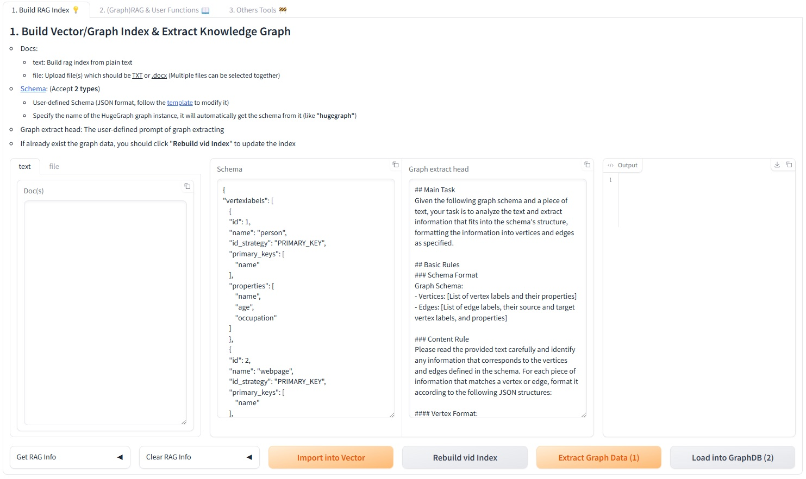

HugeGraph-LLM 用于知识图谱构建、GraphRAG 和自然语言图查询。
本文面向当前 1.8 源码构建；部署时请固定支持下述配置契约的镜像版本。

演示服务把 Gradio 页面和 FastAPI 接口挂在同一个进程上，直接从源码启动时默认只监听本机 `127.0.0.1:8001`，可用 `http://localhost:8001` 访问。若显式启动源码入口且只需本机访问，可指定 `--host 127.0.0.1`；源码 Docker 镜像的
`Dockerfile.llm` 会覆盖默认值并监听 `0.0.0.0:8001`，不要在容器内改为 loopback，否则容器外无法通过映射端口访问。

> [!WARNING]
> 生产环境必须为 HugeGraph-LLM 启用自身的登录认证（`ENABLE_LOGIN=True`，并替换 `USER_TOKEN`、`ADMIN_TOKEN`），同时在防火墙或网络入口设置来源 IP 白名单。HugeGraph Server 还必须单独开启认证与授权（见[认证与授权说明](/cn/docs/config/config-authentication/)）并保留 Server 审计日志（标准日志文件为 `audit-*.log`），为 `GRAPH_USER` 配置只具备该服务所需权限的账号。AI 服务 token 只认证 LLM 页面和 API，不能替代 HugeGraph Server 认证。

<span id="环境要求"></span>

## 环境要求 {#requirements}

> AI 总结项目文档：[Ask DeepWiki](https://deepwiki.com/apache/hugegraph-ai)

- Python >= 3.12（支持 Python 3.12–3.14）
- [`uv`](https://docs.astral.sh/uv/getting-started/installation/)
- HugeGraph Server 1.5.0 或更高版本；当前 workspace 中的 Python 客户端会拒绝可探测到的更低版本

支持以下部署与运行方式：

- [Docker Compose 部署](#deploy-with-docker-compose) — 一键拉起 Server 与 HugeGraph-LLM 容器环境。
- [Kubernetes 部署](#deploy-on-kubernetes) — 基于 Helm 将 RAG 服务部署到 K8s 集群。
- [从源码启动](#start-from-source) — 使用 `uv` 配置 Python 环境并在本地运行 Gradio/FastAPI 服务。
{.cards}

<span id="docker-compose-部署"></span>

## Docker Compose 部署 {#deploy-with-docker-compose}

当前源码工作区的 Compose 文件使用自身的 `1.8.0` 镜像，请先从检出源码本地构建；
源码版本元数据不代表相应公共镜像标签已经发布。在 HugeGraph-AI 仓库根目录准备环境文件：

```bash
git clone https://github.com/apache/hugegraph-ai.git
cd hugegraph-ai
cp docker/env.template docker/.env
# 编辑 docker/.env，将 PROJECT_PATH 改为当前仓库的绝对路径
touch hugegraph-llm/.env
# 编辑 hugegraph-llm/.env：GRAPH_URL=http://server:8080，并设置与 Server 相符的 GRAPH_USER、GRAPH_PWD
./scripts/build_llm_image.sh
cd docker
docker compose -f docker-compose-network.yml up -d
docker compose -f docker-compose-network.yml ps
```

启动后可访问：

- HugeGraph Server：`http://localhost:8080`
- RAG 服务和 Web 页面：`http://localhost:8001`

Compose 文件会把 `${PROJECT_PATH}/hugegraph-llm/.env` 挂载到容器内的 `/home/work/hugegraph-llm/.env`，因此该文件必须在容器启动前存在。资源目录 `hugegraph-llm/src/hugegraph_llm/resources` 也可以用同样方式挂载，该挂载默认被注释掉。

默认 Compose 只挂载引导配置 `.env`，容器重建后保留应用保存的连接还需要可写持久化存储。
持久部署可使用下文 Helm 方案；自行挂载资源目录时，设置 `HUGEGRAPH_LLM_RESOURCE_PATH`，并明确保留
`HUGEGRAPH_LLM_ENV_PATH=/home/work/hugegraph-llm/.env` 作为引导配置。详见[配置路径](./config-reference.md#configuration-files)。

应用读取 `GRAPH_URL`，Compose 注入的 `HUGEGRAPH_HOST` 和 `HUGEGRAPH_PORT` 不会覆盖它；因此容器内要将 `GRAPH_URL` 设为 `http://server:8080`，并在 `.env` 中配置匹配 HugeGraph Server 的用户名和密码。

<span id="容器镜像"></span>

## 容器镜像 {#container-images}

| 构建文件 | 内容 |
|---|---|
| `docker/Dockerfile.llm` | 源码运行镜像构建配方，入口是 `python -m hugegraph_llm.demo.rag_demo.app --host 0.0.0.0 --port 8001` |
| `docker/Dockerfile.nk` | 基于 `nk-llm` extra 用 Nuitka 编译的二进制镜像构建配方，入口是 `./app.dist/app.bin` |

Compose 使用 `hugegraph/rag:1.8.0`。本地构建脚本从仓库根目录的 `pyproject.toml` 读取镜像仓库与版本：

```bash
./scripts/build_llm_image.sh
```

该命令仅在本地构建 `hugegraph/rag:1.8.0`，不会推送镜像。远端部署前应加载到集群节点或推送到自己的镜像仓库；
本地构建不会替换正在运行的容器。两个 Dockerfile 均暴露 `8001` 端口、以非 root 用户 `work` 运行，并声明资源目录数据卷。
请持久化可写资源目录，以保留应用保存的连接、提示词和索引。

<span id="kubernetes-部署"></span>

## Kubernetes 部署 {#deploy-on-kubernetes}

使用 [HugeGraph 统一 Helm 部署](/cn/docs/quickstart/hugegraph/hugegraph-helm/#8-graphrag)。
在 Server 仓库的 `helm/hugegraph` Chart 中，将 `values-rag.yaml` 叠加在单节点或集群预设之后。
Chart 会为 `hugegraph/rag` 接好同一 release 的 Server 地址与凭据，无需单独部署 AI Chart。

RAG 默认通过 `ClusterIP:8001` 在集群内部访问，单副本采用 `Recreate` 策略，并使用 10 Gi 持久卷；
升级时保留已保存的连接、提示词和索引。首次验证可使用本地端口转发，再从页面配置模型。
严格 NetworkPolicy 下，模型及向量库出口需通过 `rag.networkPolicy.extraEgress` 放行，授权入口通过 `extraIngress` 配置；
策略是否生效取决于 CNI 支持。安装、存储和访问示例统一维护在 Helm 指南中。

已保存连接和部署默认值的关系见[配置参考](./config-reference.md#saved-connections)。

<span id="从源码启动"></span>

## 从源码启动 {#start-from-source}

1. **克隆源代码仓库：**

   ```bash
   git clone https://github.com/apache/hugegraph-ai.git
   cd hugegraph-ai
   ```

1. **安装依赖并激活虚拟环境：**

   ```bash
   uv sync --extra llm
   source .venv/bin/activate
   ```

1. **启动 Web 应用服务：**

   ```bash
   cd hugegraph-llm
   python -m hugegraph_llm.demo.rag_demo.app
   ```
{.steps}

自定义监听地址和端口：

```bash
python -m hugegraph_llm.demo.rag_demo.app \
  --host 127.0.0.1 \
  --port 18001
```

设置 `HG_DEV_RELOAD=1` 可让 uvicorn 以自动重载方式启动，便于开发调试。

在进程环境或 `.env` 中设置登录等部署默认值。页面和配置 API 将应用连接保存到 `settings.yaml`，重启后保留，并优先于部署默认值。

启动时缺少配置会使用代码默认值，不会自动写入文件。使用 `HUGEGRAPH_LLM_RESOURCE_PATH` 指定可写持久化目录，存放设置、提示词和生成的索引。
挂载只读 Secret 或修改部署默认值前，请先了解[配置路径和优先级](./config-reference.md)。

<span id="主要功能"></span>

## 主要功能 {#main-capabilities}

<span id="构建-rag-索引"></span>

### 构建 RAG 索引 {#build-rag-indexes}

Web 页面的第一个标签页可以处理文本或文件，并执行以下操作：

1. 切分文本并写入 chunk 向量索引。
2. 按给定 Schema 从文本抽取顶点和边。
3. 将抽取结果写入 HugeGraph，并更新顶点向量索引。

文本可以在 `text` 子页直接输入，也可以在 `file` 子页上传。上传支持 `.txt`、`.docx` 和 `.pdf`，并可一次选择多个文件。加密 PDF 以及没有可提取文本层的扫描件 PDF 会被拒绝。

Schema 可以是内联 JSON，也可以是现有图名。通过 REST API 使用图名时，必须同时传入匹配的 `client_config.graph`；内联 JSON 不会连接 HugeGraph，也不能附带 `client_config`。

该标签页还提供两个生成器。`Graph Schema Generator` 根据查询示例和少样本示例生成 Schema。`Graph Extraction Prompt Generator` 根据描述的场景和选定的参考示例生成抽取提示词。`Graph Extraction Split Type` 下拉框可在抽取前选择 `document`、`paragraph` 或 `sentence` 粒度。

### GraphRAG {#graphrag}

查询流程可以组合直接回答、chunk 向量召回和图召回。图召回先抽取关键词并匹配顶点，再尝试 Text2Gremlin；生成或执行失败时可回退到预定义的图遍历方式。请求参数可控制返回数量、向量距离阈值、模板数量和重排序方式。

同一标签页还有批量回归测试面板，可从 `.xlsx` 或 `.csv` 文件读取问题、逐条作答，并返回可下载的结果文件。上传控件旁提供模板文件下载。



### Text2Gremlin {#text2gremlin}

`POST /text2gremlin` 根据自然语言、图 Schema 和可选示例生成 Gremlin。自定义提示词必须保留 `{query}`、`{schema}`、`{example}` 和 `{vertices}` 四个占位符。

对应的页面标签可以先用问题与 Gremlin 对照文件（`.json` 或 `.csv`）构建示例向量索引。未上传文件时使用内置的 `resources/demo/text2gremlin.csv`。

<span id="图工具与管理工具"></span>

### 图工具与管理工具 {#graph-and-admin-tools}

`Graph Tools` 标签页可直接执行 Gremlin 查询、手动触发图备份，以及初始化 HugeGraph 演示数据。`Admin Tools` 标签页在校验 `ADMIN_TOKEN` 后展示 `logs/llm-server.log` 的末尾内容，并可刷新或清空该文件。

进程运行期间还有两个后台任务：每天 01:00 执行图备份的定时任务，以及持续更新顶点 id 向量的任务。

<span id="模型与向量后端"></span>

## 模型与向量后端 {#models-and-vector-backends}

Chat 支持 OpenAI 兼容接口和 Ollama。抽取与 Text2Gremlin 默认跟随 Chat，独立配置后使用自己的连接；Embedding 单独配置。
应用接受 `openai`、`ollama/local` 两种 provider。其他服务可通过 OpenAI 兼容代理接入；独立 SDK 仍提供 LiteLLM 适配器。
Reranker 支持 Cohere 和 SiliconFlow。

默认向量索引使用 FAISS。`CUR_VECTOR_INDEX` 可选 `Faiss`、`Milvus` 或 `Qdrant`，Web 页面的 `5. Set up the vector engine.` 面板提供同样的选择。Milvus 和 Qdrant 需要安装可选依赖：

```bash
cd hugegraph-ai
uv sync --package hugegraph-llm --extra vectordb
```

页面操作流程见[使用流程](./quick_start.md)，完整环境变量见[配置参考](./config-reference.md)，HTTP 请求格式见[REST API](./rest-api.md)。

<span id="程序化调用"></span>

## 程序化调用 {#programmatic-use}

原有的 `RAGPipeline` 和 `KgBuilder` 类已被流水线调度器取代。通过 `SchedulerSingleton` 按名称调用流程：

```python
from hugegraph_llm.flows.scheduler import SchedulerSingleton

scheduler = SchedulerSingleton.get_instance()
res = scheduler.schedule_flow(
    "rag_graph_only",
    query="Tell me about Al Pacino.",
    graph_only_answer=True,
    vector_only_answer=False,
    raw_answer=False,
    gremlin_tmpl_num=-1,
    gremlin_prompt=None,
)
print(res.get("graph_only_answer"))
```

已注册的流程名包括 `rag_raw`、`rag_vector_only`、`rag_graph_only`、`rag_graph_vector`、`text2gremlin`、`build_examples_index`、`build_vector_index`、`graph_extract`、`import_graph_data`、`update_vid_embeddings`、`get_graph_index_info`、`build_schema` 和 `prompt_generate`。`schedule_stream_flow` 是对应的异步流式版本。

<span id="开发检查"></span>

## 开发检查 {#development-checks}

先在仓库根目录安装模块和开发工具，再运行与 CI 一致的检查：

```bash
cd hugegraph-ai
uv sync --extra llm --extra dev
uv run ruff format --check .
uv run ruff check .

cd hugegraph-llm
SKIP_EXTERNAL_SERVICES=true uv run pytest src/tests/config/ src/tests/document/ src/tests/middleware/ \
  src/tests/operators/ src/tests/models/ src/tests/indices/ src/tests/test_utils.py -v --tb=short
SKIP_EXTERNAL_SERVICES=true uv run pytest src/tests/integration/test_graph_rag_pipeline.py \
  src/tests/integration/test_kg_construction.py src/tests/integration/test_rag_pipeline.py -v --tb=short
```

Git hook 通过 pre-commit 启用：

```bash
cd hugegraph-ai
pre-commit install
pre-commit run --all-files
```
