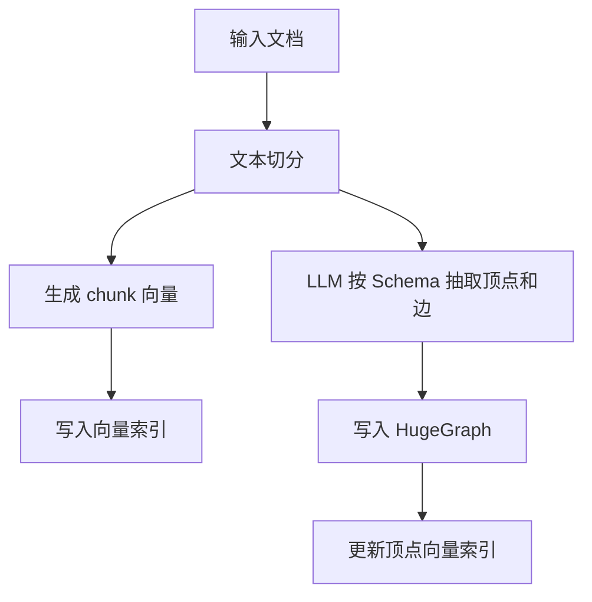
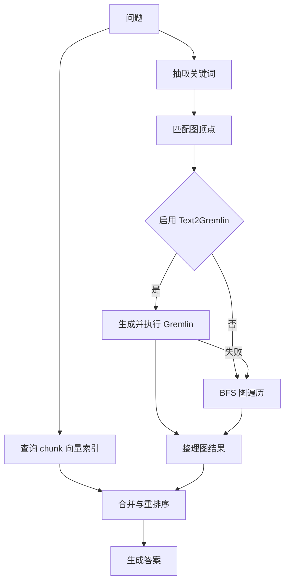

本页按 Web 页面的操作顺序，说明如何建立索引、查询文档和生成 Gremlin。服务启动方式见 [HugeGraph-LLM](./hugegraph-llm.md)。

先准备可连接的 HugeGraph Server、生成模型和 Embedding 模型。查看配置或在 `Graph Tools` 手写 Gremlin 不需要模型；
文档向量化需要 Embedding，图数据抽取和答案生成还需要 LLM。Reranker 可选，初次运行可用本地 `bleu`。

| 想做什么 | 页面入口 | 需要准备什么 |
| --- | --- | --- |
| 从文档建立索引 | `1. Build RAG Index` | 文档、Embedding；抽取图数据还需 Schema 和 LLM |
| 根据文档或图回答问题 | `2. (Graph)RAG & User Functions` | 对应索引和 LLM |
| 把问题转成 Gremlin | `3. Text2gremlin` | 图 Schema、LLM；引用示例还需 Embedding 和示例索引 |
| 直接验证图数据 | `4. Graph Tools` | HugeGraph 连接和手写 Gremlin |

本文截图基于 HugeGraph-LLM Web 界面，示例包含中英文提示词模式（通过环境变量 `LANGUAGE` 切换内置提示词语言，界面控件保持英文）。

> [!DETAILS]- 源码启动时缺少批量问题模板
>
> 若启动时报 `FileNotFoundError`，且缺少的文件为 `questions_template.xlsx`，在已安装依赖的仓库根目录创建输入模板后重启。
> 已有文件会保留。模板包含完整的 6 列，只填写测试问题和预期答案，4 个模型回答列留空。
>
> ```bash
> uv run --extra llm python - <<'PYTHON'
> from pathlib import Path
> from openpyxl import Workbook
>
> path = Path("hugegraph-llm/src/hugegraph_llm/resources/demo/questions_template.xlsx")
> if not path.exists():
>     workbook = Workbook()
>     sheet = workbook.active
>     sheet.append([
>         "Question", "Expected Answer", "Basic LLM Answer",
>         "Vector-only Answer", "Graph-only Answer", "Graph-Vector Answer",
>     ])
>     sheet.append(["Who is Sarah?", "Sarah is a 30-year-old attorney.", None, None, None, None])
>     workbook.save(path)
> PYTHON
> ```

## 0. 配置面板

标签页上方是可折叠的配置面板，共五个部分，包括 `1. Set up the HugeGraph server.`、`2. Set up the LLM.`、`3. Set up the Embedding.`、`4. Set up the Reranker.` 和 `5. Set up the vector
engine.`。每部分都有独立的应用按钮，应用后会把受支持的字段写回 `.env`。页面顶部还会显示当前提示词语言。

在 LLM 配置的 `chat`、`mini_tasks`、`text2gql` 子页分别设置回答、抽取和查询生成模型。
截图使用本地 Ollama 的 `qwen2.5:3b` 和 `mxbai-embed-large`，向量引擎为 `Faiss`。
更换 Embedding 模型后需重建索引，避免新旧向量维数或含义不同。

## 1. 构建 RAG 索引

第一个标签页负责两类索引。

- 将文档切分后写入 chunk 向量索引。
- 按 Schema 从文档抽取顶点和边，写入 HugeGraph，并维护顶点向量索引。



输入来自 `text` 子页或 `file` 子页。上传支持 `.txt`、`.docx` 和 `.pdf`，可一次选择多个文件。

首次尝试可以使用下面的短文，填入 `Input Doc(s)`。请先选择专用测试图，避免将示例写入业务图。

```text
Sarah is a 30-year-old attorney. James is a journalist. Sarah has been James's roommate since 2010.
```

将下面的 JSON 填入 `Graph Schema`，保留默认抽取提示词。它只允许抽取人物及室友关系，年龄和职业可为空。

```json
{
  "vertexlabels": [
    {"id": 1, "name": "person", "id_strategy": "PRIMARY_KEY",
     "primary_keys": ["name"], "properties": ["name", "age", "occupation"],
     "nullable_keys": ["age", "occupation"]}
  ],
  "edgelabels": [
    {"name": "roommate", "source_label": "person", "target_label": "person", "properties": ["date"]}
  ],
  "propertykeys": [
    {"name": "name", "data_type": "TEXT", "cardinality": "SINGLE"},
    {"name": "age", "data_type": "INT", "cardinality": "SINGLE"},
    {"name": "occupation", "data_type": "TEXT", "cardinality": "SINGLE"},
    {"name": "date", "data_type": "TEXT", "cardinality": "SINGLE"}
  ]
}
```

页面包含文档、Schema、抽取提示词和结果区域。按下面的顺序建立图索引。只用向量检索时，完成第 1 步即可。

1. 点击 `Import into Vector`，切分文档并建立 chunk 向量索引。
2. 在 `Graph Schema` 填入 Schema JSON 或已有图名，再点击 `Extract Graph Data (1)`。检查 `Output Info` 中的顶点、边和属性。
3. 确认抽取结果后点击 `Load into GraphDB (2)`，写入 HugeGraph 并更新顶点向量。
4. 打开 `Graph Tools`，执行 `g.V().count()` 和 `g.E().count()`，再查具体属性，确认数据已写入。
{.steps}

本例应得到 2 个顶点和 1 条边，Sarah 的年龄为 `30`，职业为 `attorney`。
图里已经有数据时，可以单独点击 `Update Vid Embedding` 更新顶点索引。

这些按钮旁的 `Graph Extraction Split Type` 下拉框可选 `document`、`paragraph` 或 `sentence`。`document` 把输入整体作为一个单元，另外两种会在抽取前先切分长文档。

页面还可以查看或清除 chunk 索引、顶点索引和图数据。清除操作会删除已有数据，执行前先确认当前图和索引是否仍被其他查询使用。

主控件下方还有两个折叠的辅助工具。

- `Graph Schema Generator` 根据查询示例和少样本示例生成 Schema，填入 Graph Schema 字段。
- `Graph Extraction Prompt Generator` 根据期望场景（例如社交关系、金融知识图谱）和选定的参考示例生成 Graph Extract Prompt Header。

## 2. GraphRAG 查询

第二个标签页提供四种回答范围，按需要选择对应索引。

| 控件 | 回答依据 |
| --- | --- |
| `Basic LLM Answer` | 直接调用 LLM，不查询文档或图 |
| `Vector-only Answer` | chunk 向量检索结果 |
| `Graph-only Answer` | 图检索结果 |
| `Graph-Vector Answer` | 图与 chunk 向量检索结果 |

推荐优先使用 `Graph-Vector Answer`，同时结合图数据检索与文档向量索引以获得更完整的事实支撑。其他范围的控件含义见上表。

截图使用下面的简短提示词。分别填入 `Query Prompt` 和 `Keywords Extraction Prompt`，其中占位符会由服务替换。
关键词输出需使用代码块中的英文前缀和冒号，姓名的大小写应与图数据一致。

```text
只根据检索到的上下文，用中文简洁回答问题，保留原文中的姓名。上下文不足时说明缺少信息。
上下文: {context_str}
问题: {query_str}
```

```text
从问题中提取人名，保留姓名原有的大小写，最多输出 {max_keywords} 个。
只返回一行，严格使用英文冒号，格式为 KEYWORDS:姓名:1.0
问题: {question}
```

1. 输入 `Who is Sarah?`，将 `Graph-only Answer` 设为 `False`，`Graph-Vector Answer` 设为 `True`。
2. 初次验证时保留 `Template Num=-1` 和 `Rerank method=bleu`，点击 `Answer Question`。
3. 查看 `Graph-Vector Answer`，将答案中的职业、年龄等事实与原文和图数据核对。
{.steps}

```gallery


```



图召回先用关键词精确匹配 HugeGraph 顶点，找不到时再用顶点向量做近似匹配。匹配结果会进入 Text2Gremlin；生成或执行失败时，流程可以回退到预定义的图遍历。

`Template Num` 控制 Text2Gremlin 在图召回中的参与方式。

- 小于 0 时，完全跳过 Text2Gremlin，图召回直接使用预定义的图遍历。
- 等于 0 时，不检索参考示例，使用基础生成结果。
- 大于 0 时，从示例索引中取相应数量的相近示例，并采用带模板的生成结果。示例数量会被限制在 0 到 10 之间。

该标签页的其他控件还有 `Rerank method`（`bleu` 或 `reranker`）、`Graph Ratio`、`Near neighbor first` 和 `Query related information`，以及可编辑的 `Query Prompt` 和 `Keywords Extraction Prompt`。

单条问答面板下方是批量回归测试面板。上传 `.xlsx` 或 `.csv` 问题文件，设置 `Max Lines To Show`，点击 `Generate Answer (Batch)`。答案会显示在预览表格中，并可下载为文件。上传控件旁提供模板文件下载。

## 3. Text2Gremlin

第三个标签页将自然语言转换为 Gremlin，并执行生成的查询。上半部分用 `.json` 或 `.csv` 的问题与 Gremlin 对建立示例向量索引；
未上传文件时使用内置的 `resources/demo/text2gremlin.csv`。示例中的标签和属性应与当前图一致。

> [!TIP]
> 若上传 CSV 构建示例向量索引后未自动召回示例模板，可直接在下面的 Prompt 模板中手动提供 Few-shot 参考示例。

复现 Sarah 查询时，使用以下输入。

1. 将下面的 CSV 保存为 `sarah-gremlin.csv`，上传后点击 `Build Example Vector Index`，并把 `Number of refer examples` 设为 `1`。
2. 在 `Schema` 填入下方的简化 Schema，只保留查询所需的类型与属性。
3. 在 `Prompt` 填入下方的提示词，输入问题 `Who is Sarah?`，再点击 `Text2Gremlin`。
4. 检查生成语句及两组 `Query ... Output`。本例返回 Sarah 的 `age=30` 和 `occupation=attorney`。
{.steps}

```csv
query,gremlin
Who is Sarah?,"g.V().has('person', 'name', 'Sarah').valueMap()"
```

```json
{"vertexlabels":[{"name":"person","properties":["name","age","occupation"]}],"edgelabels":[]}
```

```text
把问题转换为 HugeGraph 的只读 Gremlin 查询。
按人物姓名查询时，使用 g.V().has('person', 'name', '<问题中的姓名>').valueMap()。
保留姓名的大小写，按姓名查询，不使用顶点 ID。
问题示例: Who is Peter?
Gremlin 示例: g.V().has('person', 'name', 'Peter').valueMap()
图 Schema: {schema}
其他示例: {example}
已知顶点: {vertices}
问题: {query}
只返回一个 ```gremlin``` 代码块。
```

```gallery

```

小模型可能生成错误 ID、大小写不符的姓名或不满足索引条件的过滤语句。应查看执行结果中的具体数据，再判断查询是否成功。
Web 页面会直接执行生成的语句，请使用专用测试图。需要只生成语句时，在 [REST API](./rest-api.md) 中选择相应输出类型。

自定义提示词必须保留 `{query}`、`{schema}`、`{example}` 和 `{vertices}`。缺少任一占位符时，REST API 会拒绝请求。

## 4. 图工具与管理工具

`Graph Tools` 标签页可直接对当前图执行 Gremlin 查询、手动触发图备份，并通过 beta 操作初始化 HugeGraph 演示数据。后台还有两个任务，每天凌晨 1 点自动备份图数据，以及在进程运行期间持续更新顶点 id 向量。
初始化演示数据会先清空当前图，只能在专用测试图上使用。

`Admin Tools` 需要密码。输入已配置的 `ADMIN_TOKEN` 后可查看 `logs/llm-server.log` 的末尾内容（每 60 秒自动刷新），并可手动刷新或清空该文件。`ADMIN_TOKEN` 为空或仍是占位值 `xxxx` 时，访问会被拒绝。

设置 `ENABLE_LOGIN=True` 后，Web 页面会要求基础认证，用户名固定为 `rag`，密码是 `USER_TOKEN`；REST API 则要求把 `USER_TOKEN` 作为 Bearer token。日志接口还要求单独配置安全的 `ADMIN_TOKEN`。

> [!WARNING]
> 生产环境必须启用 HugeGraph-LLM 自身的登录认证，并替换 `USER_TOKEN` 和 `ADMIN_TOKEN`，同时在防火墙或网络入口设置来源 IP 白名单。HugeGraph Server 还必须单独开启认证与授权（见[认证与授权说明](/cn/docs/config/config-authentication/)）并保留 Server 审计日志（标准日志文件为 `audit-*.log`），为 `GRAPH_USER` 配置最小必要权限。AI 服务 token 不会替代 HugeGraph Server 认证。

```gallery

```

## 5. 提示词语言

在 `hugegraph-llm/.env` 中选择一种提示词语言。

```properties
# 英文提示词
LANGUAGE=EN

# 中文提示词
LANGUAGE=CN
```

修改后重启服务。该配置选择内置提示词语言，不会自动翻译输入文档，也不属于 `/rag` 请求体字段。

## 6. REST 调用

Web 页面和 REST API 使用同一套流程。需要程序集成时使用 `/rag`、`/rag/graph`、`/graph/extract` 和 `/text2gremlin`；请求结构见 [REST API](./rest-api.md)。
