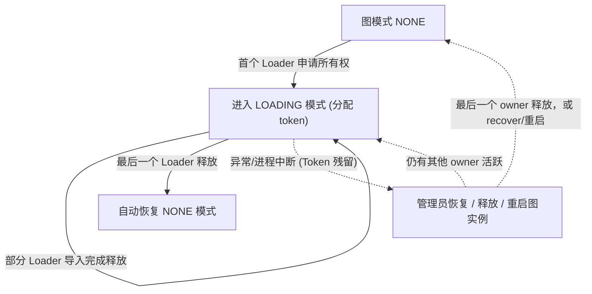

本文以 Toolchain `master` 分支（以 1.8 为基线，尚未正式发布）为准。发布版和 Docker `latest` 可能存在部分差异，使用未发布功能前请先核对版本。

### 快速上手：本地文件导入 {#quick-local-file-import}

下面通过一个最简示例体验 Loader 的基本导入流程：导入两个人和一条关系，并在 Hubble 中查询验证。
请先[安装 Loader](#2-获取-hugegraph-loader) 并启动 [HugeGraph Server](/cn/docs/quickstart/hugegraph/hugegraph-server/)。
以下命令均在 Loader 安装目录下执行，连接本地默认图 `hugegraph`。若 Server 已启用鉴权，在命令中追加 `--username` 与 `--password`（或 `--token`）。

1. **创建数据文件**

   两份 CSV 均不含表头，列名由下一步的映射文件指定。

   ```bash
   mkdir -p demo-loader
   cat > demo-loader/people.csv <<'EOF'
   docs-smoke-alice,29
   docs-smoke-bob,31
   EOF
   cat > demo-loader/knows.csv <<'EOF'
   docs-smoke-alice,docs-smoke-bob
   EOF
   ```

1. **创建 Schema 和映射文件**

   本例使用独立的 `docs_*` 名称，避免与内置的 `person` 数据冲突。
   映射文件中的路径相对于运行 Loader 时的工作目录。

   ```bash
   cat > demo-loader/schema.groovy <<'EOF'
   schema.propertyKey("docs_name").asText().ifNotExist().create()
   schema.propertyKey("docs_age").asInt().ifNotExist().create()
   schema.vertexLabel("docs_smoke_person").properties("docs_name", "docs_age")
         .primaryKeys("docs_name").ifNotExist().create()
   schema.edgeLabel("docs_smoke_knows").sourceLabel("docs_smoke_person")
         .targetLabel("docs_smoke_person").ifNotExist().create()
   EOF
   cat > demo-loader/struct.json <<'EOF'
   {
     "version": "2.0",
     "structs": [
       {
         "id": "people",
         "input": {
           "type": "FILE",
           "path": "demo-loader/people.csv",
           "format": "CSV",
           "header": ["docs_name", "docs_age"]
         },
         "vertices": [{"label": "docs_smoke_person"}]
       },
       {
         "id": "knows",
         "input": {
           "type": "FILE",
           "path": "demo-loader/knows.csv",
           "format": "CSV",
           "header": ["source_name", "target_name"]
         },
         "edges": [{
           "label": "docs_smoke_knows",
           "source": ["source_name"],
           "target": ["target_name"],
           "field_mapping": {"source_name": "docs_name", "target_name": "docs_name"}
         }]
       }
     ]
   }
   EOF
   ```

1. **执行导入**

   保持在同一工作目录。Server 运行在其他地址时，修改主机和端口。

   ```bash
   bin/hugegraph-loader.sh \
     --graphspace DEFAULT --graph hugegraph \
     --file demo-loader/struct.json --schema demo-loader/schema.groovy \
     --host 127.0.0.1 --port 8080
   ```

   首次成功导入后，统计应显示两个顶点、一条边。检查汇总中的成功数和失败数。

1. **在 Hubble 中查询结果**

   将 Hubble 连接到同一个 Server 和图，在 Gremlin 工作台分别执行以下查询。

   ```groovy
   g.V().hasLabel('docs_smoke_person').valueMap('docs_name', 'docs_age')
   g.V().has('docs_smoke_person', 'docs_name', 'docs-smoke-alice')
    .out('docs_smoke_knows').values('docs_name')
   ```

   第一条查询返回 Alice 的年龄 `29`、Bob 的年龄 `31`，第二条返回 `docs-smoke-bob`。
{.steps}

导入其他数据源时，继续阅读[映射文件参考](#33-编写数据源映射文件)。
[内置完整示例](#4-完整示例)还包含软件顶点和边属性。

### 1 HugeGraph-Loader 概述

HugeGraph-Loader 是 HugeGraph 的数据导入组件，能够将多种数据源的数据转化为图的顶点和边并批量导入到图数据库中。

目前支持的数据源包括：

- 本地磁盘文件或目录，支持 TEXT、CSV 和 JSON 格式的文件，支持压缩文件
- HDFS 文件或目录，支持压缩文件
- 主流关系型数据库，如 MySQL、PostgreSQL、Oracle、SQL Server
- Kafka topic
- 已有的 HugeGraph 图，用于把数据从一个图复制到另一个图

本地磁盘文件和 HDFS 文件支持断点续传。

> **注意**：使用 HugeGraph-Loader 需要依赖 HugeGraph Server 服务，下载和启动 Server 请参考 [HugeGraph-Server 快速上手](/cn/docs/quickstart/hugegraph/hugegraph-server)
> 
> **测试指南**：如需在本地运行 Loader 测试，请参考 [工具链本地测试指南](/cn/docs/guides/toolchain-local-test)

> **并发导入保护**：Toolchain master 分支的 Loader 已支持针对同一 Server 实例的 LOADING owner 保护。当配套 Server 的 `GET .../mode/owners` 返回 `protocol: 1` 时会自动生效；若 Server 无此接口，则保持原有导入行为。

### 2 获取 HugeGraph-Loader

可以通过以下三种方式获取 HugeGraph-Loader：

- 使用 Docker 镜像 (便于**测试**)
- 下载已编译的压缩包
- 克隆源码编译安装


#### 2.1 使用 Docker 镜像 (便于**测试**)

我们可以使用 `docker run -itd --name loader hugegraph/loader:latest` 部署 loader 服务。对于需要加载的数据，则可以通过挂载 `-v /path/to/data/file:/loader/file` 或者 `docker cp` 的方式将文件复制到 loader 容器内部。

或者使用 docker-compose 启动 loader, 启动命令为 `docker-compose up -d`, 样例的 docker-compose.yml 如下所示：

以下组合用于本地匿名试用，Server API 只发布到本机。

```yaml
version: '3'

services:
  server:
    image: hugegraph/hugegraph:latest
    container_name: server
    ports:
      - 127.0.0.1:8080:8080

  loader:
    image: hugegraph/loader:latest
    container_name: loader
    # mount your own data here
    # volumes:
      # - /path/to/data/file:/loader/file
```

具体的数据导入流程可以参考 [4.5 使用 docker 导入](#45-使用-docker-导入) 


> 注意：
> 
> 1. hugegraph-loader 的 docker 镜像是一个便捷版本，用于快速启动 loader，并不是**官方发布物料包方式**。你可以从 [ASF Release Distribution Policy](https://infra.apache.org/release-distribution.html#dockerhub) 中得到更多细节。
> 
> 2. 生产环境应固定已发布的版本标签或镜像 digest。`latest` 是可变标签，不能据此判断其与 `master` 一致。

#### 2.2 下载已编译的压缩包

从 [下载页面](/cn/docs/download/download) 选择已发布的 Toolchain 压缩包并解压。
发布包不一定包含 `master` 的全部功能；需要本文对应实现时，使用下一节的源码构建方式。

#### 2.3 克隆源码编译安装

从 master 分支编译 Loader 需要 Java 17、Maven 3.6.3+ 与 Python 3.9+。直接克隆仓库并编译：

```bash
git clone --branch master --single-branch https://github.com/apache/hugegraph-toolchain.git
cd hugegraph-toolchain
mvn package -pl hugegraph-client,hugegraph-loader -am -DskipTests -ntp
cd hugegraph-loader/apache-hugegraph-loader-*
```

如需搭配开发阶段的 Server master SDK 编译，可参阅 [Java 17 迁移指引](https://github.com/apache/hugegraph-toolchain/blob/master/docs/java17-migration.md)。

如需读取 Oracle 数据，按所用 Oracle/JDK 版本准备兼容的 JDBC 驱动 JAR，并放入解压后 Loader 的 `lib/` 目录。
启动脚本会加载该目录中的 JAR；仅将驱动安装到 Maven 本地仓库并不会让运行中的 Loader 找到它。

### 3 使用流程

导入数据前先准备图模型、数据文件和映射文件，再运行 Loader。

- 编写图模型
- 准备数据文件
- 编写输入源映射文件
- 执行命令导入

#### 3.1 编写图模型

先确定数据对应的顶点类型、边类型和属性，再编写 Schema。

以下示例包含 `person` 和 `software` 两类顶点，以及 `knows` 和 `created` 两类边。
人有姓名、年龄和城市，软件有名称和价格，两类边都记录日期。

<div style="text-align: center;">
  
  <p>示例图模型</p>
</div>


将 Schema 定义保存到 `schema.groovy`。

```groovy
// 创建一些属性
schema.propertyKey("name").asText().ifNotExist().create();
schema.propertyKey("age").asInt().ifNotExist().create();
schema.propertyKey("city").asText().ifNotExist().create();
schema.propertyKey("date").asText().ifNotExist().create();
schema.propertyKey("price").asDouble().ifNotExist().create();

// 创建 person 顶点类型，其拥有三个属性：name, age, city，主键是 name
schema.vertexLabel("person").properties("name", "age", "city").primaryKeys("name").ifNotExist().create();
// 创建 software 顶点类型，其拥有两个属性：name, price，主键是 name
schema.vertexLabel("software").properties("name", "price").primaryKeys("name").ifNotExist().create();

// 创建 knows 边类型，这类边是从 person 指向 person 的
schema.edgeLabel("knows").sourceLabel("person").targetLabel("person").properties("date").ifNotExist().create();
// 创建 created 边类型，这类边是从 person 指向 software 的
schema.edgeLabel("created").sourceLabel("person").targetLabel("software").ifNotExist().create();
```

> 关于 schema 的详细说明请参考 [HugeGraph Java Client](/cn/docs/clients/hugegraph-client/) 中对应部分。

#### 3.2 准备数据

目前 HugeGraph-Loader 支持的数据源包括：

- 本地磁盘文件或目录
- HDFS 文件或目录
- 部分关系型数据库
- Kafka topic
- 已有的 HugeGraph 图

##### 3.2.1 数据源结构

###### 3.2.1.1 本地磁盘文件或目录

用户可以指定本地磁盘文件作为数据源，如果数据分散在多个文件中，也支持以某个目录作为数据源，但暂时不支持以多个目录作为数据源。

比如：我的数据分散在多个文件中，part-0、part-1 ... part-n，要想执行导入，必须保证它们是放在一个目录下的。然后在 loader 的映射文件中，将`path`指定为该目录即可。

支持的文件格式包括：

- TEXT
- CSV
- JSON

TEXT 是自定义分隔符的文本文件，第一行通常是标题，记录了每一列的名称，也允许没有标题行（在映射文件中指定）。其余的每行代表一条记录，会被转化为一个顶点/边；行的每一列对应一个字段，会被转化为顶点/边的 id、label 或属性；

示例如下：

```text
id|name|lang|price|ISBN
1|lop|java|328|ISBN978-7-107-18618-5
2|ripple|java|199|ISBN978-7-100-13678-5
```

CSV 是分隔符为逗号`,`的 TEXT 文件，当列值本身包含逗号时，该列值需要用双引号包起来，如：

```text
marko,29,Beijing
"li,nary",26,"Wu,han"
```

JSON 文件要求每一行都是一个 JSON 串，且每行的格式需保持一致。

```json
{"source_name": "marko", "target_name": "vadas", "date": "20160110", "weight": 0.5}
{"source_name": "marko", "target_name": "josh", "date": "20130220", "weight": 1.0}
```

###### 3.2.1.2 HDFS 文件或目录

用户也可以指定 HDFS 文件或目录作为数据源，上面关于`本地磁盘文件或目录`的要求全部适用于这里。除此之外，鉴于 HDFS 上通常存储的都是压缩文件，loader 也提供了对压缩文件的支持，并且`本地磁盘文件或目录`同样支持压缩文件。

目前支持的压缩文件类型包括：GZIP、BZ2、XZ、LZMA、SNAPPY_RAW、SNAPPY_FRAMED、Z、DEFLATE、LZ4_BLOCK、LZ4_FRAMED、ORC 和 PARQUET。

###### 3.2.1.3 主流关系型数据库

loader 还支持以部分关系型数据库作为数据源，目前支持 MySQL、PostgreSQL、Oracle 和 SQL Server。

Loader 解析一行数据时，不会根据外键再查询其他表。输入行必须直接提供构造图元素所需的值。
需要关联数据时，先在数据源侧准备好查询结果。

以下以 `person`、`software`、`created` 三张表为例。

```text
// person 表结构
id | name | age | city 
```

```text
// software 表结构
id | name | lang | price
```

```text
// created 表结构
id | p_id | s_id | date
```

若 `person` 和 `software` 使用 `PRIMARY_KEY` 策略，以 `name` 为主键，导入边时就需要两个端点的 `name`。
`created` 表只有 `p_id` 和 `s_id`，Loader 不会用它们回查名称。可以改用以下两种 ID 设计。

1. 保留 `PRIMARY_KEY` 策略，将两张顶点表的 `id` 列作为主键属性。Loader 可用 `p_id`、`s_id` 和顶点标签生成端点 ID。
2. 使用自定义 ID 策略，将两张顶点表的 `id` 列直接作为顶点 ID，导入边时直接使用 `p_id` 和 `s_id`。

这两种设计都让边数据直接提供端点 ID，省去回查。

##### 3.2.2 准备顶点和边数据

###### 3.2.2.1 顶点数据

顶点数据文件由一行一行的数据组成，一般每一行作为一个顶点，每一列会作为顶点属性。下面以 CSV 格式作为示例进行说明。

- person 顶点数据（数据本身不包含 header）

```csv
Tom,48,Beijing
Jerry,36,Shanghai
```

- software 顶点数据（数据本身包含 header）

```csv
name,price
Photoshop,999
Office,388
```

###### 3.2.2.2 边数据

边数据文件由一行一行的数据组成，一般每一行作为一条边，其中有部分列会作为源顶点和目标顶点的 id，其他列作为边属性。下面以 JSON 格式作为示例进行说明。

- knows 边数据

```json
{"source_name": "Tom", "target_name": "Jerry", "date": "2008-12-12"}
```

- created 边数据

```json
{"source_name": "Tom", "target_name": "Photoshop"}
{"source_name": "Tom", "target_name": "Office"}
{"source_name": "Jerry", "target_name": "Office"}
```

#### 3.3 编写数据源映射文件

##### 3.3.1 映射文件概述

映射文件使用 JSON 格式。每个 `structs` 映射块包含一个 `input`，以及该输入对应的 `vertices` 和 `edges` 映射。

`input` 描述数据位置、格式和分隔符。顶点和边映射指定标签、ID、属性及字段转换。

> Loader 0.11.0 起使用 2.0 映射格式，此前的格式称为 1.0。下文未特别说明时，均使用 2.0 格式。


> [!DETAILS]- 点击展开/折叠 2.0 版本的映射文件的框架
> ```json
> {
>   "version": "2.0",
>   "structs": [
>     {
>       "id": "1",
>       "input": {
>       },
>       "vertices": [
>         {},
>         {}
>       ],
>       "edges": [
>         {},
>         {}
>       ]
>     }
>   ]
> }
> ```
<br/>

这里直接给出两个版本的映射文件（描述了上面图模型和数据文件）

> [!DETAILS]- 点击展开/折叠 2.0 版本的映射文件
> ```json
> {
>   "version": "2.0",
>   "structs": [
>     {
>       "id": "1",
>       "skip": false,
>       "input": {
>         "type": "FILE",
>         "path": "vertex_person.csv",
>         "file_filter": {
>           "extensions": [
>             "*"
>           ]
>         },
>         "format": "CSV",
>         "delimiter": ",",
>         "date_format": "yyyy-MM-dd HH:mm:ss",
>         "time_zone": "GMT+8",
>         "skipped_line": {
>           "regex": "(^#|^//).*|"
>         },
>         "compression": "NONE",
>         "header": [
>           "name",
>           "age",
>           "city"
>         ],
>         "charset": "UTF-8",
>         "list_format": {
>           "start_symbol": "[",
>           "elem_delimiter": "|",
>           "end_symbol": "]"
>         }
>       },
>       "vertices": [
>         {
>           "label": "person",
>           "skip": false,
>           "id": null,
>           "unfold": false,
>           "field_mapping": {},
>           "value_mapping": {},
>           "selected": [],
>           "ignored": [],
>           "null_values": [
>             ""
>           ],
>           "update_strategies": {}
>         }
>       ],
>       "edges": []
>     },
>     {
>       "id": "2",
>       "skip": false,
>       "input": {
>         "type": "FILE",
>         "path": "vertex_software.csv",
>         "file_filter": {
>           "extensions": [
>             "*"
>           ]
>         },
>         "format": "CSV",
>         "delimiter": ",",
>         "date_format": "yyyy-MM-dd HH:mm:ss",
>         "time_zone": "GMT+8",
>         "skipped_line": {
>           "regex": "(^#|^//).*|"
>         },
>         "compression": "NONE",
>         "header": null,
>         "charset": "UTF-8",
>         "list_format": {
>           "start_symbol": "",
>           "elem_delimiter": ",",
>           "end_symbol": ""
>         }
>       },
>       "vertices": [
>         {
>           "label": "software",
>           "skip": false,
>           "id": null,
>           "unfold": false,
>           "field_mapping": {},
>           "value_mapping": {},
>           "selected": [],
>           "ignored": [],
>           "null_values": [
>             ""
>           ],
>           "update_strategies": {}
>         }
>       ],
>       "edges": []
>     },
>     {
>       "id": "3",
>       "skip": false,
>       "input": {
>         "type": "FILE",
>         "path": "edge_knows.json",
>         "file_filter": {
>           "extensions": [
>             "*"
>           ]
>         },
>         "format": "JSON",
>         "delimiter": null,
>         "date_format": "yyyy-MM-dd HH:mm:ss",
>         "time_zone": "GMT+8",
>         "skipped_line": {
>           "regex": "(^#|^//).*|"
>         },
>         "compression": "NONE",
>         "header": null,
>         "charset": "UTF-8",
>         "list_format": null
>       },
>       "vertices": [],
>       "edges": [
>         {
>           "label": "knows",
>           "skip": false,
>           "source": [
>             "source_name"
>           ],
>           "unfold_source": false,
>           "target": [
>             "target_name"
>           ],
>           "unfold_target": false,
>           "field_mapping": {
>             "source_name": "name",
>             "target_name": "name"
>           },
>           "value_mapping": {},
>           "selected": [],
>           "ignored": [],
>           "null_values": [
>             ""
>           ],
>           "update_strategies": {}
>         }
>       ]
>     },
>     {
>       "id": "4",
>       "skip": false,
>       "input": {
>         "type": "FILE",
>         "path": "edge_created.json",
>         "file_filter": {
>           "extensions": [
>             "*"
>           ]
>         },
>         "format": "JSON",
>         "delimiter": null,
>         "date_format": "yyyy-MM-dd HH:mm:ss",
>         "time_zone": "GMT+8",
>         "skipped_line": {
>           "regex": "(^#|^//).*|"
>         },
>         "compression": "NONE",
>         "header": null,
>         "charset": "UTF-8",
>         "list_format": null
>       },
>       "vertices": [],
>       "edges": [
>         {
>           "label": "created",
>           "skip": false,
>           "source": [
>             "source_name"
>           ],
>           "unfold_source": false,
>           "target": [
>             "target_name"
>           ],
>           "unfold_target": false,
>           "field_mapping": {
>             "source_name": "name",
>             "target_name": "name"
>           },
>           "value_mapping": {},
>           "selected": [],
>           "ignored": [],
>           "null_values": [
>             ""
>           ],
>           "update_strategies": {}
>         }
>       ]
>     }
>   ]
> }
> ```
<br/>

> [!DETAILS]- 点击展开/折叠 1.0 版本的映射文件
> ```json
> {
>   "vertices": [
>     {
>       "label": "person",
>       "input": {
>         "type": "file",
>         "path": "vertex_person.csv",
>         "format": "CSV",
>         "header": ["name", "age", "city"],
>         "charset": "UTF-8"
>       }
>     },
>     {
>       "label": "software",
>       "input": {
>         "type": "file",
>         "path": "vertex_software.csv",
>         "format": "CSV"
>       }
>     }
>   ],
>   "edges": [
>     {
>       "label": "knows",
>       "source": ["source_name"],
>       "target": ["target_name"],
>       "input": {
>         "type": "file",
>         "path": "edge_knows.json",
>         "format": "JSON"
>       },
>       "field_mapping": {
>         "source_name": "name",
>         "target_name": "name"
>       }
>     },
>     {
>       "label": "created",
>       "source": ["source_name"],
>       "target": ["target_name"],
>       "input": {
>         "type": "file",
>         "path": "edge_created.json",
>         "format": "JSON"
>       },
>       "field_mapping": {
>         "source_name": "name",
>         "target_name": "name"
>       }
>     }
>   ]
> }
> ```
<br/> 

映射文件 1.0 版本是以顶点和边为中心，设置输入源；而 2.0 版本是以输入源为中心，设置顶点和边映射。有些输入源（比如一个文件）既能生成顶点，也能生成边，如果用 1.0 版的格式写，就需要在 vertex 和 edge 映射块中各写一次 input 块，这两次的 input 块是完全一样的；而 2.0 版本只需要写一次 input。所以 2.0 版相比于 1.0 版，能省掉一些 input 的重复书写。

在 hugegraph-loader-{version} 的 bin 目录下，有一个脚本工具 `mapping-convert.sh` 能直接将 1.0 版本的映射文件转换为 2.0 版本的，使用方式如下：

```bash
bin/mapping-convert.sh struct.json
```

会在 struct.json 的同级目录下生成一个 struct-v2.json。

bin 目录下还提供了 `utf8-bom-to-utf8.sh`，用于去掉单个数据文件、或目录下所有文件开头的 UTF-8 BOM。当 Windows 工具导出的 CSV 或 TEXT 文件因为首列表头带有不可见的 BOM 而解析失败时，可以用它处理：

```bash
bin/utf8-bom-to-utf8.sh /path/to/file-or-dir
```

##### 3.3.2 输入源

输入源目前分为五类：FILE、HDFS、JDBC、KAFKA 和 GRAPH，由`type`节点区分，我们称为本地文件输入源、HDFS 输入源、JDBC 输入源和 KAFKA 输入源，图数据源，下面分别介绍。

###### 3.3.2.1 本地文件输入源

- id: 输入源的 id，该字段用于支持一些内部功能，非必填（未填时会自动生成），强烈建议写上，对于调试大有裨益；
- skip: 是否跳过该输入源，由于 JSON 文件无法添加注释，如果某次导入时不想导入某个输入源，但又不想删除该输入源的配置，则可以设置为 true 将其跳过，默认为 false，非必填；
- input: 输入源映射块，复合结构
    - type: 输入源类型，必须填 file 或 FILE； 
    - path: 本地文件或目录的路径，绝对路径或相对于 Loader 进程当前工作目录的相对路径，必填；为避免工作目录不同导致找不到文件，建议使用绝对路径；
    - file_filter: 从`path`中筛选复合条件的文件，复合结构，目前只支持配置扩展名，用子节点`extensions`表示，默认为"*"，表示保留所有文件；
    - format: 本地文件的格式，可选值为 CSV、TEXT 及 JSON，必须大写，默认为 CSV，选填；               
    - header: 文件各列的列名，如不指定则以数据文件第一行作为 header；显式指定时，首行若与 header 完全相同，默认仍会跳过，详见 has_header；JSON 文件不需要指定 header，选填；
    - has_header: 对 CSV 和 TEXT 格式，如果某个文件的首行与 header 完全相同，该行会被丢弃，这样目录下每个分片文件重复的表头不会被当作数据导入。如果分片文件的首行是恰好与 header 相同的真实数据，可以设为 `false` 关闭这个检查，选填；
    - delimiter: 文件行的列分隔符。默认值取决于`format`：CSV 为逗号`","`，TEXT 为制表符`"\t"`；CSV 只接受逗号。`JSON`文件不需要指定，选填；     
    - charset: 文件的编码字符集，默认`UTF-8`，选填；    
    - date_format: 自定义的日期格式，默认值为 yyyy-MM-dd HH:mm:ss，选填；如果日期是以时间戳的形式呈现的，此项须写为`timestamp`（固定写法）；
    - extra_date_formats: 备用日期格式列表，当某个值不符合`date_format`时会逐个尝试，默认为空，选填；
    - time_zone: 设置日期数据是处于哪个时区的，默认值为`GMT+8`，选填；
    - skipped_line: 想跳过的行，复合结构，目前只能配置要跳过的行的正则表达式，用子节点`regex`描述。默认正则为`(^#|^//).*|`，即跳过以`#`或`//`开头的行以及空行；如果需要保留这类行，把`regex`改为一个不匹配任何行的表达式即可，选填；
    - compression: 文件的压缩格式，可选值为 NONE、GZIP、BZ2、XZ、LZMA、SNAPPY_RAW、SNAPPY_FRAMED、Z、DEFLATE、LZ4_BLOCK、LZ4_FRAMED、ORC 和 PARQUET，默认为 NONE，表示非压缩文件，选填；ORC 和 PARQUET 的 header 匹配不区分大小写；
    - list_format: 当文件 (非 JSON ) 的某列是集合结构时（对应图中的 PropertyKey 的 Cardinality 为 Set 或 List），可以用此项设置该列的起始符、分隔符、结束符，复合结构：
        - start_symbol: 集合结构列的起始符 (默认值是空字符串 `""`, JSON 格式目前不支持指定)
        - elem_delimiter: 集合结构列的分隔符 (默认值是 `|`, 且不能与`delimiter`相同; JSON 格式目前只支持原生`,`分隔)
        - end_symbol: 集合结构列的结束符 (默认值是空字符串 `""`, JSON 格式目前不支持指定)
        - ignored_elems: 拆分之后要丢弃的元素，默认值是 `[""]`，即忽略空元素

###### 3.3.2.2 HDFS 输入源

上述`本地文件输入源`的节点及含义这里基本都适用，下面仅列出 HDFS 输入源不一样的和特有的节点。

- type: 输入源类型，必须填 hdfs 或 HDFS，必填； 
- path: HDFS 文件或目录的路径，必须是 HDFS 的绝对路径，必填； 
- core_site_path: HDFS 集群的 core-site.xml 文件路径，重点要指明 NameNode 的地址（`fs.default.name`），以及文件系统的实现（`fs.hdfs.impl`），必填；
- hdfs_site_path: HDFS 集群的 hdfs-site.xml 文件路径，选填；
- dir_filter: 当`path`是目录时，决定递归进入哪些子目录，复合结构，选填：
    - include_regex: 只读取目录名匹配该正则的目录，默认为空，即不作限制；
    - exclude_regex: 跳过目录名匹配该正则的目录，默认为空；
- kerberos_config: 访问开启了 Kerberos 认证的 HDFS 集群时的配置，复合结构，选填：
    - enable: 是否使用 Kerberos 认证，默认为 false；
    - krb5_conf: krb5.conf 文件路径，`enable` 为 true 时必填；
    - principal: Kerberos principal，`enable` 为 true 时必填；
    - keytab: keytab 文件路径，`enable` 为 true 时必填；

###### 3.3.2.3 JDBC 输入源

前面说到过支持多种关系型数据库，但由于它们的映射结构非常相似，故统称为 JDBC 输入源，然后用`vendor`节点区分不同的数据库。

- type: 输入源类型，必须填 jdbc 或 JDBC，必填；
- vendor: 数据库类型，可选项为 [MySQL、PostgreSQL、Oracle、SQLServer]，不区分大小写，必填；
- driver: JDBC driver 类名，选填；不填时使用`vendor`对应的默认 driver，见下面各表；
- url: jdbc 要连接的数据库的 url，必填；
- database: 要连接的数据库名，必填；
- schema: 要连接的 schema 名，不同的数据库要求不一样，下面详细说明；
- table: 要连接的表名，`custom_sql` 和 `table` 参数必须填其中一个；
- custom_sql: 自定义 SQL 语句，`custom_sql` 和 `table` 参数必须填其中一个；
- username: 连接数据库的用户名，必填；
- password: 连接数据库的密码，必填；
- where: 附加到生成的 select 语句上的过滤条件，不需要写 where 关键字，选填；
- batch_size: 按页获取表数据时的一页的大小，默认为 500，选填；

**MYSQL**

| 节点     | 固定值或常见值                     |
|--------|-----------------------------| 
| vendor | MYSQL                       |
| driver | com.mysql.cj.jdbc.Driver    |
| url    | jdbc:mysql://127.0.0.1:3306 |

schema: 可空，若填写必须与 database 的值一样

**POSTGRESQL**

| 节点     | 固定值或常见值                          |
|--------|----------------------------------| 
| vendor | POSTGRESQL                       |
| driver | org.postgresql.Driver            |
| url    | jdbc:postgresql://127.0.0.1:5432 |

schema: 可空，默认值为“public”

**ORACLE**

| 节点     | 固定值或常见值                          |
|--------|----------------------------------| 
| vendor | ORACLE                           |
| driver | oracle.jdbc.driver.OracleDriver  |
| url    | jdbc:oracle:thin:@127.0.0.1:1521 |

schema: 可空，默认值为大写形式的用户名

**SQLSERVER**

| 节点     | 固定值或常见值                                      |
|--------|----------------------------------------------| 
| vendor | SQLSERVER                                    |
| driver | com.microsoft.sqlserver.jdbc.SQLServerDriver |
| url    | jdbc:sqlserver://127.0.0.1:1433              |

schema: 必填

###### 3.3.2.4 Kafka 输入源

- type：输入源类型，必须填 `kafka` 或 `KAFKA`，必填；
- bootstrap_server：kafka bootstrap server 列表，必填；
- topic：订阅的 topic，必填；
- group：Kafka 消费者组，必填；
- from_beginning：设置 Kafka 的 `auto.offset.reset`；`true` 对应 `earliest`，`false` 对应 `latest`，默认为 `false`。该策略仅在消费组没有已提交 offset，或已提交 offset 不再有效时生效；已有有效 offset 时会从该 offset 继续读取；
- format：每条消息的格式，可选值为 CSV、TEXT 及 JSON，必须大写，必填；
- header：消息各列的列名；loader 不会从 topic 中读取表头行，因此 CSV 和 TEXT 格式必须指定，JSON 消息则不需要；
- delimiter：消息的列分隔符，仅 TEXT 格式使用，CSV 固定以`,`分隔，选填；
- charset：消息的编码字符集，默认 UTF-8，选填；
- date_format：自定义的日期格式，默认值为 yyyy-MM-dd HH:mm:ss，选填；如果日期是以时间戳的形式呈现的，此项须写为 timestamp（固定写法）；
- extra_date_formats：自定义的其他日期格式列表，默认为空，选填；列表中每一项都是一个 date_format 指定日期格式的备用日期格式；
- time_zone：置日期数据是处于哪个时区的，默认值为 GMT+8，选填；
- skipped_line：当前 master 的 KafkaReader 未实现该过滤，配置此字段不会跳过 Kafka 消息；每条消息仍会直接交给所选格式的解析器，空行或注释行可能因此触发解析错误。需要过滤时请在写入 Kafka 前或消费侧预处理；
- batch_size：单次拉取的最大记录数（`max.poll.records`），默认为 500，选填；
- early_stop：某次从 Kafka broker 拉取的记录为空，停止任务，默认为 false，仅用于调试，选填；

###### 3.3.2.5 GRAPH 输入源

GRAPH 输入源从另一个 HugeGraph 图（通过 HugeGraph-PD 访问）读取顶点和边，并写入目标图。当映射文件中出现 GRAPH 输入源时，该文件中所有未被跳过的输入源都必须是 GRAPH 类型，并且导入期间 loader 会把目标图切换为 `RESTORING` 模式。

- type：输入源类型，必须填 `graph` 或 `GRAPH`，必填；
- graphspace：源图空间名称，必填；
- graph： 源图名称，必填；
- username：HugeGraph 用户名；为空时使用命令行参数 `--username`；
- password：HugeGraph 密码；为空时使用命令行参数 `--password`；
- selected_vertices：要复制的顶点 label 列表，每一项形如 `{"label": "...", "properties": [...], "query": {...}}`，其中 `properties` 限定要复制的属性，`query` 是传给源图的可选过滤条件；
- ignored_vertices：要跳过的顶点 label 列表，每一项形如 `{"label": "...", "properties": [...]}`；
- selected_edges：要复制的边 label 列表，每一项结构与 `selected_vertices` 相同；
- ignored_edges：要跳过的边 label 列表，每一项结构与 `ignored_vertices` 相同；
- pd-peers：源集群的 HugeGraph-PD 节点地址；为空时使用 `--pd-peers`；
- meta-endpoints：源集群 Meta 服务端点；为空时使用 `--meta-endpoints`；
- cluster：源集群名称；为空时使用 `--cluster`；
- batch_size：批量读取源图数据的批次大小，默认为500；

##### 3.3.3 顶点和边映射

顶点和边映射的节点（JSON 文件中的一个 key）有很多相同的部分，下面先介绍相同部分，再分别介绍`顶点映射`和`边映射`的特有节点。

**相同部分的节点**

- label: 待导入的顶点/边数据所属的`label`，必填；                                                                                   
- skip: 是否跳过该顶点/边映射，输入源和其他映射不受影响，默认为 false，选填；
- field_mapping: 将输入源列的列名映射为顶点/边的属性名，选填；
- value_mapping: 将输入源的数据值映射为顶点/边的属性值，选填；
- selected: 选择某些列插入，其他未选中的不插入，不能与`ignored`同时存在，选填；                                                                           
- ignored: 忽略某些列，使其不参与插入，不能与`selected`同时存在，选填；
- null_values: 可以指定一些字符串代表空值，比如"NULL"，如果该列对应的顶点/边属性又是一个可空属性，那在构造顶点/边时不会设置该属性的值，选填；                                                                                
- update_strategies: 如果数据需要按特定方式批量**更新**时可以对每个属性指定具体的更新策略 (具体见下)，选填；
- unfold: 是否将列展开，展开的每一列都会与其他列一起组成一行，相当于是展开成了多行；比如文件的某一列（id 列）的值是`[1,2,3]`，其他列的值是`18,Beijing`，当设置了 unfold 之后，这一行就会变成 3 行，分别是：`1,18,Beijing`，`2,18,Beijing`和`3,18,Beijing`。需要注意的是此项只会展开被选作为 id 的列。默认 false，选填；

**更新策略**支持 8 种 :  (需要全大写)

1. 数值累加 : `SUM`
2. 两个数字/日期取更大的: `BIGGER`
3. 两个数字/日期取更小: `SMALLER`
4. **Set**属性取并集：`UNION`
5. **Set**属性取交集：`INTERSECTION`
6. **List**属性追加元素：`APPEND`
7. **List/Set**属性删除元素：`ELIMINATE`
8. 覆盖已有属性：`OVERRIDE`

**注意：** 如果新导入的属性值为空，会采用已有的旧数据而不会采用空值，效果可以参考如下示例

```json
// JSON 文件中以如下方式指定更新策略
{
  "vertices": [
    {
      "label": "person",
      "update_strategies": {
        "age": "SMALLER",
        "set": "UNION"
      },
      "input": {
        "type": "file",
        "path": "vertex_person.txt",
        "format": "TEXT",
        "header": ["name", "age", "set"]
      }
    }
  ]
}

// 1.写入一行带 OVERRIDE 更新策略的数据 (这里 null 代表空)
'a b null null'

// 2.再写一行
'null null c d'

// 3.最后可以得到
'a b c d'   

// 如果没有更新策略，则会得到
'null null c d'
```

> **注意** : 采用了批量更新的策略后, 磁盘读请求数会大幅上升, 导入速度相比纯写覆盖会慢数倍 (此时HDD磁盘[IOPS](https://en.wikipedia.org/wiki/IOPS)会成为瓶颈, 建议采用SSD以保证速度)

**顶点映射的特有节点**

- id: 指定某一列作为顶点的 id 列，当顶点 id 策略为`CUSTOMIZE`时，必填；当 id 策略为`PRIMARY_KEY`时，必须为空；

**边映射的特有节点**
                                                                                                                                                         
- source: 选择输入源某几列作为**源顶点**的 id 列，当源顶点的 id 策略为 `CUSTOMIZE`时，必须指定某一列作为顶点的 id 列；当源顶点的 id 策略为 `PRIMARY_KEY`时，必须指定一列或多列用于拼接生成顶点的 id，也就是说，不管是哪种 id 策略，此项必填； 
- target: 指定某几列作为**目标顶点**的 id 列，与 source 类似，不再赘述；
- unfold_source: 是否展开文件的 source 列，效果与顶点映射中的类似，不再赘述； 
- unfold_target: 是否展开文件的 target 列，效果与顶点映射中的类似，不再赘述；

#### 3.4 执行命令导入

准备好图模型、数据文件以及输入源映射关系文件后，接下来就可以将数据文件导入到图数据库中。

导入过程由用户提交的命令控制，用户可以通过不同的参数控制执行的具体流程。

##### 3.4.1 参数说明

| 参数                                      | 默认值         | 是否必传 | 描述信息                                                              |
|-----------------------------------------|-------------|------|-------------------------------------------------------------------|
| `-f` 或 `--file`                         |             | Y    | 配置脚本的路径                                                           |
| `-g` 或 `--graph`                        | hugegraph   |      | 图名称                                                               |
| `--graphspace`                          | DEFAULT     |      | 图空间                                                               |
| `-s` 或 `--schema`                       |             |      | schema 文件路径；已有 Schema 时可以不传                                      |
| `-h` 或 `--host` 或 `-i`                  | localhost   |      | HugeGraphServer 的地址                                               |
| `-p` 或 `--port`                         | 8080        |      | HugeGraphServer 的端口号                                              |
| `--username`                            | null        |      | 当 HugeGraphServer 开启了权限认证时，当前图的 username                          |
| `--password`                            | null        |      | 当 HugeGraphServer 开启了权限认证时，当前图的 password                          |
| `--create-graph`                        | false       |      | 是否在图不存在时自动创建                                                      |
| `--token`                               | null        |      | 当 HugeGraphServer 开启了权限认证时，当前图的 token                             |
| `--protocol`                            | http        |      | 向服务端发请求的协议，可选 http 或 https                                        |
| `--pd-peers`                            |             |      | PD 服务节点地址                                                         |
| `--pd-token`                            |             |      | 访问 PD 服务的 token                                                   |
| `--meta-endpoints`                      |             |      | 元信息存储服务地址                                                         |
| `--direct`                              | false       |      | 当前 master 未启用 Store 直连，仍经 Server API 导入；保留默认值                                              |
| `--route-type`                          | NODE_PORT   |      | 路由选择方式（可选值：NODE_PORT / DDS / BOTH）                                |
| `--cluster`                             | hg          |      | 集群名                                                               |
| `--trust-store-file`                    |             |      | 请求协议为 https 时，客户端的证书文件路径                                          |
| `--trust-store-password`                |             |      | 请求协议为 https 时，客户端证书密码                                             |
| `--clear-all-data`                      | false       |      | 导入数据前是否清除服务端的原有数据                                                 |
| `--clear-timeout`                       | 240         |      | 导入数据前清除服务端的原有数据的超时时间                                              |
| `--incremental-mode`                    | false       |      | 是否使用断点续导模式，仅输入源为 FILE 和 HDFS 支持该模式，启用该模式能从上一次导入停止的地方开始导入          |
| `--failure-mode`                        | false       |      | 失败模式为 true 时，会导入之前失败了的数据，一般来说失败数据文件需要在人工更正编辑好后，再次进行导入             |
| `--batch-insert-threads`                | CPUs        |      | 批量插入线程池大小 (CPUs 是当前 OS 可用**逻辑核**个数)                               |
| `--single-insert-threads`               | 8           |      | 单条插入线程池的大小                                                        |
| `--max-conn`                            | 4 * CPUs    |      | HugeClient 与 HugeGraphServer 的最大 HTTP 连接数；保持默认值时会自动提升到 4 * `--batch-insert-threads` |
| `--max-conn-per-route`                  | 2 * CPUs    |      | HugeClient 与 HugeGraphServer 每个路由的最大 HTTP 连接数；保持默认值时会自动提升到 2 * `--batch-insert-threads` |
| `--batch-size`                          | 500         |      | 导入数据时每个批次包含的数据条数                                                  |
| `--max-parse-errors`                    | 1           |      | 最多允许多少行数据解析错误，达到该值则程序退出                                           |
| `--max-insert-errors`                   | 500         |      | 最多允许多少行数据插入错误，达到该值则程序退出                                           |
| `--timeout`                             | 60          |      | 插入结果返回的超时时间（秒）                                                    |
| `--shutdown-timeout`                    | 10          |      | 多线程停止的等待时间（秒）                                                     |
| `--retry-times`                         | 3           |      | 发生超时时的最大重试次数                                                       |
| `--retry-interval`                      | 10          |      | 重试之前的间隔时间（秒）                                                      |
| `--check-vertex`                        | false       |      | 插入边时是否检查边所连接的顶点是否存在                                               |
| `--print-progress`                      | true        |      | 是否在控制台实时打印导入条数                                                    |
| `--dry-run`                             | false       |      | 打开该模式，只解析不导入，通常用于测试                                               |
| `--help` 或 `-help`                      | false       |      | 打印帮助信息                                                            |                                                  
| `--parser-threads` 或 `--parallel-count` | max(2,CPUs/2) |      | 并行读取管线数；`--parallel-count` 已弃用                                     |
| `--start-file`                          | 0           |      | 用于部分（分片）导入的起始文件索引                                                 |
| `--end-file`                            | -1          |      | 用于部分导入的截止文件索引                                                     |
| `--scatter-sources`                     | false       |      | 分散（并行）读取多个数据源以优化 I/O 性能                                           |
| `--cdc-flush-interval`                  | 30000       |      | Flink CDC 的数据刷新间隔                                                 |
| `--cdc-sink-parallelism`                | 1           |      | Flink CDC 写入端（Sink）的并行度                                           |
| `--max-read-errors`                     | 1           |      | 程序退出前允许的最大读取错误行数                                                  |
| `--max-read-lines`                      | -1L         |      | 最大读取行数限制；一旦达到此行数，导入任务将停止                                          |
| `--test-mode`                           | false       |      | 是否开启测试模式                                                          |
| `--use-prefilter`                       | false       |      | 是否预先过滤顶点                                                          |
| `--short-id`                            |             |      | 将自定义顶点 ID 映射为更短的生成 ID，格式为 `label:field:type`，其中 `type` 可选 boolean、byte、int、long、float、double、text、blob、date、uuid；可以重复指定以覆盖多个 label |
| `--vertex-edge-limit`                   | -1L         |      | 单个顶点的最大边数限制                                                       |
| `--sink-type`                           | true        |      | 仅 `spark-loader` 使用：true 通过 HugeGraph server API 写入，false 生成 HFile 并直接 bulkload 到 HBase |
| `--vertex-partitions`                   | 64          |      | HBase 顶点表的预分区数量，配合 `--sink-type false` 使用 |
| `--edge-partitions`                     | 64          |      | HBase 边表的预分区数量，配合 `--sink-type false` 使用 |
| `--vertex-table-name`                   |             |      | HBase 顶点表名称，配合 `--sink-type false` 使用 |
| `--edge-table-name`                     |             |      | HBase 边表名称，配合 `--sink-type false` 使用 |
| `--hbase-zk-quorum`                     |             |      | HBase Zookeeper 集群地址，配合 `--sink-type false` 使用 |
| `--hbase-zk-port`                       |             |      | HBase Zookeeper 端口号，配合 `--sink-type false` 使用 |
| `--hbase-zk-parent`                     |             |      | HBase Zookeeper 根路径，配合 `--sink-type false` 使用 |
| `--restore`                             | false       |      | 将图模式设置为恢复模式 (RESTORING)                                           |
| `--backend`                             | hstore      |      | 自动创建图（如果不存在）时的后端存储类型                                              |
| `--serializer`                          | binary      |      | 自动创建图（如果不存在）时的序列化器类型                                              |
| `--scheduler-type`                      | distributed |      | 自动创建图（如果不存在）时的任务调度器类型                                             |
| `--batch-failure-fallback`              | true        |      | 批量插入失败时是否回退至单条插入模式                                                |
{.td-table--wide}

映射文件选项 `--file`（`-f`）是必填项，其他选项使用默认值。有效的最简调用为：

```bash
bin/hugegraph-loader.sh --file struct.json
```

启动脚本也支持 JCommander 原生的 `@file` 语法。在 `loader.args` 中把每个选项及其值分别写在单独一行：

```text
--file
struct.json
```

```bash
bin/hugegraph-loader.sh @loader.args
```

这与上面的最简调用等价。参数中的相对路径以 Loader 进程的工作目录为基准。
若参数文件包含凭据，使用 `chmod 0600 loader.args` 把权限限制为 `0600`；`@file` 调用让这些值不出现在进程参数中。
Loader 必须能够创建并写入以映射文件前缀命名的进度目录。
从只读 Kubernetes ConfigMap 挂载映射文件时，先把映射复制到可写卷中再运行 Loader。

##### 3.4.2 断点续导模式

通常情况下，Loader 任务都需要较长时间执行，如果因为某些原因导致导入中断进程退出，而下次希望能从中断的点继续导，这就是使用断点续导的场景。

设置 `--incremental-mode` 为 `true` 即可从进度文件续导。Loader 在导入成功或正常停止后关闭时写入进度；意外失败可能阻止该写入。
进度文件位于 `${struct}` 目录下，文件名形如 `load-progress_${timestamp}` ，${struct} 为映射文件的前缀，${timestamp} 为导入开始
的时刻，格式为 `yyyyMMdd-HHmmss`。比如：在 `2019-10-10 12:30:30` 开始的一次导入任务，使用的映射文件为 `struct-example.json`，则进度文件的路径为与 struct-example.json 
同级的 `struct-example/load-progress_20191010-123030`。当目录下存在多个进度文件时，续导会读取按文件名排序的最后一个，也就是最新的那个。

> 注意：导入成功或正常停止（包括达到错误上限）后会写入进度文件，与 `--incremental-mode` 或 `--print-progress` 是否打开无关。
> 意外失败导致导入中止时，可能不会写入进度文件。

如果数据文件格式都是合法的，是用户自己停止（CTRL + C 或 kill，kill -9 不支持）的导入任务，也就是说没有错误记录的情况下，下一次导入只需要设置为断点续导即可。

但如果是因为太多数据不合法或者网络异常，达到了 --max-read-errors、--max-parse-errors 或 --max-insert-errors 的限制，Loader 会把这些失败的原始行记录到
失败文件中，用户对失败文件中的数据行修改后，设置 --failure-mode 为 true 即可把这些"失败文件"也当作输入源进行导入（不影响正常的文件的导入），
当然如果修改后的数据行仍然有问题，则会被再次记录到失败文件中（不用担心会有重复行，关闭文件时会去重）。失败模式下上述三个错误上限会被解除，因此会扫描整个失败文件。

每个输入源（即映射文件 `structs` 中的每一项）都会有自己的失败文件，文件名为该输入源的 `id` 加后缀 `.error`，保存在 `${struct}/failure-data` 目录下。
每一条失败记录写为两行：一行以 `#### READ ERROR:`、`#### PARSE ERROR:` 或 `#### INSERT ERROR:` 开头的提示行，紧接着是原始数据行。当输入源有 header 时，header 会以 JSON 形式写入同目录下的 `${id}.header` 文件，以便失败文件能按正确的列重新读取。
比如映射文件中 id 为 `1` 的输入源包含顶点映射 person，id 为 `3` 的输入源包含边映射 knows，它们各有一些错误行，当 Loader 退出后，在 `${struct}/failure-data` 目录下会看到如下文件：

- 1.error: 输入源 1 的失败数据行，每行前面都有对应的提示行
- 1.header: 输入源 1 的 header，仅当该输入源有 header 时才会生成
- 3.error: 输入源 3 的失败数据行
- 3.header: 输入源 3 的 header

> 内容为空的 `.error` 文件会在 Loader 退出时删除，因此只有真正出现失败行的输入源才会留下文件。增量模式下新的失败行会追加到已有文件，其他模式下该文件会被重新写入。

##### 3.4.3 logs 目录文件说明

程序执行过程中各日志及错误数据会写入 hugegraph-loader.log 文件中。

##### 3.4.4 执行命令

运行 bin/hugegraph-loader.sh 并传入参数

```bash
bin/hugegraph-loader.sh -g {GRAPH_NAME} -f ${INPUT_DESC_FILE} -s ${SCHEMA_FILE} -h {HOST} -p {PORT}
```

脚本在设置了 `JAVA_HOME` 时使用其中的 JVM，否则使用 `PATH` 上的 `java`。它会把 `JVM_OPTS` 环境变量的内容，以及 `-Xmx10g` 和由 `lib/` 生成的 classpath 一起传给 JVM，因此需要追加 JVM 参数时可以设置 `JVM_OPTS`。日志由 `conf/log4j2.xml` 配置。

#### 3.4.5 最小本地文件导入示例

按本页开头的[本地文件导入步骤](#quick-local-file-import)操作。

#### 3.4.6 并发导入与 LOADING owner {#loading-ownership}

在 master 分支中，Loader 为普通导入实现了 LOADING 所有权管理协议，与 Server 的 `/mode/owners` 接口协同工作。
若部署的 Server 提供该接口并返回 `protocol: 1`，Loader 会自动启用所有权保护；已发布的 Server 1.7.0 及更早版本则继续使用原有模式切换流程。



1. **探测与获取**：Loader 启动后探测 `/mode/owners`。首个 Loader 获取所有权句柄（`instance/epoch/token`），图模式由 `NONE` 转为 `LOADING`；并发 Loader 可申请加入该模式。
2. **数据导入**：持有有效句柄的 Loader 并行执行数据导入。
3. **安全释放**：导入完成后停止 worker 并释放对应句柄。当最后一个 owner 释放时，图模式自动恢复为 `NONE`。
4. **异常恢复**：若因异常中断（如 `kill -9`）导致句柄残留，请先停止并排空所有相关的导入任务与图写操作，
   然后通过 [RESTful API 管理员恢复接口](/cn/docs/clients/restful-api/graphs/#loading-ownership) 执行恢复，或重启 Server。
   直接调用 `release` 仅适用于仍持有 Token 的调用方（如直接调用 REST API 的客户端）。
{.steps}

> [!NOTE]
> **兼容性与运维说明**
> - **旧版本兼容**：普通导入时仅在接口返回不支持该路由的 `404` 响应时回退至旧版 `LOADING`/`NONE` 枚举流程（支持 1.7 等旧版 Server，但不提供并发隔离）。
>   权限、网络、图不存在或无效响应错误不会触发回退。
> - **恢复与图源导入**：保留 `RESTORING` 模式，不探测 owner 且不自动重置。恢复导入完成后须手动将图模式设回 `NONE`，否则后续普通导入无法获取首个所有权。
>   在活跃 owner 存在期间，请勿运行恢复导入、图源导入、Spark connector 或旧版 Loader 导入。
> - **作用范围与生命周期**：所有权属于直连 Server 实例，不跨节点同步；owner 无自动租期过期机制。
>   对于嵌入式程序集成，调用方必须调用 `HugeGraphLoader.shutdown()` 执行单次句柄释放；若释放失败，不会自动重试；
>   该 owner 可能会在 Server 端保持活跃，此时可能需要通过上述管理员恢复流程处理。

### 4 完整示例

下面给出的是 hugegraph-loader 包中 example 目录下的例子。([GitHub 地址](https://github.com/apache/hugegraph-toolchain/tree/master/hugegraph-loader/assembly/static/example/file))

#### 4.1 准备数据

顶点文件：`example/file/vertex_person.csv`

```csv
marko,29,Beijing
vadas,27,Hongkong
josh,32,Beijing
peter,35,Shanghai
"li,nary",26,"Wu,han"
tom,null,NULL
```

顶点文件：`example/file/vertex_software.txt`

```text
id|name|lang|price|ISBN
1|lop|java|328|ISBN978-7-107-18618-5
2|ripple|java|199|ISBN978-7-100-13678-5
```

边文件：`example/file/edge_knows.json`

```json
{"source_name": "marko", "target_name": "vadas", "date": "20160110", "weight": 0.5}
{"source_name": "marko", "target_name": "josh", "date": "20130220", "weight": 1.0}
```

边文件：`example/file/edge_created.json`

```json
{"source_name": "marko", "target_id": 1, "date": "2017-12-10", "weight": 0.4}
{"source_name": "josh", "target_id": 1, "date": "2009-11-11", "weight": 0.4}
{"source_name": "josh", "target_id": 2, "date": "2017-12-10", "weight": 1.0}
{"source_name": "peter", "target_id": 1, "date": "2017-03-24", "weight": 0.2}
```

#### 4.2 编写 schema

> [!DETAILS]- 点击展开/折叠 schema 文件：example/file/schema.groovy
> ```groovy
> schema.propertyKey("name").asText().ifNotExist().create();
> schema.propertyKey("age").asInt().ifNotExist().create();
> schema.propertyKey("city").asText().ifNotExist().create();
> schema.propertyKey("weight").asDouble().ifNotExist().create();
> schema.propertyKey("lang").asText().ifNotExist().create();
> schema.propertyKey("date").asText().ifNotExist().create();
> schema.propertyKey("price").asDouble().ifNotExist().create();
>
> schema.vertexLabel("person").properties("name", "age", "city").primaryKeys("name").nullableKeys("age", "city").ifNotExist().create();
> schema.vertexLabel("software").useCustomizeNumberId().properties("name", "lang", "price").ifNotExist().create();
>
> schema.indexLabel("personByAge").onV("person").by("age").range().ifNotExist().create();
> schema.indexLabel("personByCity").onV("person").by("city").secondary().ifNotExist().create();
> schema.indexLabel("personByAgeAndCity").onV("person").by("age", "city").secondary().ifNotExist().create();
> schema.indexLabel("softwareByPrice").onV("software").by("price").range().ifNotExist().create();
>
> schema.edgeLabel("knows").sourceLabel("person").targetLabel("person").properties("date", "weight").ifNotExist().create();
> schema.edgeLabel("created").sourceLabel("person").targetLabel("software").properties("date", "weight").ifNotExist().create();
>
> schema.indexLabel("createdByDate").onE("created").by("date").secondary().ifNotExist().create();
> schema.indexLabel("createdByWeight").onE("created").by("weight").range().ifNotExist().create();
> schema.indexLabel("knowsByWeight").onE("knows").by("weight").range().ifNotExist().create();
> ```

`person` 使用 `name` 作为主键；Tom 的 `age` 和 `city` 会被 `null_values` 去掉，因此这两个属性必须允许为空。
`software` 使用自定义数值 ID，映射中的 `id` 和 `created.target_id` 分别对应顶点 ID 及边的目标 ID。
请在未包含同名 Schema 的空图中执行，避免 `ifNotExist()` 保留已有的不兼容定义。

#### 4.3 编写输入源映射文件`example/file/struct.json`

> [!DETAILS]- 点击展开/折叠 源映射文件 example/file/struct.json
> ```json
> {
>   "vertices": [
>     {
>       "label": "person",
>       "input": {
>         "type": "file",
>         "path": "example/file/vertex_person.csv",
>         "format": "CSV",
>         "header": ["name", "age", "city"],
>         "charset": "UTF-8",
>         "skipped_line": {
>           "regex": "(^#|^//).*"
>         }
>       },
>       "null_values": ["NULL", "null", ""]
>     },
>     {
>       "label": "software",
>       "input": {
>         "type": "file",
>         "path": "example/file/vertex_software.txt",
>         "format": "TEXT",
>         "delimiter": "|",
>         "charset": "GBK"
>       },
>       "id": "id",
>       "ignored": ["ISBN"]
>     }
>   ],
>   "edges": [
>     {
>       "label": "knows",
>       "source": ["source_name"],
>       "target": ["target_name"],
>       "input": {
>         "type": "file",
>         "path": "example/file/edge_knows.json",
>         "format": "JSON",
>         "date_format": "yyyyMMdd"
>       },
>       "field_mapping": {
>         "source_name": "name",
>         "target_name": "name"
>       }
>     },
>     {
>       "label": "created",
>       "source": ["source_name"],
>       "target": ["target_id"],
>       "input": {
>         "type": "file",
>         "path": "example/file/edge_created.json",
>         "format": "JSON",
>         "date_format": "yyyy-MM-dd"
>       },
>       "field_mapping": {
>         "source_name": "name"
>       }
>     }
>   ]
> }
> ```

#### 4.4 执行命令导入

```bash
sh bin/hugegraph-loader.sh -g hugegraph -f example/file/struct.json -s example/file/schema.groovy
```

导入结束后，会出现类似如下统计信息：

```bash
vertices/edges has been loaded this time : 8/6
--------------------------------------------------
count metrics
     input read success            : 14
     input read failure            : 0
     vertex parse success          : 8
     vertex parse failure          : 0
     vertex insert success         : 8
     vertex insert failure         : 0
     edge parse success            : 6
     edge parse failure            : 0
     edge insert success           : 6
     edge insert failure           : 0
```

#### 4.5 使用 docker 导入

##### 4.5.1 使用 docker exec 直接导入数据

###### 4.5.1.1 数据准备

如果仅仅尝试使用 loader, 我们可以使用内置的 example 数据集进行导入，无需自己额外准备数据

如果使用自定义的数据，则在使用 loader 导入数据之前，我们需要将数据复制到容器内部。 

首先我们可以根据 [4.1-4.3](#41-准备数据) 的步骤准备数据，将准备好的数据通过 `docker cp` 复制到 loader 容器内部。

假设我们已经按照上述的步骤准备好了对应的数据集，存放在 `hugegraph-dataset` 文件夹下，文件结构如下：

```bash
tree -f hugegraph-dataset/

hugegraph-dataset
├── hugegraph-dataset/edge_created.json
├── hugegraph-dataset/edge_knows.json
├── hugegraph-dataset/schema.groovy
├── hugegraph-dataset/struct.json
├── hugegraph-dataset/vertex_person.csv
└── hugegraph-dataset/vertex_software.txt
```

将文件复制到容器内部

```bash
docker cp hugegraph-dataset loader:/loader/dataset
docker exec -it loader ls /loader/dataset

edge_created.json  edge_knows.json  schema.groovy  struct.json  vertex_person.csv  vertex_software.txt
```

###### 4.5.1.2 数据导入

以内置的 example 数据集为例，我们可以使用以下的命令对数据进行导入。

如果需要导入自己准备的数据集，则只需要修改 `-f` 配置脚本的路径 以及 `-s` schema 文件路径即可。

其他的参数可以参照 [3.4.1 参数说明](#341-参数说明)

```bash
docker exec -it loader bin/hugegraph-loader.sh -g hugegraph -f example/file/struct.json -s example/file/schema.groovy -h server -p 8080
```

如果导入用户自定义的数据集，按照刚才的例子，则使用：

```bash
docker exec -it loader bin/hugegraph-loader.sh -g hugegraph -f /loader/dataset/struct.json -s /loader/dataset/schema.groovy -h server -p 8080
```

自定义数据集的 `struct.json` 还需将每个 `input.path` 改为容器内实际路径，例如 `/loader/dataset/vertex_person.csv`。
只修改 `-f` 和 `-s` 不会改变数据文件的解析路径。


> 如果 `loader` 和 `server`位于同一 docker 网络，则可以指定 `-h {server_container_name}`, 否则需要指定 `server`的宿主机的 ip (在我们的例子中， `server_container_name` 为 `server`).

然后我们可以观察到结果：

```bash
HugeGraphLoader worked in NORMAL MODE
vertices/edges loaded this time : 8/6
--------------------------------------------------
count metrics
    input read success            : 14                  
    input read failure            : 0                   
    vertex parse success          : 8                   
    vertex parse failure          : 0                   
    vertex insert success         : 8                   
    vertex insert failure         : 0                   
    edge parse success            : 6                   
    edge parse failure            : 0                   
    edge insert success           : 6                   
    edge insert failure           : 0                   
--------------------------------------------------
meter metrics
    total time                    : 0.199s              
    read time                     : 0.046s              
    load time                     : 0.153s              
    vertex load time              : 0.077s              
    vertex load rate(vertices/s)  : 103                 
    edge load time                : 0.112s              
    edge load rate(edges/s)       : 53   
```

也可以使用 `curl` 或者 `hubble`观察导入结果，此处以 `curl` 为例：

以下使用支持 GraphSpace 的 Server API；旧版 Server 的路径需去掉 `/graphspaces/DEFAULT`。

```bash
curl --compressed "http://localhost:8080/graphspaces/DEFAULT/graphs/hugegraph/graph/vertices"
{"vertices":[{"id":1,"label":"software","type":"vertex","properties":{"name":"lop","lang":"java","price":328.0}},{"id":2,"label":"software","type":"vertex","properties":{"name":"ripple","lang":"java","price":199.0}},{"id":"1:tom","label":"person","type":"vertex","properties":{"name":"tom"}},{"id":"1:josh","label":"person","type":"vertex","properties":{"name":"josh","age":32,"city":"Beijing"}},{"id":"1:marko","label":"person","type":"vertex","properties":{"name":"marko","age":29,"city":"Beijing"}},{"id":"1:peter","label":"person","type":"vertex","properties":{"name":"peter","age":35,"city":"Shanghai"}},{"id":"1:vadas","label":"person","type":"vertex","properties":{"name":"vadas","age":27,"city":"Hongkong"}},{"id":"1:li,nary","label":"person","type":"vertex","properties":{"name":"li,nary","age":26,"city":"Wu,han"}}]}
```

如果想检查边的导入结果，可以使用 `curl --compressed "http://localhost:8080/graphspaces/DEFAULT/graphs/hugegraph/graph/edges"`

##### 4.5.2 进入 docker 容器进行导入

除了直接使用 `docker exec` 导入数据，我们也可以进入容器进行数据导入，基本流程与 [4.5.1](#451-使用-docker-exec-直接导入数据) 相同

使用 `docker exec -it loader bash`进入容器内部，并执行命令

```bash
sh bin/hugegraph-loader.sh -g hugegraph -f example/file/struct.json -s example/file/schema.groovy -h server -p 8080
```

执行的结果如 [4.5.1](#451-使用-docker-exec-直接导入数据) 所示

#### 4.6 使用 spark-loader 导入

当前 master 分支的 API 写入路径使用 Spark `3.5.8`、Scala `2.12`，driver 和 executor 均需 Java 17。
POM 中的 Spark `3.2.2` 只提供编译期 API，不是运行引擎。设置 `SPARK_HOME` 和 `JAVA_HOME`，
再使用发行目录中的启动脚本和 shaded Loader JAR。

先创建 Schema，确保 executor 可以读取数据文件。CSV、TEXT 数据须使用 UTF-8、去掉表头行，并在映射中显式指定 `header`。
其他字符集和 `has_header: true` 会被拒绝。边依赖已有顶点时，先导入顶点。将以下路径替换为准备好的顶点映射文件。

```bash
bin/hugegraph-spark-loader.sh \
  --master 'local[2]' --driver-memory 1g \
  --file /path/to/vertex-mapping.json \
  --host 127.0.0.1 --port 8080 --graph hugegraph --sink-type true
```

启动脚本可同时接收 `--master`、`--conf`、`--jars` 等 Spark 参数和 Loader 参数。
额外的 JDBC 驱动需通过 `--jars` 传入，仅放在 `lib/` 中不会分发到 executor。
导入后查询目标图，核对数量和属性；API 写入路径的插入计数器不统计分布式写入。

该路径拒绝 `--incremental-mode true` 和 `--failure-mode true`。Standalone Spark 仅支持 client 部署模式。
Spark 3.5.8 / Java 17 不支持 HBase bulkload（`--sink-type false`）。已有 bulkload 部署建议继续沿用原环境验证通过的
Loader 发布包及其相关依赖。更多细节见 [Spark 迁移说明](https://github.com/apache/hugegraph-toolchain/blob/master/hugegraph-loader/docs/spark-java17.md)。

#### 4.7 使用 flink-cdc-loader 导入

当前 master 分支适配 Flink `2.2.1`、MySQL CDC `3.6.0-2.2` 和 Java 17。
此前使用 Flink 1.13.5、CDC 2.2.1 的示例属于旧实现。
设置 `FLINK_HOME`，确保提交进程、JobManager 和 TaskManager 都使用 Java 17。
保留 Flink 的模块访问参数，发行目录的 `lib/` 中须恰好有一个 shaded Loader JAR。

每个映射都需使用 MySQL JDBC 输入，包含 `url`、`database`、`table`、`username` 和 `password`。
MySQL 须配置 `binlog_row_image=FULL`。UPDATE 事件需要显式指定非空的 `update_strategies`，且图元素标识保持不变。
顶点 ID、边端点或排序键变化时，任务会拒绝更新。CDC 也会拒绝 `--dry-run true` 和 `--use-prefilter true`。

不带分隔符时，所有参数均交给 Loader。需要设置 Flink 参数时，将其放在 `--` 之前，Loader 参数放在之后。
准备好 `mysql-cdc.json` 映射后，使用单个 sink writer 提交任务。

```bash
bin/hugegraph-flinkcdc-loader.sh -p 1 -- \
  --file ./mysql-cdc.json --host 127.0.0.1 --port 8080 \
  --graph hugegraph --cdc-sink-parallelism 1
```

每个映射使用一个 source reader 和一个 sink writer。`--cdc-sink-parallelism` 默认为 `1`，其他取值会被拒绝。
`--` 之后的 Loader 参数 `-p` 表示 Server 端口。Checkpoint 刷新不提供图写入事务，也不保证 exactly-once。
在生产环境部署边 CDC 或更复杂的多表映射前，建议先在真实环境中充分验证。
支持范围和恢复流程见 [Flink CDC 说明](https://github.com/apache/hugegraph-toolchain/blob/master/hugegraph-loader/docs/flink-cdc-java17.md)。
