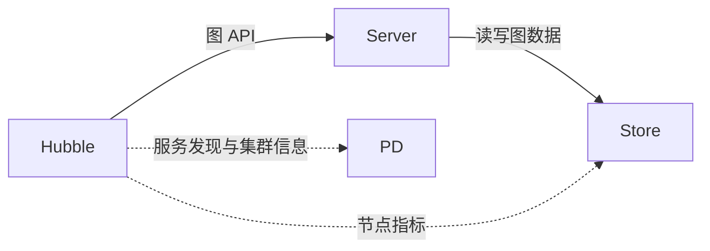
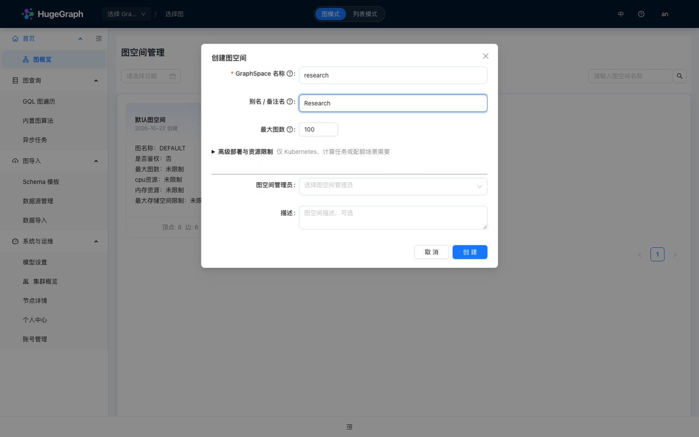
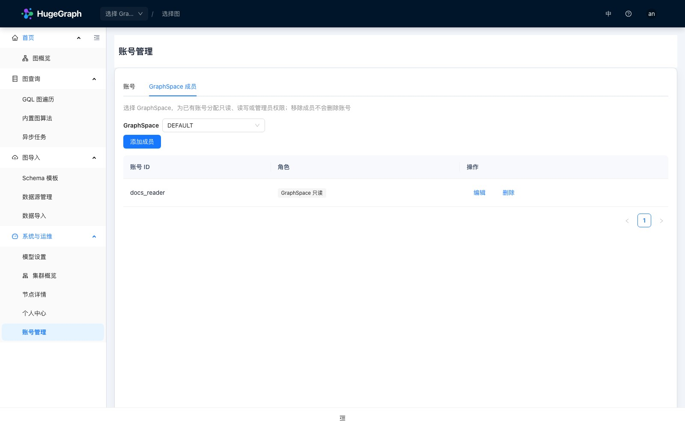
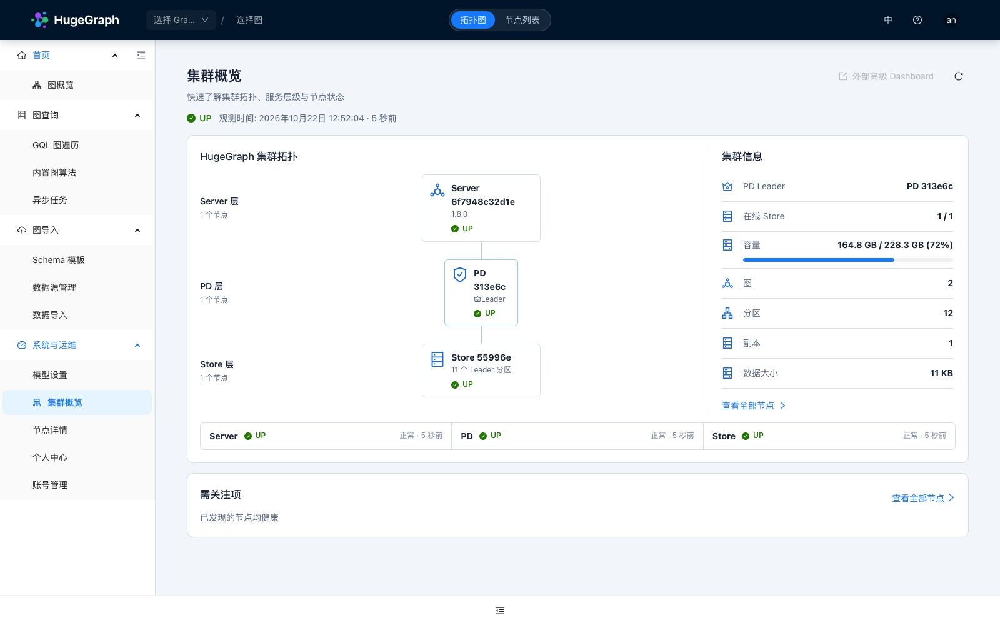
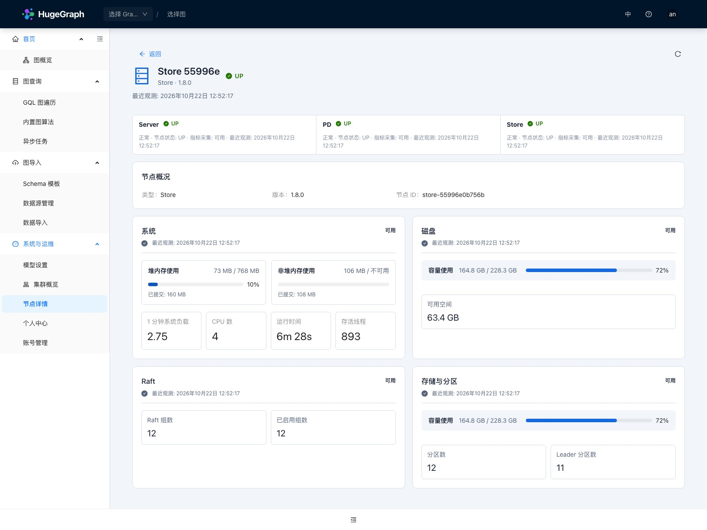

本篇重点介绍 HStore + PD 分布式部署与单机 RocksDB 的核心差异。图建模、数据导入和图遍历等通用操作请参考
[Hubble 基础与单机指南](/cn/docs/quickstart/toolchain/hugegraph-hubble/)。
内容以 Toolchain、Server、PD 与 Store 的 `master` 分支（当前版本均为 `1.8.0`）为准。

主仓库的 [docker/docker-compose-hstore.yml](https://github.com/apache/hugegraph/blob/master/docker/docker-compose-hstore.yml)
已提供完整的 PD、Store、Server 与 Hubble 服务编排。请直接参考同目录 [Docker README](https://github.com/apache/hugegraph/blob/master/docker/README.md)
配置 `.env` 并生成 Hubble 本地配置文件，然后在 `docker/` 目录下启动，无需自行维护部署文件。
下文重点说明连接与运维配置要点，部署前请确保满足 README 中的 PD 凭据与前置依赖要求。

Docker `latest` 为动态标签，配图用于定位界面，实际版本以部署镜像的 digest 及构建信息为准。
不同版本可提供的指标和权限接口有所区别。

Kubernetes 环境可使用 [Helm 部署](/cn/docs/quickstart/hugegraph/hugegraph-helm/)，获得相同的 PD/Store/Server/Hubble 基础服务。
启用可选 Vermeer 时，Chart 会同时配置 Hubble 的计算连接与健康采集；RocksDB 单机部署不提供这条原生 PD/Store 加载路径。

<span id="连接分布式集群"></span>

## 连接分布式集群 {#connect-to-a-distributed-cluster}

Hubble 仍通过 **Server 的图 API** 管理数据。区别在于，分布式模式通过 PD 发现 Server，
同时从 PD 和 Store 获取集群信息；Hubble 不直接读写 Store 中的图数据。



1. **生成 Hubble 配置。** 按 Docker README 在主仓库的 `docker/` 目录准备 `.env`。

   ```bash
   set -a
   . ./.env
   set +a
   ./set-hubble-pd-password.sh hstore
   ```

   脚本会读取 `.env` 中的 `HG_PD_AUTH_SECRET_KEY`，将其值作为 `operations.pd.password` 写入生成文件 `docker/conf/hubble/hstore.local.properties`。
   若需调整连接地址或运维参数，直接编辑该文件即可（请勿覆盖 Git 跟踪的 `.example` 模板文件），并确保 `operations.pd.password`
   与 PD 所用密钥一致。Compose 会将该文件只读挂载到容器内部，无需进入容器修改。
   该生成文件与 `.env` 均属于敏感配置，请勿提交到版本库；重新运行脚本会覆盖该文件，届时需重新补齐自定义参数。

1. **启动服务。** 在同一 `docker/` 目录启动组合，确认 Server 已注册、Store 已就绪。

   ```bash
   docker compose -f docker-compose-hstore.yml up -d --wait
   ```
{.steps}

若分别部署服务，参照 [PD 部署指南](/cn/docs/quickstart/hugegraph/hugegraph-pd/) 和
[HStore 部署指南](/cn/docs/quickstart/hugegraph/hugegraph-hstore/)；源码或二进制包启动的 Hubble 则编辑其
`conf/hugegraph-hubble.properties`。以下连接项与官方最小拓扑一致，其他部署请使用 Hubble 后端实际可达的地址。

```properties
pd.enabled=true
cluster=hg
pd.peers=pd:8686
pd.server=pd:8620
```

| 配置 | 用途 | 随包配置值 |
|---|---|---|
| `pd.enabled` | 显式启用 PD 模式；此时不使用 `server.direct_url`。 | `false` |
| `cluster` | 用于 Server 服务发现的集群名称，应与注册信息一致。 | `hg` |
| `pd.peers` | PD **gRPC** 地址；多个地址用逗号分隔。 | `127.0.0.1:8686` |
| `pd.server` | 集群运维使用的 PD **REST** 地址，不是 gRPC peer 列表。 | `127.0.0.1:8620` |

请区分两个端口。`8686` 为 gRPC 端口，`8620` 为 REST 端口，切勿混用；跨容器通信时请使用容器服务名或网络可达 IP，避免使用 `127.0.0.1`。
发行包默认配置中显式设为 `pd.enabled=false`；若未配置该项，代码默认值为 `true`，因此单机与分布式部署均建议显式声明该配置。
修改配置后，源码或二进制部署需重启 Hubble 服务；Docker Compose 部署则在 `docker/` 目录下重新创建 Hubble 容器以重新加载挂载配置
（沿用启动时的项目名及所有 `-f` 参数）。

```bash
docker compose -f docker-compose-hstore.yml up -d --force-recreate hubble
```

在 Hubble 界面中无需为每个图单独配置 Server 主机与端口。

<span id="用图空间组织图与权限"></span>

## 用图空间组织图与权限 {#organize-graphs-and-permissions-with-graphspaces}

GraphSpace（图空间）将图、Schema 模板和访问权限组织在同一个范围内。例如，分别为业务团队创建 `sales` 与 `research`，
让各团队只看到并操作自己的图。进入图空间后，图的建模、导入和查询仍沿用基础指南的流程。

<span id="创建与调整图空间"></span>

### 创建与调整图空间 {#create-and-adjust-a-graphspace}

开启 Server 认证时，创建、编辑和删除图空间要求超级管理员权限。创建时先填写全局唯一的 GraphSpace 名称、
可选的显示别名及最大图数；例如用 `research` 作 API 标识，用“研究图谱”作显示名。GraphSpace 名称创建后不可修改，
别名和描述可随后调整，别名不参与 URL 或权限匹配。图空间管理员从已有账号中选择。

“高级部署与资源限制”包含图查询/写入服务、异步计算任务的 CPU 与内存上限，以及存储容量限制。
部署配额不会自动扩容现有容器。空间卡片会单独展示可取得的存储用量，阅读时应同时关注来源与刷新延迟。

> [!DETAILS]- 高级部署的默认值
>
> 创建表单默认最大图数为 100；图服务与计算任务分别为 128 核、128 GB，存储上限为 256 GB。
> 普通容器试用可保留默认值。Kubernetes 命名空间、Operator 和算法镜像仅在对应场景中填写。

API 创建请求中，省略的计算限额保存为 `0`，继承对应图服务限额；正数表示独立的显式限额。
创建表单提交界面显示的数值。编辑时，计算字段输入零或清空可恢复继承，界面会显示当前生效值。
已有正数配置保持不变（apache/hugegraph#3391）；修改继承设置应使用配套更新的 Server 与 Java Client，旧版 Java Client 在部分更新时会将未显式设置的计算限额传为 0 并重置为继承。

存储用量随 Store 心跳与 PD 配额检查刷新，不会逐次写入实时更新。支持 `storage_used_kb` 的 Server 可展示不足 1 GB 的用量及低于 0.01% 的比例；
旧 Server 回退到整数 GB 用量。只有旧版 `Integer.MAX_VALUE` 配额哨兵值显示为不限。

选择图空间后，再进入其中的图。切换空间时应重新确认当前图，尤其是不同空间中存在同名图时。
列表只显示账号可访问的空间；看不到预期空间时，先检查成员权限，不要反复新建图。


{width="1600" height="1000"}

配置原生 Vermeer 集成后，删除源图或图空间前请依次操作：

1. **停止新提交，完成或取消正在处理的任务。** 待处理的 load/reload 任务会阻止源删除；
   正在执行的计算也要先完成或取消，才能卸载对应的图。
   在【异步任务】中确认最终状态；切换页面或算法不会取消任务。
1. **确认访问权限与清理结果。** Hubble 会先检查任务队列并卸载已有计算副本，再删除源。
   开启认证时，清理副本需要超级管理员权限。如果 Vermeer 不可达、队列检查失败或卸载被拒绝，先恢复服务或权限再重试。
   没有计算副本的图仍遵循 Server 原有的删除权限。
1. **失败后先核对状态。** 删除图空间时，后续副本卸载失败可能发生在部分副本已卸载之后；
   此时源空间及其管理员绑定仍保留。请检查剩余副本后再重试。
   新提交的任务可能与这些检查冲突，因此应保持停止提交，直到删除完成。
{.steps}

加载与卸载接口见 [Vermeer 指南](/cn/docs/quickstart/computing/hugegraph-vermeer/)。

<span id="复用-schema-模板"></span>

### 复用 Schema 模板 {#reuse-schema-templates}

**用户 Schema 模板仅适用于 PD 模式**，按图空间持久化保存 Groovy Schema。
当一组业务图需要同样的顶点类型、边类型和索引时，可以先保存模板，再在创建图时选择它，减少重复建模。
例如 `research` 中的用户模板用于该空间后续创建的图；切换到另一个空间后，应重新选择该空间的模板。

主篇的内置示例模板用于快速体验预设模型。用户模板用于保存自己的模型并长期复用。
模板本身不等于导入数据；是否加载示例数据是创建图时的另一个选择。
开启 Server 认证时，创建用户模板需要所在空间的写权限，更新或删除还要求模板所有者或相应管理权限。
匿名模式不进行按用户的权限与模板所有者检查。
单机模式不提供用户模板管理。

<span id="给用户分配图空间权限"></span>

## 给用户分配图空间权限 {#assign-access-to-a-graphspace}

账号创建、登录和个人资料管理见[基础指南](/cn/docs/quickstart/toolchain/hugegraph-hubble/)；
分布式模式额外提供“管理 GraphSpace 成员”，在已有账号与指定空间之间分配权限。
支持权限预设的 Server 提供以下常用选择。

| 预设 | 适用对象 | 作用范围 |
|---|---|---|
| GraphSpace 只读 | 查看、查询图数据的使用者 | 所选空间。 |
| GraphSpace 读写 | 建模、导入和维护图数据的使用者 | 所选空间。 |
| GraphSpace 管理员 | 管理该空间的成员与图资源的负责人 | 所选空间，不因此获得创建/编辑图空间或集群运维权限。 |
| 超级管理员 | 管理账号、图空间及集群的运维人员 | 全局，应按实际职责分配。 |

同一账号可在不同空间拥有不同权限，例如对 `research` 读写、对 `sales` 只读。
账号与空间成员分开管理，移除成员不会删除全局账号。

创建账号后可以立即继续分配空间权限；调整已有成员时，确认当前空间及预设，保留其他空间仍需要的权限。

仅启用 `pd.enabled` 不会授予权限，旧 Server 的自定义角色也不能直接当作这些预设处理。
认证配置见 [Server 认证与授权](/cn/docs/config/config-authentication/)。


{width="1600" height="1000"}

<span id="从集群概览定位异常"></span>

## 从集群概览定位异常 {#locate-problems-through-the-cluster-overview}

集群概览用一张拓扑展示 **Server → PD → Store**，可切换节点列表按类型、状态或名称筛选。
概览中的 PD Leader、在线 Store 数、图数、分区数、副本数和数据量，帮助判断当前连接的规模及哪些节点需要关注。
分区和副本描述数据分布；数据量是采集到的用量，不是图空间配置的存储上限。

先看集群和来源状态，再进入异常节点。`UP` 表示本次采集的来源正常；`DEGRADED` 表示集群或部分来源异常；
`DOWN` 表示相应探测未成功。拓扑可用而指标部分缺失时，仍可能正常查询图。
页面会区分不支持、不可用、数据过期和采集失败，并显示采集时间；空值不是零，历史值也不等于当前状态。

分别检查注册状态、服务就绪、数据状态与指标采集。Store 已注册不表示数据服务已就绪；指标 HTTP 请求失败也不一定意味着节点离线。
来源诊断保留失败端点、响应状态及最近一次成功观测，并提供恢复提示；即使 PD 同时报告优先级更高的数据故障，端点映射问题仍会保留。

<span id="节点详情读什么"></span>

### 节点详情读什么 {#read-node-details}

| 节点 | 主要关注信息 | 如何使用 |
|---|---|---|
| Server | 节点可用性、JVM/CPU/内存及后端指标 | 判断查询与写入入口是否可达，并检查资源压力。 |
| PD | Leader/Follower 角色、状态及上游可提供的运行指标 | 确认元数据与调度入口；Leader 信息缺失时不推断角色。 |
| Store | 分区数、Leader 分区数、系统/磁盘指标，以及 Raft 组数和启用组数 | 检查存储节点及副本服务，结合其他节点比较分布。 |
{.td-table--wide}

```gallery
 # 集群概览，先看异常来源
 # Store 详情，再检查节点指标
```

PD Leader 与 Store 的 Leader 分区分别负责不同的工作。前者协调集群元数据，后者负责相应数据分区的 Raft 组。
Hubble 展示上游提供的观测值，不代替完整的 Raft 副本一致性检查；各版本可用的指标不同。

开启 Server 认证时，集群运维读取要求超级管理员（`ADMIN` 级别），空间管理员和普通成员不会因此获得集群读取权限。
部署时使用容器隔离、可信 HTTPS 入口、Server 认证与网络白名单，避免直接公开 Hubble 和组件端口。

<span id="配置运维访问"></span>

### 配置运维访问 {#configure-operations-access}

PD/Store 的运维凭据由 Hubble **后端**使用，与浏览器登录 Server 的账号分开。
Compose 部署修改上文生成的宿主机 `docker/conf/hubble/hstore.local.properties`；其他部署修改 Hubble 包内配置文件。
其中 PD 密码由脚本生成并与 `.env` 中的密钥保持一致，Store 启用认证时再配置对应服务账号。不要把密码写进文档、截图或提交的配置。

| 配置 | 随包默认值 | 设置方式 |
|---|---|---|
| `operations.pd.username` / `operations.pd.password` | 用户名 `hubble`，密码为空 | 与 PD 运维 REST 认证匹配。 |
| `operations.store.username` / `operations.store.password` | 用户名 `hubble`，密码为空 | 上游 Store REST 启用认证时配置对应服务账号。 |
| `operations.store.allowed_targets` | `[http://127.0.0.1:8520,http://[::1]:8520]` | 列出信任的 Store 指标来源。 |
| `operations.pd.direct_peers` | `false` | 仅在每个 PD peer 主机名对应单个成员、而非共享 Service 时启用。 |
{.td-table--wide}

例如容器中的 Store 上报 `store:8520`，将白名单配置为以下内容。

```properties
operations.store.allowed_targets=[http://store:8520]
```

多节点集群中需列出所有允许访问的目标地址。每项必须是包含显式端口的 `http` 或 `https` 源地址（Origin），不可包含路径、凭据或通配符，
且需与 PD 返回的 Store 指标目标完全一致。仅在白名单中添加地址不会自动建立节点发现。

若集群拓扑可见但节点指标不完整，请依次检查 Hubble 后端到 PD REST 的网络连通性与认证凭据、PD 返回的 Store REST 与指标地址，
以及目标地址是否已加入上述白名单。概览中的部分可用状态仅表示特定来源指标采集受阻，并不代表图 API 服务不可用。

当 `pd.server` 指向无法唯一确定成员的 Service 或代理时，其进程指标仅作为【配置的 PD 端点样本】展示，既不是某个成员的历史，也不是集群合计值。
只有可信且唯一映射的 PD 成员才展示归属于该成员的指标；启用直连 peer 采集前先核对路由。

## 使用一体化 Vermeer 工作流 {#vermeer-workflow}

使用 [Helm 可选 Vermeer 引擎](/cn/docs/quickstart/hugegraph/hugegraph-helm/#optional-engines)时，沿用 HugeGraph 账号登录 Hubble。
Chart 为计算和健康观测提供内部 Master URL 与 Token 文件。Server 开启认证时，直接 Store 加载与原生计算要求超级管理员权限。

1. 选择图空间和图，在【内置图算法】下进入【OLAP 全图计算】。
1. 加载或重新加载图，等待加载任务完成。内存中的计算副本不会自动跟随之后的图写入。
1. 选择受支持的 Vermeer 算法并设置参数，提交后保留其任务身份，进入【异步任务】查看。
1. 在工作台查看有界结果样本，或打开任务的分页结果；区分样本与完整结果集。
{.steps}

支持的算法、参数、API 任务 ID 和结果缓存限制见 [Vermeer 指南](/cn/docs/quickstart/computing/hugegraph-vermeer/#24-通过-hubble-提交与集成)。
已有 Computer 部署仍通过单独的兼容入口使用。

在【集群概览】中，紧凑的 Vermeer 摘要可打开 Master 位于 Worker 上层的独立计算视图，点击【返回主集群】恢复 Server/PD/Store 视图。
Worker 的就绪数／注册数是观测结果，不是 Helm 中期望的副本数。CPU 使用进程核数，内存使用 RSS；部分节点的采集覆盖不等于整个集群的资源总量。
监控失败时，缓存观测会标记为过期，当前就绪状态仍未知；Vermeer 异常与主图集群状态分别展示。
按图空间的 Worker 分配探针与部署级健康快照回答的是不同问题。
