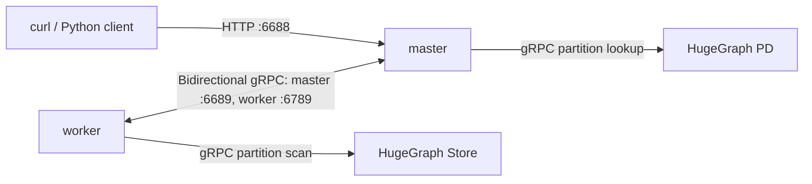
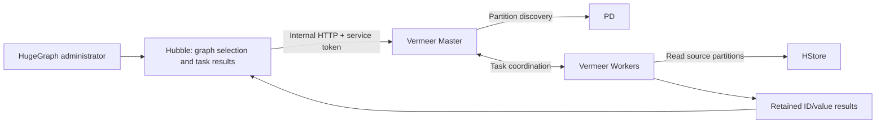

Use [Helm and Hubble](#24-submit-and-integrate-via-hubble) for the integrated HStore workflow, or the native API for your own automation.
This guide follows current source builds; released images may offer fewer algorithms or result-preview capabilities.
Pin compatible Hubble and Vermeer image tags or digests when deploying.

- [Load and compute through Hubble](#24-submit-and-integrate-via-hubble) — Use chart-managed connections and your HugeGraph login.
- [Call the native task API](#2-task-creation-rest-api) — Submit load/compute requests with Vermeer service credentials.
- [Check health and readiness](#4-cluster-monitoring-and-telemetry) — Separate Worker registration, task availability and process metrics.
{.cards .td-cards-list}

## 1. Overview of Vermeer

### 1.1 Architecture

Vermeer is a memory-first graph computing framework written in Go: load a graph once, then run repeated OLAP computations.
A single Master schedules multiple Workers. Compute time depends on graph size, algorithm parameters and available resources.

The master handles communication, forwarding, and aggregation, with modest computation and resource usage. Workers store graph data and execute tasks, consuming most memory and CPU. gRPC handles internal communication; REST provides external APIs.

At startup, built-in defaults are loaded first, followed by the `[default]` section of `config/<env>.ini` under the working directory, then explicit command-line overrides. For example, `--env=master` reads `config/master.ini`. The Docker image copies repository configuration to `/go/bin/config/` and works from `/go/bin/`. A host bind mount hides the bundled files, so it must contain every ini file used. Ordinary INI keys are not mapped automatically from environment variables. Dedicated deployment credential settings also support
`VERMEER_PD_PASSWORD_FILE`, `VERMEER_PD_PEERS`, `VERMEER_HUGEGRAPH_CREDENTIALS_FILE` and the documented token-factor/password file settings.

Default ports:

| Role | Configuration key | Default address | Purpose |
|---|---|---|---|
| master | `http_peer` | `0.0.0.0:6688` | REST API for host-side clients |
| master | `grpc_peer` | `0.0.0.0:6689` | Workers connect to master |
| worker | `http_peer` | `0.0.0.0:6788` | Worker HTTP service |
| worker | `grpc_peer` | `0.0.0.0:6789` | Worker gRPC listener, also advertised to master for node communication |

The Docker examples publish only master HTTP on host loopback `127.0.0.1:6688:6688`; master and worker gRPC ports stay within the container network.



### 1.2 Running Vermeer

> [!DETAILS]- Helm: deploy Vermeer with HugeGraph and Hubble
> From the HugeGraph repository root, enable Vermeer alongside the HStore stack:
>
> ```bash
> helm install hugegraph ./helm/hugegraph -n hugegraph --create-namespace \
>   -f helm/hugegraph/values-single.yaml \
>   --set vermeer.enabled=true --set vermeer.mode=standalone \
>   --wait --timeout 20m
> ```
>
> `standalone` places distinct Master and Worker containers in one Pod. For a dedicated Master and multiple Worker Pods, use
> `vermeer.mode=cluster` and set `vermeer.worker.replicas`. Both topologies require authentication.
> Easy mode defaults to authenticated native HTTP/UI through NodePort; strict mode defaults to ClusterIP.
> Use the `<release>-vermeer-admin` Secret's `password` for UI login; automation and Hubble use service tokens.
>
> Keep the existing `metadataCluster` value (chart default `hg-test`) consistent across Server and Store;
> changing it does not migrate data and can cause `Schema missing` during loading.
> The chart configures Hubble's Master URL and service token. Continue with the [Hubble workflow](#24-submit-and-integrate-via-hubble),
> or consult [Helm optional engines](/docs/quickstart/hugegraph/hugegraph-helm/#optional-engines) for access, image pinning and persistence.

> [!WARNING]
> In production, enable [Server authentication and authorization](/docs/config/config-authentication/), an IP allowlist, and minimum permissions; retain `audit-*.log`. Server Auth does not protect independent Vermeer, PD, or Store APIs. Restrict these HTTP/gRPC ports to trusted networks and callers, and configure access controls at the Vermeer external entry point.
>
> Manual standalone deployments default to `auth=none` in `master.ini`, and the Docker examples below publish to loopback only.
> When deploying manually for remote access, always enable `auth=token`. The Helm deployment requires token authentication in both modes
> and exposes only native HTTP/UI through NodePort in easy mode by default.

Both Docker options need a host configuration directory. From the Vermeer repository root, copy the supplied [`master.ini`](https://github.com/apache/hugegraph-computer/blob/master/vermeer/config/master.ini) and [`worker.ini`](https://github.com/apache/hugegraph-computer/blob/master/vermeer/config/worker.ini) templates. The mount hides image configuration under `/go/bin/config`, so never mount an empty directory or your entire home directory there:

```shell
CONFIG_DIR="$HOME/vermeer-config"
mkdir -p "$CONFIG_DIR"
cp config/master.ini config/worker.ini "$CONFIG_DIR/"
```

Keep master HTTP/gRPC listeners at `0.0.0.0:6688` and `0.0.0.0:6689`. The Compose example assigns `172.20.0.10` to master and `172.20.0.11` to worker; set these options in the copied `worker.ini`:

```ini
[default]
http_peer=0.0.0.0:6788
grpc_peer=172.20.0.11:6789
master_peer=172.20.0.10:6689
run_mode=worker
worker_group=$
```

This single-worker example uses literal `worker_group=$`, the general group used when no named group is bound. The repository template defaults to `worker_group=default`; if retaining that named group, bind it to the task space or graph before submitting tasks. For default space `$DEFAULT`, use:

```shell
curl --fail --show-error -X POST \
  'http://localhost:6688/admin/workers/alloc/default/%24DEFAULT'
```

An `errcode=0` response confirms binding; with token authentication, also supply the authorization header. `master_peer` must reach master gRPC from the worker network. `grpc_peer` is both the listener and advertised worker address, so do not advertise `0.0.0.0`, which other containers cannot reach. Update these IPs when changing the subnet or addresses; each additional worker needs a unique, mutually reachable `grpc_peer`.

#### Docker Compose {#vermeer-compose}

Run from the Vermeer repository root. Modify existing `docker-compose.yaml` or use the following example. The repository file currently mounts all of `~/` as configuration and does not publish master HTTP; replace the mount and add the port mapping before starting:

```yaml
services:
  vermeer-master:
    image: hugegraph/vermeer:latest
    container_name: vermeer-master
    ports:
      - "127.0.0.1:6688:6688"
    volumes:
      - /home/user/vermeer-config:/go/bin/config:ro
    command: --env=master
    networks:
      vermeer_network:
        ipv4_address: 172.20.0.10 # Static master address

  vermeer-worker:
    image: hugegraph/vermeer:latest
    container_name: vermeer-worker
    volumes:
      - /home/user/vermeer-config:/go/bin/config:ro
    command: --env=worker
    networks:
      vermeer_network:
        ipv4_address: 172.20.0.11 # Static worker address

networks:
  vermeer_network:
    driver: bridge
    ipam:
      config:
        - subnet: 172.20.0.0/24 # Change the subnet as needed
```

Replace `/home/user/vermeer-config` with your actual absolute configuration directory. Changing the subnet or static IPs of `vermeer_network` also requires updating `grpc_peer` and `master_peer` in `worker.ini`. Do not use the default `grpc_peer=0.0.0.0:6789` as an advertised container address.

Obtain an image, then start the Compose stack. Use a published image for a quick trial, or build from the checked-out source:

```bash {tab="Published image"}
docker pull hugegraph/vermeer:latest
```

```bash {tab="Source image"}
docker build -t hugegraph/vermeer:latest .
```

```bash
docker compose up -d
```

View logs / stop / remove:

```shell
docker compose logs -f
docker compose down
```

#### Separate Docker commands {#vermeer-docker-run}

Set `CONFIG_DIR` to the prepared configuration directory, with `grpc_peer` and `master_peer` matching the static container addresses. Replace the example `CONFIG_DIR` with your actual absolute path.

Use the same published or source-built image as in the [Compose option](#vermeer-compose).

Create a custom bridge network (once):

```shell
docker network create --driver bridge \
  --subnet 172.20.0.0/24 \
  vermeer_network
```

Run master (use your absolute `CONFIG_DIR` and adjust IPs as needed):

```shell
CONFIG_DIR=/home/user/vermeer-config

docker run -d \
  --name vermeer-master \
  --network vermeer_network --ip 172.20.0.10 \
  -p 127.0.0.1:6688:6688 \
  -v ${CONFIG_DIR}:/go/bin/config:ro \
  hugegraph/vermeer:latest \
  --env=master
```

Run worker:

```shell
docker run -d \
  --name vermeer-worker \
  --network vermeer_network --ip 172.20.0.11 \
  -v ${CONFIG_DIR}:/go/bin/config:ro \
  hugegraph/vermeer:latest \
  --env=worker
```

View logs / stop / remove:

```shell
docker logs -f vermeer-master
docker logs -f vermeer-worker

docker stop vermeer-master vermeer-worker
docker rm vermeer-master vermeer-worker

# Delete the custom network if needed
docker network rm vermeer_network
```

#### Build from source {#vermeer-source-build}

Build following the [Vermeer README](https://github.com/apache/hugegraph-computer/tree/master/vermeer).
Use the toolchain recorded in `go.mod` (currently Go 1.23.7); a newer toolchain is not automatically compatible with every dependency.
Install Node.js/npm, `curl` and `unzip` for the first asset/dependency setup, then run from `vermeer/`:

```bash
export GOTOOLCHAIN=go1.23.7
make
```

The default build generates embedded UI assets before compiling the executable.
For local API development, `GOTOOLCHAIN=go1.23.7 go build -tags=dev` reads UI files from disk instead;
a successful development build does not verify packaged UI assets.

For a single-host trial, use the supplied `config/master.ini` and `config/worker.ini`. Set the Worker's `master_peer=127.0.0.1:6689`,
`grpc_peer=127.0.0.1:6789` and `worker_group=$`; container addresses from the Docker example do not apply here.
Start the two processes from the Vermeer root in separate terminals:

```bash
./vermeer --env=master
```

```bash
./vermeer --env=worker
```

For multiple hosts, advertise addresses reachable from every participating node.

After starting master, check its HTTP port from the host:

```shell
curl --fail --show-error http://localhost:6688/graphs
```

Expect HTTP 200 and JSON `errcode=0`.

### 1.3 Authentication, Token Tooling, and Deployment Credentials

When `auth=token` is enabled in `master.ini` (or `-auth token` via CLI), protect the Master signing factor in a dedicated file (`0600`) instead of command-line
arguments. File-backed authentication uses **v2 HMAC-SHA256** Base58-encoded tokens with constant-time MAC verification, preventing legacy downgrade attacks.

#### 1. Generating File-Backed Signing Factor

Create a protected signing factor file before starting Master:

```bash
umask 077
openssl rand -hex 32 > config/token-factor
```

Set the environment variable `VERMEER_AUTH_TOKEN_FACTOR_FILE=/path/to/token-factor`, or set `auth_token_factor_file` in Master's `master.ini`. The environment
variable takes precedence over the INI file, and either file setting takes precedence over inline `auth_token_factor`. The file must contain one valid UTF-8
line with at least 16 characters and cannot consist solely of whitespace. An invalid or unreadable file stops Master before opening network listeners (fails
closed), and it never falls back to inline or default factors.

#### 2. Generating Auth Tokens with `/go/bin/vermeer-token`

Vermeer container images bundle the native `/go/bin/vermeer-token` CLI utility (built from `cmd/vermeer-token`). It generates v2 Base58 tokens without
requiring a running Master or Kubernetes API access:

```bash {tab="Docker CLI"}
docker run --rm --user "$(id -u):$(id -g)" -v "$PWD/config:/tokens" \
  --entrypoint /go/bin/vermeer-token \
  hugegraph/vermeer:latest -user admin -space '$DEFAULT' \
  -factor-file /tokens/token-factor -output-file /tokens/admin-token -i -quiet
```

```bash {tab="Go Source"}
go run ./cmd/vermeer-token -user admin -space '$DEFAULT' \
  -factor-file config/token-factor -output-file config/admin-token -i -quiet
```

CLI Parameters:
- `-user`: Username (default: `foo`).
- `-space`: Graph space name (default: `bar`; use `$DEFAULT` for system default graph space).
- `-factor-file`: Path to the signing factor file (required; inline factors are rejected).
- `-output-file`: Atomically writes the Base58 token with file mode `0600` without echoing secrets to stdout.
- `-quiet`: Suppresses informational logs and outputs only the token when `-output-file` is omitted.
- `-client`: Client identifier (default: `hg`).
- `-i`: Generates an immortal token that never expires (standard tokens expire after 24 hours).

To authenticate HTTP requests, pass the generated token in the header:
```bash
curl -H "Authorization: Bearer <token>" http://localhost:6688/graphs
```

#### 3. Kubernetes Secret Password Files and Credential Isolation

To integrate with Kubernetes Secrets without wrapping raw credentials in JSON, configure Worker with raw password files:

- Set `VERMEER_HUGEGRAPH_USERNAME` and `VERMEER_HUGEGRAPH_PASSWORD_FILE` (or `hugegraph_username` and `hugegraph_password_file` in `worker.ini`). Both values
  must be configured together; if either is set, a missing or unreadable file fails graph loading closed.
- Raw password file bytes are preserved exactly, including quotes, backslashes, spaces, and terminal newlines.
- When an explicit JSON credentials file is set (`VERMEER_HUGEGRAPH_CREDENTIALS_FILE` or `hugegraph_credentials_file`), it takes precedence over the raw pair.
- For PD authentication, mount `VERMEER_PD_PASSWORD_FILE` (or `pd_password_file` in INI). When deployment credentials are used, `VERMEER_PD_PEERS` (`pd_peers`)
  is required to discover Schema exclusively through trusted PD endpoints.
- Secret credentials remain confined to deployment configuration and worker processes; they are never persisted in task metadata or returned in query APIs.
- Dial timeouts can be bounded with `grpc_dial_timeout` or `VERMEER_GRPC_DIAL_TIMEOUT` (default `5s`).

### 1.4 Upgrading Master and Workers {#vermeer-upgrade}

Master accepts a Worker only when their **reported runtime version strings are identical**. A mixed-version deployment can reject registration with
`registration denied: inconsistent registration version`; matching image tags alone do not verify the running versions.
Plan an unavailable interval when changing versions:

1. Stop new load/compute submissions. Let active tasks finish, or cancel them, then unload the compute graphs.
1. Preserve configuration, authentication material and any output files that must survive. Deploy the matching Master and all Workers together.
1. Check reported versions and Worker registration in the [cluster snapshot](#41-cluster-health-snapshot-get-apiv1admincluster),
   then verify [availability for the caller's space](#42-space-worker-availability-probe-get-apiv1workersavailability).
1. Reload the source graph and run a small computation before reopening submissions.
   PVC files do not automatically restore in-memory graphs or retained results.
{.steps}

See [Helm operations](/docs/quickstart/hugegraph/hugegraph-helm-operations/#vermeer-upgrade) for the chart deployment procedure.

## 2. Task Creation REST API

### 2.1 Introduction

Submit a `load` task, wait for loading to finish, then submit a `compute` task.
A loaded graph supports repeated computations and is not deleted after a task completes.

Asynchronous APIs return task information, including its ID, before completion. Synchronous APIs wait for success or failure;
client and proxy HTTP timeouts must be long enough for that wait.

Query `task.status`: `loaded` means successful loading, `complete` successful computation, `error` failure, and `canceled` cancellation.
Other states remain waiting or running. Graphs loading or in an error state cannot be computed;
deletion requires a deletable graph state with no current usage.

Available URLs:

- Asynchronous: `POST http://master_ip:port/tasks/create`; read the ID from response `task.id`.
- Synchronous: `POST http://master_ip:port/tasks/create/sync`; returns after the task ends.
- Query task: `GET http://master_ip:port/task/{task_id}`. `errcode=0` indicates a successful query; inspect `task.status` for task status.
  Set a client polling deadline for asynchronous jobs; reaching it stops client waiting without canceling the server task.
- Read retained results: `GET http://master_ip:port/tasks/value/{task_id}` (or `/api/v1/tasks/value/{id}`).
- Cluster health snapshot: `GET http://master_ip:port/api/v1/admin/cluster` (admin token required; see [Section 4](#4-cluster-monitoring-and-telemetry)).
- Worker availability probe: `GET http://master_ip:port/api/v1/workers/availability` (space-scoped availability check).

Native clients submit `POST /api/v1/tasks/create` with `graph`, `task_type` (`load`, `reload` or `compute`), and a flat string-valued `params` map.
For computation, set `params["compute.algorithm"]`, not a top-level `algorithm`.
The response contains a native `task.id`; query it at `GET /api/v1/task/{id}` and read retained values at `GET /api/v1/tasks/value/{id}`.
These paths and positive IDs differ from Hubble's wrapper.

Native result rows use `ID` and `Value`. Set `output.need_query=1` on the compute request to retain values for this API.
Native pages return `cursor` but no total or `has_more`: continue with the returned cursor until `message:"EOF"` or an empty final page.
When the final page exactly fills `limit`, one additional request can be needed to observe EOF.
Hubble's wrapper separately peeks one value ahead to supply `has_more`.

`POST /api/v1/tasks` does not submit work: after the task-method fix it returns HTTP 405 and `Allow: GET`;
older builds can return a misleading `{"code":200}` without creating a task.
See the [native API examples](https://github.com/apache/hugegraph-computer/blob/master/vermeer/README.md#api-overview).

Vermeer Master HTTP follows Helm mode defaults: easy is NodePort, strict is ClusterIP; RPC and Worker ports remain internal.
Native UI admin uses the password in `<release>-vermeer-admin`. Automation APIs use service tokens in `Authorization: Bearer <token>`;
UI admin password cannot be used as this token. Chart automatically configures service token for Hubble.

### 2.2 Loading Graph Data

The examples list common load parameters. Each loader reads its own keys; unused keys do not change behavior.

Choose one source for a load task. The JSON bodies below are submitted to `POST /api/v1/tasks/create`,
with the same authentication as the complete curl examples.

#### Local files {#vermeer-load-local}

Start with a four-vertex directed ring. Save these two UTF-8 files **without headers** in a directory readable by the Worker:

```csv {title="vertices.csv"}
1
2
3
4
```

```csv {title="edges.csv"}
1,2
2,3
3,4
4,1
```

`load.vertex_files` and `load.edge_files` are JSON-encoded strings mapping the host portion of the Worker's advertised `grpc_peer` to files.
The following request assumes a local Worker advertising `127.0.0.1`; replace `/absolute/data` with its actual readable directory.
For the Compose example, mount the files at Worker `/data`, use `/data/vertices.csv` and `/data/edges.csv`, and change the mapping key to `172.20.0.11`.
Paths are resolved by Workers, not by the HTTP client or Master.

```bash
curl -X POST http://localhost:6688/api/v1/tasks/create \
  -H 'Content-Type: application/json' \
  -d '{
    "task_type":"load",
    "graph":"docs_ring",
    "params":{
      "load.type":"local",
      "load.parallel":"1",
      "load.delimiter":",",
      "load.vertex_backend":"mem",
      "load.vertex_files":"{\"127.0.0.1\":\"/absolute/data/vertices.csv\"}",
      "load.edge_files":"{\"127.0.0.1\":\"/absolute/data/edges.csv\"}",
      "load.use_out_degree":"1",
      "load.use_outedge":"1"
    }
  }'
```

Wait for the returned load task to succeed, then compute with `graph:"docs_ring"`.
This four-vertex/four-edge example yields four equal PageRank values (`0.25`) with the PageRank defaults and sufficient iteration budget.
Token-authenticated deployments must add their service credential; these loopback examples assume `auth=none`.

#### HugeGraph / HStore {#vermeer-load-hugegraph}

**Request example:**

Replace request addresses, graph name, and credentials with your actual connection settings.

```json
{
  "task_type": "load",
  "graph": "testdb",
  "params": {
    "load.parallel": "1",
    "load.type": "hugegraph",
    "load.hg_pd_peers": "[\"<pd-address-reachable-from-vermeer>:8686\"]",
    "load.hugegraph_name": "DEFAULT/hugegraph2/g",
    "load.hugegraph_username": "admin",
    "load.hugegraph_password": "<your-password-here>",
    "load.use_out_degree": "1",
    "load.use_outedge": "1"
  }
}
```

Vermeer master connects to PD through `load.hg_pd_peers` to look up partitions; workers read data from the returned Store addresses. These services must be reachable from the corresponding Vermeer hosts or containers. Inside Docker, `127.0.0.1` identifies the container itself, not the host or another container.

#### HDFS {#vermeer-load-hdfs}

**Request example:**

```json
{
  "task_type": "load",
  "graph": "testdb",
  "params": {
    "load.parallel": "1",
    "load.type": "hdfs",
    "load.hdfs_namenode": "name_node1:9000",
    "load.hdfs_conf_path": "/path/to/conf",
    "load.krb_realm": "EXAMPLE.COM",
    "load.krb_name": "user@EXAMPLE.COM",
    "load.krb_keytab_path": "/path/to/keytab",
    "load.krb_conf_path": "/path/to/krb5.conf",
    "load.hdfs_use_krb": "1",
    "load.vertex_files": "/data/graph/vertices",
    "load.edge_files": "/data/graph/edges",
    "load.use_out_degree": "1",
    "load.use_outedge": "1"
  }
}
```

### 2.3 Outputting Computation Results

Current result writers support `local`, `hdfs`, and `hugegraph` through `output.type`; `none` disables output. Source retains an `afs` constant, but current master registers no AFS loader or writer. Set `output.need_statistics=1` to put statistics into task information; supported statistics operators depend on each algorithm implementation.

The examples list common computation and output parameters; supported algorithm parameters depend on current Vermeer implementations.

Request example:

```bash
curl -X POST http://localhost:6688/api/v1/tasks/create \
  -H 'Content-Type: application/json' \
  -d '{
    "task_type":"compute",
    "graph":"docs_ring",
    "params":{
      "compute.algorithm":"pagerank",
      "compute.parallel":"1",
      "compute.max_step":"20",
      "pagerank.damping":"0.85",
      "pagerank.diff_threshold":"0.00001",
      "output.type":"local",
      "output.file_path":"./data/pagerank-example",
      "output.need_query":"1"
    }
  }'
```

`output.type=local` writes to the executing Worker's local filesystem. For containers, mount the output directory if the host needs to read files.
To retain query results without writing output files, use `output.type=none` with `output.need_query=1`.
These choices do not write PageRank scores into the HugeGraph source graph.

Replace `123` below with the computation's returned `task.id`, wait for `task.status:"complete"`, then read its values:

```bash
curl http://localhost:6688/api/v1/task/123
curl 'http://localhost:6688/api/v1/tasks/value/123?cursor=0&limit=2'
```

The example ring yields `ID`/`Value` pairs with values equivalent to `0.25` (the JSON may use scientific notation).
Read the computation's ID, not the earlier load task's ID. Cached results can disappear after a process restart.


#### Result types when writing back {#vermeer-result-types}

For native `output.type=hugegraph`, the writer creates a property key using the algorithm's output type.
`output.hugegraph_property` selects its name; if omitted, the name defaults to `compute.algorithm`.
Check existing schema before reusing that default after an upgrade or when changing cycle mode:

| Algorithm / mode | Current property type | Existing schema to migrate |
|---|---|---|
| `triangle_count` | `LONG` | Older `INT` result properties |
| `cycle_detection`, `cycle.mode=boolean` | `INT` (`0` / `1`) | Older `TEXT` result properties |
| `cycle_detection`, `cycle.mode=all` or `limit` | `TEXT` | A property previously used by boolean mode |
{.wide}

Choose a new property name of the required type, for example `output.hugegraph_property=triangle_count_v2` or `cycle_membership_v2`.
Verify a small write-back task and its values before updating application queries; retain old properties until their consumers have migrated.
Do not rely on the writer to convert an existing property's type. Hubble's default `output.type=none` only retains results and does not alter Server schema.

### 2.4 Submit and Integrate via Hubble

The shortest integrated path is **Helm → Hubble → Vermeer**. The chart provisions the service URL and read-only token file;
Hubble keeps your Server login separate from the service credential. Use matching current Hubble and Vermeer builds.
See [Helm optional engines](/docs/quickstart/hugegraph/hugegraph-helm/#optional-engines) for installation and image selection.

1. **Deploy HStore and enable Vermeer.** Keep Hubble in PD mode. The single-node Helm preset still uses PD + Store + Server,
   so it supports direct loading; a standalone RocksDB Server does not. Vermeer does not need the Computer Operator or its CRDs.
1. **Choose the source graph in Hubble.** Sign in with a HugeGraph super-administrator account and select its GraphSpace and graph.
   Direct Store scans bypass Server label-level authorization, so ordinary graph read permission is insufficient for this integration.
   Anonymous deployments follow their existing anonymous-access policy.
1. **Load the compute copy.** Open **OLAP graph compute (Vermeer)** and select Load or Reload. Wait for the load task to succeed
   and the graph to become `loaded`; acceptance of a task alone does not establish readiness.
1. **Submit an algorithm.** Start with PageRank, use its parameter form, and keep the returned task identity.
   Computation is asynchronous. Switching to another algorithm does not cancel previously accepted tasks.
1. **Read results and release resources.** Inspect the task and its paged values or bounded preview.
   Finish/cancel work before unloading the compute copy. Source graph changes require Reload before the next computation uses them.
{.steps}



#### Load, compute and unload APIs {#hubble-task-apis}

With an authenticated Hubble cookie, first submit the selected graph's load:

```bash
curl -b hubble.cookies -X POST 'http://localhost:8088/api/v1.3/vermeer/task' \
  -H 'Content-Type: application/json' \
  -d '{"graphspace":"DEFAULT","graph":"hugegraph","task_type":"load"}'
```

Use `task_type:"reload"` to refresh an existing compute copy. Hubble accepts load tuning such as `load.parallel`,
but resolves the PD endpoints, source graph and credentials itself. `POST /api/v1.3/vermeer/task` does not submit computation.
Wait for loading to complete, then submit PageRank through the graph-scoped endpoint:

```bash
curl -b hubble.cookies -X POST \
  'http://localhost:8088/api/v1.3/graphspaces/DEFAULT/graphs/hugegraph/algorithms/vermeer' \
  -H 'Content-Type: application/json' \
  -d '{"params":{"compute.algorithm":"pagerank","compute.parallel":1,"compute.max_step":10,"pagerank.damping":0.85,"pagerank.diff_threshold":0.00001}}'
```

The response envelope contains `data.task_id`. Use the exact returned ID with that graph's async-task API:

| Surface | Example for native task `123` | Meaning |
|---|---|---|
| Vermeer native API | `123`, queried at `/api/v1/task/123` | Positive native task ID |
| Hubble API | `-123`, queried at `/api/v1.3/graphspaces/DEFAULT/graphs/hugegraph/async-tasks/-123` | Signed routing ID; preserve the minus sign |
| Hubble task list | `Vermeer #123` | Display identity, distinct from `Server #123`; either qualified identity can be searched |

Never send Hubble's negative routing ID to Server's `/tasks/{id}` or Vermeer's native API.
After success, request `GET .../async-tasks/-123/values?cursor=0&limit=100` and continue with the returned `cursor` while `has_more` is true.
The wrapper accepts `limit` from 1 through 10000. A full final page still reports `has_more:false`; use metadata rather than guessing from row count.

To unload the in-memory graph, send `DELETE /api/v1.3/vermeer/DEFAULT-hugegraph` with
`{"graphspace":"DEFAULT","graph":"hugegraph"}`. Finish/cancel active work first. This removes the Vermeer copy, not the HugeGraph source graph.
The current loading page provides Load/Reload controls; use the administrator API for unload.

#### Read bounded previews and concurrent results {#hubble-result-preview}

The OLAP result area offers graph, table and connected-sample views. Values are computation **ID/value pairs**, not editable Server vertices.
It loads 12 values at a time, up to 300 for this preview; use Async Tasks and paged result APIs for additional retained values.

The graph view shows the sampled IDs and their values. Optional edges come from the **currently loaded Vermeer graph**,
not Server and not necessarily the snapshot that produced a historical result.
Each page's edge lookup is bounded to 3000 scanned edges and 30 returned edges, and cannot establish a complete induced subgraph.

Edge enrichment requires a Vermeer build implementing `POST /api/v1/graphs/{graph}/preview-edges`; the current native source baseline
does not expose that route, so Hubble keeps values readable and reports adjacency unavailable.

The connected-sample view shows at most six linked sampled vertices; it does not calculate a new graph path query.
Missing adjacency leaves valid table values readable. No edges in a preview is not proof that the graph has no edges.

Accepted tasks remain separately selectable in the result area while other algorithms submit or finish.
The page remembers recent tasks by GraphSpace and graph in memory; a page refresh clears that selection history.
It is not durable task storage.
Switching graphs or algorithms does not merge results. Returning to an algorithm can restore its latest accepted task without rerunning it.
A missing, expired, oversized or failed result has its own feedback; task success does not guarantee that its cached values still exist.

Hubble submits compute with `output.type=none` and `output.need_query=1`: it retains queryable results without generating worker-local output files
or writing scores into HugeGraph properties. Restarting Vermeer can discard those in-memory results even when task metadata or PVC files survive.
Native API callers can choose an explicit output writer instead; see [output configuration](#23-outputting-computation-results).

```gallery
 # Select Vermeer and load the selected HStore graph
 # Sampled results; use the task entry for full retained pages
```

#### Hubble algorithm catalog and limits {#hubble-algorithm-catalog}

The current native adapter accepts these 19 algorithm identifiers. The page's native examples below are not interchangeable with the
`params` object expected by Hubble's graph-level computation endpoint.

| Category | `compute.algorithm` |
|---|---|
| Centrality | `pagerank`, `ppr`, `degree`, `closeness_centrality`, `betweenness_centrality` |
| Components and communities | `wcc`, `scc`, `lpa`, `slpa`, `louvain`, `louvain_weighted` |
| Structure and traversal | `triangle_count`, `kcore`, `clustering_coefficient`, `sssp`, `depth`, `cycle_detection`, `kout` |
| Similarity | `jaccard` |
{.wide .expand}

Use the selected form's own parameters. For example, PPR uses `ppr.source`, Jaccard requires `jaccard.source`, and K-out accepts
`kout.direction` as `in`, `out` or `both`. Hubble allows `compute.*`, the selected algorithm's namespace and `output.need_statistics`;
Louvain variants also use the `louvain.*` settings, and cycle detection uses `cycle.*` plus the filter-pair fields.
Arbitrary output paths and caller-supplied Server credentials are rejected.

Current Hubble loading cannot verify property availability for weighted/filter operations.
Leave `louvain.edge_weight_property` blank and cycle property-filter expressions empty when using this adapter;
selecting the weighted form does not establish that source edge weights were loaded. Native Vermeer property-loading capabilities do not remove this boundary.
Use the [native engine step budgets](#vermeer-step-budgets), even if a form accepts a smaller value.
In particular, current Triangle Count and clustering coefficient both require at least 3 steps; Hubble's clustering form can still accept 2.
Louvain requires at least 2 and weighted Louvain at least 3, with more steps needed to finish some graphs.

**Computer compatibility** remains an explicit optional workflow. Expanding it checks the selected graph's capability;
it does not switch automatically when Vermeer is unavailable. Computer job parameters, task identities and deployment remain separate.

## 3. Supported Algorithms

The JSON snippets below replace the **entire `params` map** in the [complete native compute request](#23-outputting-computation-results).
Keep its loaded `graph` (the CSV example uses `docs_ring`) and `task_type=compute`; submit to `POST /api/v1/tasks/create`.
The snippets retain query results without file output. Source-based examples use vertex ID `1` from that CSV; choose an existing ID for your graph.

### Step budgets and complete output {#vermeer-step-budgets}

`compute.max_step` defaults to 10. The minimum accepted value only permits execution; it does not establish convergence or complete output.

| Algorithm | Native minimum / completion condition |
|---|---|
| Triangle Count, clustering coefficient | At least 3 steps |
| Betweenness centrality | At least 2 steps; contribution scattering may need more |
| Cycle detection | At least 2 steps; bound search length and cycle count separately |
| Louvain / weighted Louvain | At least 2 / 3 steps; final community publication must finish |
| Closeness centrality | All vertices must finish distance expansion |
{.wide}

Closeness and betweenness reject incomplete output instead of publishing partial scores. If the task reports
`increase compute.max_step`, raise the budget and resubmit; the same applies to unfinished Louvain publication.
Inspect task status and error before reading retained values. Start with centrality sampling rate `1` for a small correctness check,
then reduce it deliberately for an approximation: the two centrality algorithms sample different things.

### 3.1 PageRank

The PageRank algorithm, also known as the web ranking algorithm, is a technique used by search engines to calculate the relevance and importance of web pages (nodes) based on their mutual hyperlinks.

- If a web page is linked to by many other web pages, it indicates that the web page is relatively important, and its PageRank value will be relatively high.
- If a web page with a high PageRank value links to other web pages, the PageRank value of the linked web pages will also increase accordingly.

The PageRank algorithm is suitable for scenarios such as web page ranking and identifying key figures in social networks.

`params` example:

```json
{
  "compute.algorithm": "pagerank",
  "compute.parallel": "1",
  "output.type": "none",
  "compute.max_step": "10",
  "output.need_query": "1"
}
```

### 3.2 WCC (Weakly Connected Components)

The weakly connected components algorithm calculates all connected subgraphs in an undirected graph and outputs the weakly connected subgraph ID to which each vertex belongs, indicating the connectivity between points and distinguishing different connected communities.

`params` example:

```json
{
  "compute.algorithm": "wcc",
  "compute.parallel": "1",
  "output.type": "none",
  "compute.max_step": "10",
  "output.need_query": "1"
}
```

### 3.3 LPA (Label Propagation Algorithm)

The label propagation algorithm is a graph clustering algorithm commonly used in social networks to discover potential communities.

`params` example:

```json
{
  "compute.algorithm": "lpa",
  "compute.parallel": "1",
  "output.type": "none",
  "compute.max_step": "10",
  "output.need_query": "1"
}
```

### 3.4 Degree Centrality

Degree counts incident edges using `degree.direction=in`, `out` or `both`. It measures local connectivity,
not shortest-path centrality; select the direction that matches the question being asked.

`params` example:

```json
{
  "compute.algorithm": "degree",
  "compute.parallel": "1",
  "output.type": "none",
  "degree.direction": "both",
  "output.need_query": "1"
}
```

### 3.5 Closeness Centrality

Current Vermeer computes **inward closeness** on a directed graph: distances from other reachable vertices to the current vertex.
With `closeness_centrality.sample_rate=1`, no incoming edges are sampled out. If `r` other vertices can reach this vertex and
`D` is the sum of their shortest-path distances, the base score is `r / D`.
The default `closeness_centrality.wf_improved=1` multiplies it by `r / (N - 1)`, where `N` is the loaded vertex count;
set it to `0` to disable that correction. A vertex with no reachable others, or a graph of at most one vertex, scores `0`.

The finite sampling rate must be in `(0, 1]`. A lower rate samples **incoming adjacency**, so the score describes the sampled graph;
it is not equivalent to sampling source vertices in betweenness. The current distributed implementation checks global completion;
if distance expansion exhausts the step budget, the task fails and asks for a larger `compute.max_step`.

`params` example:

```json
{
  "compute.algorithm": "closeness_centrality",
  "compute.parallel": "1",
  "output.type": "none",
  "closeness_centrality.sample_rate": "1",
  "output.need_query": "1",
  "compute.max_step": "20",
  "closeness_centrality.wf_improved": "1"
}
```

### 3.6 Betweenness Centrality

Betweenness measures a vertex's contribution to shortest paths between other vertices, using the Brandes algorithm.
`betweenness_centrality.sample_rate=1` uses every source vertex. A finite rate in `(0, 1)` selects a deterministic subset of
**source vertices** and scales contributions by the sampling rate; it gives an approximation, with no fixed error guarantee.

`betweenness_centrality.use_endpoint` accepts `0` (default, exclude endpoints) or `1` (include endpoints).
Scores are normalized by `(N - 1)(N - 2)` without endpoints or `N(N - 1)` with endpoints, and adjusted for the sampling rate.
Graphs too small for the respective denominator score `0`.
The native engine needs at least 2 steps, but propagation and contribution scattering can require more.
It rejects incomplete contribution scattering with `increase compute.max_step` rather than returning a partial score.

`params` example:

```json
{
  "compute.algorithm": "betweenness_centrality",
  "compute.parallel": "1",
  "output.type": "none",
  "betweenness_centrality.sample_rate": "1",
  "output.need_query": "1",
  "compute.max_step": "20",
  "betweenness_centrality.use_endpoint": "0"
}
```

### 3.7 Triangle Count

Triangle Count returns the number of triangles containing each vertex as a `LONG`. It treats adjacency as undirected,
removes self-loops and duplicate neighbors, and requires `compute.max_step >= 3`.
Before writing into a property created by an older version, follow the [result-type migration](#vermeer-result-types).

`params` example:

```json
{
  "compute.algorithm": "triangle_count",
  "compute.parallel": "1",
  "output.type": "none",
  "output.need_query": "1",
  "compute.max_step": "3"
}
```

### 3.8 K-Core

K-Core repeatedly removes vertices whose remaining undirected neighbor count is below `kcore.degree_k`.
It outputs the remaining degree, with `0` for removed vertices; it does not select only vertices whose original degree equals K.

`params` example:

```json
{
  "compute.algorithm": "kcore",
  "compute.parallel": "1",
  "output.type": "none",
  "kcore.degree_k": "2",
  "output.need_query": "1"
}
```

### 3.9 SSSP (Single Source Shortest Path)

SSSP computes **unweighted hop distances** along outgoing edges from `sssp.source`: the source has distance `0`
and unreachable vertices have `-1`. The source ID must exist in the loaded graph. This is not a weighted shortest-path solver.

`params` example:

```json
{
  "compute.algorithm": "sssp",
  "compute.parallel": "1",
  "output.type": "none",
  "sssp.source": "1",
  "output.need_query": "1"
}
```

### 3.10 KOUT

Starting from a point, get the k-layer nodes of this point.

`params` example:

```json
{
  "compute.algorithm": "kout",
  "compute.parallel": "1",
  "output.type": "none",
  "kout.source": "1",
  "compute.max_step": "6",
  "output.need_query": "1"
}
```

### 3.11 Louvain

The Louvain algorithm is a community detection algorithm based on modularity. The basic idea is that nodes in the network try to traverse all neighbor community labels and choose the community label that maximizes the modularity increment. After maximizing modularity, each community is regarded as a new node, and the process is repeated until the modularity no longer increases.

Vertex order, parallel execution and random traversal can change the community assignment between runs.
Compare partitions and modularity for your data rather than assuming identical community IDs.

`params` example:

```json
{
  "compute.algorithm": "louvain",
  "compute.parallel": "1",
  "compute.max_step": "1000",
  "louvain.threshold": "0.0000001",
  "louvain.resolution": "1.0",
  "louvain.step": "10",
  "output.type": "none",
  "output.need_query": "1"
}
```

### 3.12 Jaccard Similarity Coefficient

The Jaccard index, also known as the Jaccard similarity coefficient, is used to compare the similarity and diversity between finite sample sets. The larger the Jaccard coefficient value, the higher the similarity of the samples. It is used to calculate the Jaccard similarity coefficient between a given source point and all other points in the graph.

`params` example:

```json
{
  "compute.algorithm": "jaccard",
  "compute.parallel": "1",
  "compute.max_step": "2",
  "jaccard.source": "1",
  "output.type": "none",
  "output.need_query": "1"
}
```

### 3.13 Personalized PageRank

The goal of personalized PageRank is to calculate the relevance of all nodes relative to user u. Starting from the node corresponding to user u, at each node, there is a probability of 1-d to stop walking and start again from u, or a probability of d to continue walking, randomly selecting a node from the nodes pointed to by the current node to walk down. It is used to calculate the personalized PageRank score starting from a given starting point, suitable for scenarios such as social recommendations.

Since the calculation requires using out-degree, load.use_out_degree needs to be set to 1 when reading the graph.

`params` example:

```json
{
  "compute.algorithm": "ppr",
  "compute.parallel": "1",
  "compute.max_step": "10",
  "ppr.source": "1",
  "ppr.damping": "0.85",
  "ppr.diff_threshold": "0.00001",
  "output.type": "none",
  "output.need_query": "1"
}
```

### 3.14 Global Kout

Older examples used `compute.algorithm=kout_all` for all-vertex K-out counts. The current native algorithm registry does not register `kout_all`,
and Hubble does not accept it. Do not submit that legacy request to current builds.
Use [`kout`](#310-kout) for a selected source's traversal; it is not an all-vertex replacement.

### 3.15 Clustering Coefficient

The local clustering coefficient measures connections between a vertex's undirected neighbors.
Like Triangle Count, it ignores edge direction, self-loops and duplicate neighbors, and requires `compute.max_step >= 3`.

`params` example:

```json
{
  "compute.algorithm": "clustering_coefficient",
  "compute.parallel": "1",
  "compute.max_step": "3",
  "output.type": "none",
  "output.need_query": "1"
}
```

### 3.16 SCC (Strongly Connected Components)

In the mathematical theory of directed graphs, if every vertex of a graph can be reached from any other point in the graph, the graph is said to be strongly connected. The parts of any directed graph that can achieve strong connectivity are called strongly connected components. It indicates the connectivity between points and distinguishes different connected communities.

`params` example:

```json
{
  "compute.algorithm": "scc",
  "compute.parallel": "1",
  "output.type": "none",
  "compute.max_step": "200",
  "output.need_query": "1"
}
```

### 3.17 Depth {#vermeer-depth}

`compute.algorithm=depth` computes a depth sketch over the loaded graph. It has no caller-selected `depth.source` parameter;
use the form's `compute.parallel` and `compute.max_step` controls. It is distinct from source-vertex K-out or shortest-path queries.

### 3.18 SLPA {#vermeer-slpa}

`compute.algorithm=slpa` runs Speaker-Listener Label Propagation. `slpa.k` limits retained labels (`-1` means no such limit),
and `slpa.select_method` selects `max` or `random`. The Hubble form requires `slpa.k=-1` or a positive integer.
Increasing `compute.max_step` increases the iterative budget; the current native implementation caps SLPA at 1000 steps.

### 3.19 Weighted Louvain {#vermeer-weighted-louvain}

`compute.algorithm=louvain_weighted` shares `louvain.resolution`, `louvain.threshold` and `louvain.step` with Louvain.
Resolution must be positive and finite; threshold must be finite and nonnegative; `louvain.step` must be positive.
Native callers can select `louvain.edge_weight_property` only when the corresponding finite, nonnegative edge weights were loaded.
Hubble currently requires that property field to remain blank, as explained in [adapter limits](#hubble-algorithm-catalog).

Both Louvain variants validate that final community IDs have been published before output is accepted.
A computation that reaches its outer step budget early can fail with an instruction to increase `compute.max_step`.
Task failure does not produce a valid provisional community assignment; inspect the task error before reading results.

When there are no effective edges (or total effective weight is zero for weighted Louvain), each vertex forms its own community
and the algorithm's `mod_value` is `0`. This is a valid degenerate result.

### 3.20 Directed cycle detection {#vermeer-cycle-detection}

`compute.algorithm=cycle_detection` finds simple directed cycles and excludes self-loops.
Use `cycle.mode=limit` for a bounded number of cycles, `boolean` to mark participation, or `all` only when full enumeration is intended.
The native default is `all`; the Hubble form defaults to `limit` with `cycle.max_cycles=10`.

`cycle.min_length` values 0 or 1 use the natural minimum of 2; `cycle.max_length` must be at least 2 and not below the minimum.
`cycle.max_cycles` must be positive in limit mode, and `compute.max_step` must be at least 2.

Boolean mode outputs integer `0` / `1`; all/limit modes output text. Use separate typed properties when writing different modes back
([schema migration](#vermeer-result-types)).

Choose a small maximum length first: limiting output does not make every graph search inexpensive.
Hubble's property-filter fields must remain empty until its loader can verify those properties.

## 4. Cluster Monitoring and Telemetry

Vermeer provides dedicated REST endpoints for operations dashboards (such as Apache HugeGraph Hubble) and cloud-native container orchestrators (such as
Kubernetes / Helm availability probes).

### 4.1 Cluster Health Snapshot (`GET /api/v1/admin/cluster`)

`GET /api/v1/admin/cluster` returns a read-only, versioned cluster health snapshot (`schema_version: 1`). In deployments where `auth=token` is enabled, this
endpoint requires an administrator token (`Authorization: Bearer <admin-token>`) and enforces the standard `/admin` authentication filters.

#### Health and Readiness Semantics
- Registration alone is not readiness. A Worker must be registered, connected to Master, and have `load`, `compute`, and `superstep` streams ready.
- Cluster status is `DEGRADED` for an unready Master, no Workers, or any unready Worker; aggregate reasons are `master_initializing` / `service_offline`, `no_workers`, or `workers_not_ready`. Otherwise status is `UP`.
- `metric_status` is an object with `availability` (`AVAILABLE`, `UNAVAILABLE`, or `UNSUPPORTED`), `observed_at`, and optional `reason`.
- Master checks are `http_ready`, `initialized`, and `service_online`; Worker checks are `registered`, `connection_ready`, and the three `*_stream_ready` fields.
- Worker telemetry uses one 800 ms aggregate deadline outside the Worker manager lock and does not affect readiness.

#### Example Request and Response

CPU is consumed process CPU seconds per elapsed wall second (`cpu_cores`); RSS is resident process memory in bytes.
These are not Kubernetes Pod utilization percentages. The first sample may report `metrics_warming_up`; later observations include
`sample_window_seconds`. Missing metrics do not mean zero usage and do not alone make a ready Worker unavailable.

```bash
curl -H "Authorization: Bearer <admin-token>" \
  http://localhost:6688/api/v1/admin/cluster
```

The following JSON illustrates the response shape; use the returned observation time and collection state for actual diagnosis.

```json
{
  "schema_version": 1,
  "observed_at": 1793491200000,
  "status": "UP",
  "registered_workers": 1,
  "ready_workers": 1,
  "master": {
    "id": "master", "name": "Vermeer Master", "role": "MASTER",
    "grpc_peer": "127.0.0.1:6689", "version": "1.8.0",
    "launch_time": "2026-11-01T08:00:00Z", "status": "UP", "ready": true,
    "checks": {"http_ready": true, "initialized": true, "service_online": true},
    "metrics": {"cpu_cores": 0.15, "rss_bytes": 134217728, "sample_window_seconds": 10.0},
    "metric_status": {"availability": "AVAILABLE", "observed_at": 1793491200000}
  },
  "workers": [{
    "id": "worker-1", "name": "worker-1", "role": "WORKER", "group": "default",
    "grpc_peer": "127.0.0.1:6789", "version": "1.8.0",
    "launch_time": "2026-11-01T08:00:05Z", "status": "UP", "ready": true,
    "checks": {"registered": true, "connection_ready": true, "load_stream_ready": true,
      "compute_stream_ready": true, "superstep_stream_ready": true},
    "metrics": {"cpu_cores": 1.42, "rss_bytes": 2147483648, "sample_window_seconds": 10.0},
    "metric_status": {"availability": "AVAILABLE", "observed_at": 1793491200000}
  }]
}
```
In Hubble, **System & Operations → Cluster Overview** keeps Server, PD and Store as the primary topology.
With Vermeer monitoring enabled, open its compute summary to inspect Master above Workers, then return to the main cluster view.
This deployment-wide snapshot is separate from the selected graph's loaded-copy state and its algorithm result cache.
A failed Vermeer metrics collection does not by itself establish a HugeGraph database outage.
Helm configures `operations.vermeer.enabled`, `operations.vermeer.address` and `operations.vermeer.token_file` together with the compute connection;
manual deployments must configure those backend properties separately.

### 4.2 Space Worker Availability Probe (`GET /api/v1/workers/availability`)

`GET /api/v1/workers/availability` provides a space-scoped readiness check for Kubernetes and Helm availability hooks.

- **Request**: Sent with caller authentication credentials representing a specific graph space.
- **Response**: Returns `{"available": true}` when the target space has available computing capacity, or `{"available": false}` otherwise.
- **Availability criteria**: An accessible common, space, or graph Worker group must contain at least one Worker, and every registered member in that group
  must pass all readiness checks. Workers registered exclusively in other graph spaces do not fulfill availability for the caller's space.

> 🚧, further updates and improvements will be made at any time. Suggestions and feedback are welcome.
