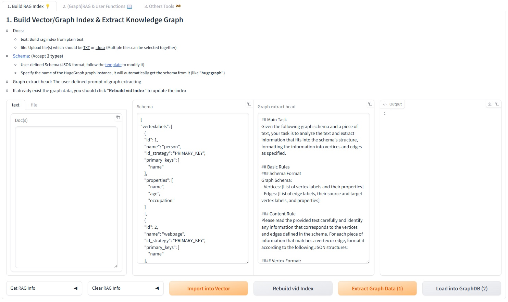

HugeGraph-LLM supports knowledge graph construction, GraphRAG, and natural-language graph queries.
This guide describes current 1.8 source builds; pin an image that supports the configuration contract below.

Its demo service hosts Gradio and FastAPI in one process. Source launches listen locally at `127.0.0.1:8001`, accessible at `http://localhost:8001`; explicitly
use `--host 127.0.0.1` for local-only access. `Dockerfile.llm` overrides this to `0.0.0.0:8001`; do not use loopback inside the container, or published ports
will not reach the service.

> [!WARNING]
> Production requires HugeGraph-LLM login (`ENABLE_LOGIN=True`, replacing `USER_TOKEN` and `ADMIN_TOKEN`) and a source IP allowlist at the firewall or network entry point. Separately enable [Server authentication and authorization](/docs/config/config-authentication/), retain Server audit logs (normally `audit-*.log`), and grant `GRAPH_USER` only the permissions this service needs. AI service tokens authenticate the LLM UI and API, not HugeGraph Server.

## Requirements {#requirements}

> AI-generated project documentation: [Ask DeepWiki](https://deepwiki.com/apache/hugegraph-ai)

- Python >= 3.12 (Python 3.12–3.14 supported)
- [`uv`](https://docs.astral.sh/uv/getting-started/installation/)
- HugeGraph Server 1.5.0 or later; the current workspace client rejects detectable older versions

Choose your deployment method below:

- [Deploy with Docker Compose](#deploy-with-docker-compose) — Quickly spin up Server and HugeGraph-LLM containers together.
- [Deploy on Kubernetes](#deploy-on-kubernetes) — Deploy the RAG service onto Kubernetes using Helm.
- [Start from Source](#start-from-source) — Set up Python environment with `uv` and run the Gradio/FastAPI app locally.
{.cards}

## Deploy with Docker Compose {#deploy-with-docker-compose}

The current source workspace's Compose file expects its `1.8.0` image. Build the checkout locally before starting it;
source version metadata does not imply that the matching public image tag has been published.
Prepare the environment files from the HugeGraph-AI repository root:

```bash
git clone https://github.com/apache/hugegraph-ai.git
cd hugegraph-ai
cp docker/env.template docker/.env
# Edit docker/.env and set PROJECT_PATH to the absolute path of this repository
touch hugegraph-llm/.env
# Set GRAPH_URL=http://server:8080 and matching GRAPH_USER / GRAPH_PWD in hugegraph-llm/.env
./scripts/build_llm_image.sh
cd docker
docker compose -f docker-compose-network.yml up -d
docker compose -f docker-compose-network.yml ps
```

After startup, HugeGraph Server is available at `http://localhost:8080`, and the RAG service and Web UI are available at `http://localhost:8001`.

The Compose file mounts `${PROJECT_PATH}/hugegraph-llm/.env` into the container at `/home/work/hugegraph-llm/.env`, so the file has to exist before the container starts. The resource directory `hugegraph-llm/src/hugegraph_llm/resources` can be mounted the same way; the mount is commented out by default.

The default Compose file mounts bootstrap `.env` only. Saved connections need persistent writable storage across container recreation.
For a persistent setup, use the Helm deployment below or mount a resource directory with `HUGEGRAPH_LLM_RESOURCE_PATH` and explicitly retain
`HUGEGRAPH_LLM_ENV_PATH=/home/work/hugegraph-llm/.env` for the bootstrap file. See [configuration paths](./config-reference.md#configuration-files).

The application reads `GRAPH_URL`; Compose-provided `HUGEGRAPH_HOST` and `HUGEGRAPH_PORT` do not override it. Set `GRAPH_URL=http://server:8080` and matching
Server credentials in the container's `.env`.

## Container Images {#container-images}

| Build recipe | Description |
|---|---|
| `docker/Dockerfile.llm` | Source runtime image recipe; starts `python -m hugegraph_llm.demo.rag_demo.app --host 0.0.0.0 --port 8001` |
| `docker/Dockerfile.nk` | Nuitka binary image recipe using the `nk-llm` extra; starts `./app.dist/app.bin` |

Compose selects `hugegraph/rag:1.8.0`. The local build script uses the image repository and version from the root `pyproject.toml`:

```bash
./scripts/build_llm_image.sh
```

It builds `hugegraph/rag:1.8.0` locally without pushing. Load it onto cluster nodes or push to your own registry before a remote deployment;
a locally built image does not replace an already running container. Both Dockerfiles expose port `8001`, run as non-root user `work`,
and declare the resource directory as a volume. Persist a writable resource directory for saved connections, prompts and indexes.

## Deploy on Kubernetes {#deploy-on-kubernetes}

Use the [unified HugeGraph Helm deployment](/docs/quickstart/hugegraph/hugegraph-helm/#8-graphrag).
Layer `values-rag.yaml` after the single-node or cluster preset in the Server repository's `helm/hugegraph` chart.
It connects `hugegraph/rag` to the Server and credentials from the same release; it does not require a separate AI chart.

The RAG service stays internal on `ClusterIP:8001`. Its single replica uses `Recreate` and a 10 Gi persistent volume by default;
keep the saved connections, prompts and indexes when upgrading. Use local port forwarding for a first check, then configure models through the UI.
Under strict NetworkPolicy, allow the selected model/vector endpoints with `rag.networkPolicy.extraEgress` and authorized entry points with
`extraIngress`; enforcement requires a supporting CNI. The Helm guide owns installation, storage and access examples.

See the [configuration reference](./config-reference.md#saved-connections) for saved connections and deployment defaults.

## Start from Source {#start-from-source}

1. **Clone the repository:**

   ```bash
   git clone https://github.com/apache/hugegraph-ai.git
   cd hugegraph-ai
   ```

1. **Install dependencies and activate environment:**

   ```bash
   uv sync --extra llm
   source .venv/bin/activate
   ```

1. **Launch the Web application:**

   ```bash
   cd hugegraph-llm
   python -m hugegraph_llm.demo.rag_demo.app
   ```
{.steps}

To use a custom address and port:

```bash
python -m hugegraph_llm.demo.rag_demo.app \
  --host 127.0.0.1 \
  --port 18001
```

Set `HG_DEV_RELOAD=1` to start uvicorn with auto-reload during development.

Set deployment defaults, including login, in the process environment or `.env`. The UI and configuration APIs save application connections
in `settings.yaml`; these saved connections survive restarts and override deployment defaults.

Missing configuration uses code defaults without
writing files at startup. Use `HUGEGRAPH_LLM_RESOURCE_PATH` for a writable persistent directory containing settings, prompts and generated indexes.
See [configuration paths and precedence](./config-reference.md) before mounting a read-only Secret or changing deployment defaults.

## Main Capabilities {#main-capabilities}

### Build RAG Indexes {#build-rag-indexes}

The first Web UI tab splits text into a chunk vector index, extracts vertices and edges according to a schema, writes the graph to HugeGraph, and updates the vertex vector index. Input can be typed into the `text` tab or uploaded through the `file` tab, which accepts `.txt`, `.docx`, and `.pdf` files and allows selecting several at once. Encrypted PDFs and scanned PDFs without an extractable text layer are rejected.

The schema can be inline JSON or the name of an existing graph. Through the REST API, a graph name requires a matching `client_config.graph`; inline JSON neither connects to HugeGraph nor accepts `client_config`.

The tab also carries two generators. `Graph Schema Generator` derives a schema from query examples plus a few-shot example. `Graph Extraction Prompt Generator` writes an extraction prompt from a described scenario and a selected reference example. A `Graph Extraction Split Type` dropdown chooses `document`, `paragraph`, or `sentence` granularity before extraction.

### GraphRAG {#graphrag}

The query pipeline can combine direct LLM answers, chunk-vector retrieval, and graph retrieval. Graph retrieval first extracts keywords and matches vertices, then attempts Text2Gremlin. If generation or execution fails, it can fall back to predefined graph traversals. Request parameters control result limits, vector distance thresholds, template counts, and reranking.

The same tab has a batch back-testing panel that reads questions from an `.xlsx` or `.csv` file, answers each one, and returns a downloadable file. A template file is offered for download next to the upload control.



### Text2Gremlin {#text2gremlin}

`POST /text2gremlin` generates Gremlin from natural language, the graph schema, and optional examples. A custom prompt must retain `{query}`, `{schema}`, `{example}`, and `{vertices}`.

The matching UI tab can first build the example vector index from a `.json` or `.csv` file of question and Gremlin pairs. The bundled `resources/demo/text2gremlin.csv` is used when no file is supplied.

### Graph and Admin Tools {#graph-and-admin-tools}

The `Graph Tools` tab runs a Gremlin query directly, triggers a manual graph backup, and can initialize demo data in HugeGraph. The `Admin Tools` tab shows the last lines of `logs/llm-server.log` behind an `ADMIN_TOKEN` prompt, and can refresh or clear that file.

Two background tasks run for the lifetime of the process: a cron job that backs up the graph every day at 01:00, and a task that keeps vertex-id embeddings up to date.

## Models and Vector Backends {#models-and-vector-backends}

Chat supports OpenAI-compatible endpoints and Ollama. Extraction and Text2Gremlin follow Chat until configured independently; embeddings have their own
connection.
The application accepts `openai` and `ollama/local` providers. Use an OpenAI-compatible proxy URL for other providers; the standalone SDK also has a LiteLLM
adapter. Reranking supports Cohere and SiliconFlow.

FAISS is the default vector index. `CUR_VECTOR_INDEX` selects `Faiss`, `Milvus`, or `Qdrant`, and the same choice is available in the `5. Set up the vector engine.` panel of the Web UI. Milvus and Qdrant require the optional dependencies:

```bash
cd hugegraph-ai
uv sync --package hugegraph-llm --extra vectordb
```

See the [workflow guide](./quick_start.md), the [configuration reference](./config-reference.md), and the [REST API](./rest-api.md) for details.

## Programmatic Use {#programmatic-use}

The former `RAGPipeline` and `KgBuilder` classes were replaced by a pipeline scheduler. Call a flow by name through `SchedulerSingleton`:

```python
from hugegraph_llm.flows.scheduler import SchedulerSingleton

scheduler = SchedulerSingleton.get_instance()
res = scheduler.schedule_flow(
    "rag_graph_only",
    query="Tell me about Al Pacino.",
    graph_only_answer=True,
    vector_only_answer=False,
    raw_answer=False,
    gremlin_tmpl_num=-1,
    gremlin_prompt=None,
)
print(res.get("graph_only_answer"))
```

The registered flow names are `rag_raw`, `rag_vector_only`, `rag_graph_only`, `rag_graph_vector`, `text2gremlin`, `build_examples_index`, `build_vector_index`, `graph_extract`, `import_graph_data`, `update_vid_embeddings`, `get_graph_index_info`, `build_schema`, and `prompt_generate`. `schedule_stream_flow` is the async streaming variant.

## Development Checks {#development-checks}

Install the module and the development tools from the repository root, then run the checks that mirror CI:

```bash
cd hugegraph-ai
uv sync --extra llm --extra dev
uv run ruff format --check .
uv run ruff check .

cd hugegraph-llm
SKIP_EXTERNAL_SERVICES=true uv run pytest src/tests/config/ src/tests/document/ src/tests/middleware/ \
  src/tests/operators/ src/tests/models/ src/tests/indices/ src/tests/test_utils.py -v --tb=short
SKIP_EXTERNAL_SERVICES=true uv run pytest src/tests/integration/test_graph_rag_pipeline.py \
  src/tests/integration/test_kg_construction.py src/tests/integration/test_rag_pipeline.py -v --tb=short
```

Git hooks are available through pre-commit:

```bash
cd hugegraph-ai
pre-commit install
pre-commit run --all-files
```
