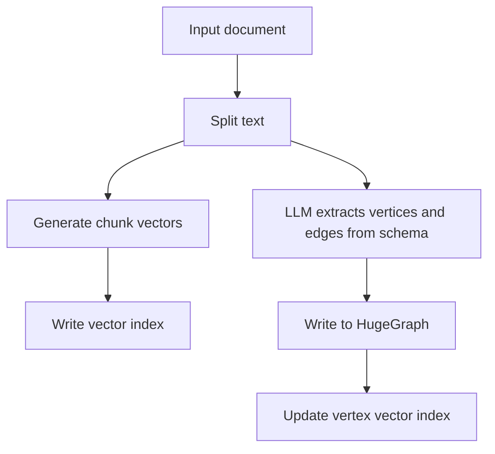
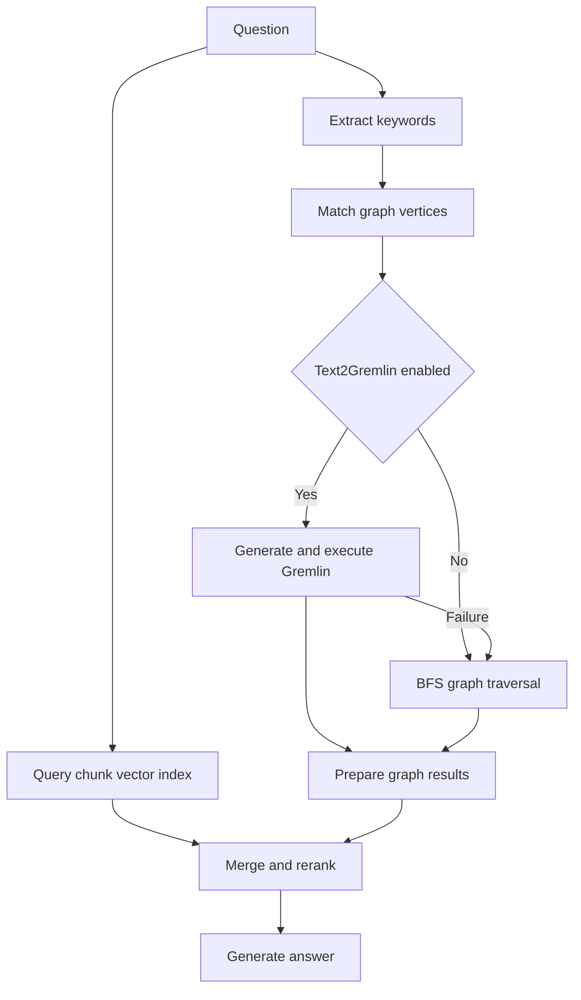

Follow the Web UI to build indexes, query documents, and generate Gremlin. See [HugeGraph-LLM](./hugegraph-llm.md) for startup instructions.

Prepare a reachable HugeGraph Server, a generation model, and an embedding model. Viewing settings or running handwritten Gremlin in
`Graph Tools` needs no model. Document vectors require embeddings; graph extraction and answers also require an LLM.
The reranker is optional. Start with the local `bleu` method.

| Task | UI tab | Prerequisites |
| --- | --- | --- |
| Build indexes from documents | `1. Build RAG Index` | Documents and embeddings; graph extraction also needs a schema and LLM |
| Answer from documents or a graph | `2. (Graph)RAG & User Functions` | The corresponding indexes and an LLM |
| Convert a question to Gremlin | `3. Text2gremlin` | Graph schema and LLM; examples also need embeddings and an example index |
| Check graph data directly | `4. Graph Tools` | A HugeGraph connection and handwritten Gremlin |

The screenshots show the HugeGraph-LLM Web UI. The built-in prompt language can be toggled via `LANGUAGE` in `.env`, while UI controls remain in English.

> [!DETAILS]- Missing batch-question template when starting from source
>
> If startup raises `FileNotFoundError` for `questions_template.xlsx`, create the input template from the repository root after installing dependencies,
> then restart. This preserves an existing file. The template has all 6 columns, with a test question and expected answer; the 4 model-answer columns stay empty.
>
> ```bash
> uv run --extra llm python - <<'PYTHON'
> from pathlib import Path
> from openpyxl import Workbook
>
> path = Path("hugegraph-llm/src/hugegraph_llm/resources/demo/questions_template.xlsx")
> if not path.exists():
>     workbook = Workbook()
>     sheet = workbook.active
>     sheet.append([
>         "Question", "Expected Answer", "Basic LLM Answer",
>         "Vector-only Answer", "Graph-only Answer", "Graph-Vector Answer",
>     ])
>     sheet.append(["Who is Sarah?", "Sarah is a 30-year-old attorney.", None, None, None, None])
>     workbook.save(path)
> PYTHON
> ```

## 0. Configuration Panel

Above the tabs sits a collapsible configuration panel with five sections: `1. Set up the HugeGraph server.`, `2. Set up the LLM.`, `3. Set up the Embedding.`, `4. Set up the Reranker.`, and `5. Set up the vector engine.`. Each section has its own apply button, and applying a change writes the supported fields back to `.env`. The header also shows the current prompt language.

Set the answer, extraction, and query-generation models in the `chat`, `mini_tasks`, and `text2gql` sub-tabs of the LLM settings.
The screenshots use local Ollama models `qwen2.5:3b` and `mxbai-embed-large`, with `Faiss` as the vector engine.
Rebuild indexes after changing embedding models, since vector dimensions or meaning can differ.

## 1. Build RAG Indexes

The first tab splits documents into a chunk vector index. It also extracts vertices and edges according to a schema, writes them to HugeGraph, and maintains a vertex vector index.



Input comes from either the `text` sub-tab or the `file` sub-tab. Uploads accept `.txt`, `.docx`, and `.pdf`, and several files can be selected at once.

For a first run, paste this short document into `Input Doc(s)`. Select a dedicated test graph before importing it.

```text
Sarah is a 30-year-old attorney. James is a journalist. Sarah has been James's roommate since 2010.
```

Paste this JSON into `Graph Schema` and keep the default extraction prompt.
It allows people and roommate relationships, with optional age and occupation.

```json
{
  "vertexlabels": [
    {"id": 1, "name": "person", "id_strategy": "PRIMARY_KEY",
     "primary_keys": ["name"], "properties": ["name", "age", "occupation"],
     "nullable_keys": ["age", "occupation"]}
  ],
  "edgelabels": [
    {"name": "roommate", "source_label": "person", "target_label": "person", "properties": ["date"]}
  ],
  "propertykeys": [
    {"name": "name", "data_type": "TEXT", "cardinality": "SINGLE"},
    {"name": "age", "data_type": "INT", "cardinality": "SINGLE"},
    {"name": "occupation", "data_type": "TEXT", "cardinality": "SINGLE"},
    {"name": "date", "data_type": "TEXT", "cardinality": "SINGLE"}
  ]
}
```

Follow these steps to build the indexes. For vector-only retrieval, stop after step 1.

1. Click `Import into Vector` to split the document and build the chunk vector index.
2. Enter schema JSON or an existing graph name in `Graph Schema`, then click `Extract Graph Data (1)`.
   Check the vertices, edges, and properties in `Output Info`.
3. Click `Load into GraphDB (2)` after checking the extraction. This writes to HugeGraph and refreshes vertex embeddings.
4. Open `Graph Tools`. Run `g.V().count()` and `g.E().count()`, then query the properties to confirm that the data was written.
{.steps}

This example should produce 2 vertices and 1 edge, with Sarah's age set to `30` and occupation to `attorney`.
If the graph already contains data, use `Update Vid Embedding` to refresh its vertex index separately.
The `Graph Extraction Split Type` dropdown selects `document`, `paragraph`, or `sentence`.
`document` uses the whole input; the other options split it before extraction.

The page can also inspect or clear chunk indexes, vertex indexes, and graph data. Clearing removes existing data, so first confirm that the current graph and indexes are not still used by other queries.

Two collapsed helpers sit below the main controls:

- `Graph Schema Generator` takes query examples and a few-shot example and produces a schema for the Graph Schema field.
- `Graph Extraction Prompt Generator` takes an expected scenario, such as social relationships or a financial knowledge graph, and a selected reference example, and produces a Graph Extract Prompt Header.

## 2. GraphRAG Queries

The second tab offers four answer modes. Choose the indexes needed for your question.

| Control | Answer source |
| --- | --- |
| `Basic LLM Answer` | The LLM alone, without document or graph retrieval |
| `Vector-only Answer` | Retrieved document chunks |
| `Graph-only Answer` | Retrieved graph data |
| `Graph-Vector Answer` | Retrieved graph data and document chunks |

Using `Graph-Vector Answer` is recommended, as it combines graph traversal and
vector search for more comprehensive fact retrieval. Other scopes are summarized in the table above.

The screenshots use these short prompts. Paste them into `Query Prompt` and `Keywords Extraction Prompt`, respectively.
The service fills the placeholders. Keep the `KEYWORDS:` prefix and ASCII colons in keyword output, and preserve name capitalization.

```text
Answer the question in English using only the retrieved context. Preserve names and state when the context is insufficient.
Context: {context_str}
Question: {query_str}
```

```text
Extract person names from the question and preserve their case. Return at most {max_keywords} names.
Return one line in this exact ASCII format: KEYWORDS:name:1.0
Question: {question}
```

1. Enter `Who is Sarah?`, set `Graph-only Answer` to `False`, and set `Graph-Vector Answer` to `True`.
2. Keep `Template Num=-1` and `Rerank method=bleu` for the first check, then click `Answer Question`.
3. Read `Graph-Vector Answer` and compare facts such as age and occupation with the source document and graph.
{.steps}

```gallery


```



Graph retrieval first matches HugeGraph vertices exactly by keyword and then uses vector similarity if no exact match exists. The matched vertices are passed to Text2Gremlin. If generation or execution fails, the pipeline can fall back to a predefined traversal.

`Template Num` controls how Text2Gremlin participates in graph retrieval:

- A negative value skips Text2Gremlin entirely, so graph retrieval goes straight to the predefined traversal.
- `0` uses baseline generation without retrieving examples.
- A positive value retrieves that many similar examples from the example index and uses the template-guided result. The example count is clamped to the range 0 to 10.

Other controls on this tab are `Rerank method` (`bleu` or `reranker`), `Graph Ratio`, `Near neighbor first`, and `Query related information`, plus editable `Query Prompt` and `Keywords Extraction Prompt` fields.

Below the single-question panel is a batch back-testing panel. Upload an `.xlsx` or `.csv` file of questions, set `Max Lines To Show`, and click `Generate Answer (Batch)`. The answers appear in a preview table and can be downloaded as a file. A template file is offered next to the upload control.

## 3. Text2Gremlin

The third tab converts natural language into Gremlin and executes the generated queries.
The upper panel builds an example vector index from question and Gremlin pairs in `.json` or `.csv` files.
When no file is uploaded, it uses `resources/demo/text2gremlin.csv`. Match example labels and properties to the current graph.

> [!TIP]
> If building the example index does not automatically retrieve similar templates, you can provide few-shot examples directly in the Prompt template below.

Use these inputs to reproduce the Sarah query.

1. Save the CSV below as `sarah-gremlin.csv`, upload it, and click `Build Example Vector Index`. Set `Number of refer examples` to `1`.
2. Paste the simplified schema below into `Schema`. It contains only the labels and properties needed for this query.
3. Paste the prompt below into `Prompt`, enter `Who is Sarah?`, then click `Text2Gremlin`.
4. Check both generated queries and their `Query ... Output` fields. This example returns Sarah with `age=30` and `occupation=attorney`.
{.steps}

```csv
query,gremlin
Who is Sarah?,"g.V().has('person', 'name', 'Sarah').valueMap()"
```

```json
{"vertexlabels":[{"name":"person","properties":["name","age","occupation"]}],"edgelabels":[]}
```

```text
Translate the question into a read-only HugeGraph Gremlin query.
For person-name lookups, use g.V().has('person', 'name', '<name from question>').valueMap().
Preserve name capitalization. Query by name; do not use vertex IDs.
Example question: Who is Peter?
Example Gremlin: g.V().has('person', 'name', 'Peter').valueMap()
Graph schema: {schema}
Additional examples: {example}
Known vertices: {vertices}
Question: {query}
Return only one ```gremlin``` code block.
```

```gallery

```

A small model can generate incorrect IDs, change name capitalization, or use filters that do not meet the graph's index requirements.
Check the returned data before treating a query as successful. The Web UI executes generated queries directly, so use a dedicated test graph.
To generate a query without executing it, select the corresponding output types in the [REST API](./rest-api.md).

A custom prompt must retain `{query}`, `{schema}`, `{example}`, and `{vertices}`. The REST API rejects it if any placeholder is missing.

## 4. Graph and Administration Tools

`Graph Tools` runs a Gremlin query directly against the configured graph, triggers a manual graph backup, and can initialize demo data in HugeGraph through a beta action. A background job also backs up the graph every day at 01:00, and a second background task keeps vertex-id embeddings up to date while the process runs.
Initializing demo data first clears the current graph. Use this action only on a dedicated test graph.

`Admin Tools` is password protected. Entering the configured `ADMIN_TOKEN` reveals the tail of `logs/llm-server.log`, which refreshes every 60 seconds, along with buttons to refresh or clear it. Access is refused while `ADMIN_TOKEN` is empty or still set to the placeholder `xxxx`.

When `ENABLE_LOGIN=True`, the Web UI asks for basic credentials with the fixed user name `rag` and `USER_TOKEN` as the password, and the REST API requires `USER_TOKEN` as a Bearer token. The log endpoint additionally requires a separately configured, secure `ADMIN_TOKEN`.

> [!WARNING]
> In production, enable HugeGraph-LLM login, replace `USER_TOKEN` and `ADMIN_TOKEN`, and enforce a source IP allowlist at the firewall or network entry point. Separately enable [Server authentication and authorization](/docs/config/config-authentication/), retain Server audit logs (normally `audit-*.log`), and grant `GRAPH_USER` minimum required permissions. AI service tokens do not replace Server authentication.

```gallery

```

## 5. Prompt Language

Set `LANGUAGE=EN` or `LANGUAGE=CN` in `hugegraph-llm/.env`, then restart the service. This selects the language of built-in prompts; it does not translate input documents and is not a field in the `/rag` request body.

## 6. REST Calls

The Web UI and REST API use the same pipeline. For application integration, use `/rag`, `/rag/graph`, `/graph/extract`, and `/text2gremlin`; see the [REST API](./rest-api.md) for request formats.
