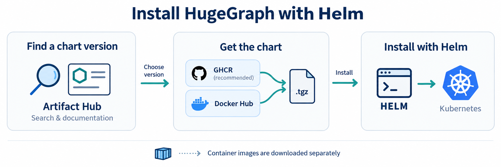
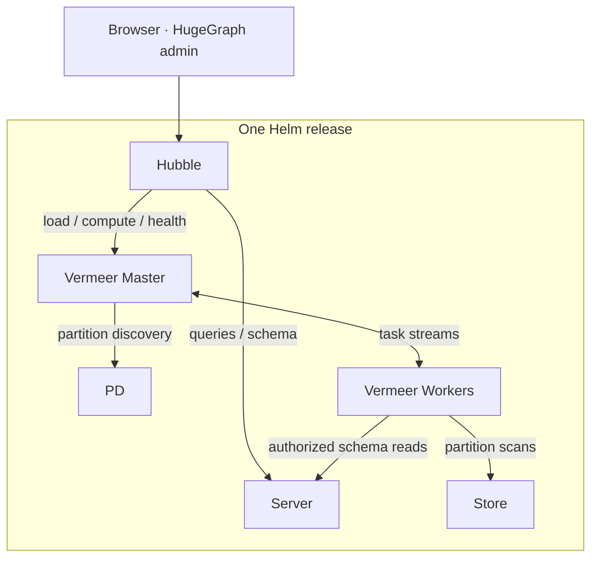

This guide covers HugeGraph **1.8.0 and later**, using Helm **3.10+** with OCI support and Kubernetes (K8s) **1.23+**.
Install `hugegraph-helm` from GHCR or Docker Hub. Chart and HugeGraph versions are maintained separately:
for example, a `0.4.x` Chart can deploy a `1.8.x` service.

> [!WARNING]
> The current development Chart uses `latest` images for the base HugeGraph components and is intended for testing.
> Vermeer also follows `latest` with `pullPolicy: Always`; select compatible Hubble and Vermeer builds together.
> The optional RAG overlay pins its own image digest; see [optional components](#optional-engines).
> For production, choose a stable Chart once the corresponding HugeGraph service has been released, and review its image versions.
> Image tags can change; set each component's `image.digest` to keep using the same image content.

[Artifact Hub](https://artifacthub.io/packages/helm/hugegraph-helm/hugegraph-helm) helps you find the Chart, browse versions and read installation instructions.
The packages themselves are downloaded from GHCR or Docker Hub.

See the [chart README](https://github.com/apache/hugegraph/blob/master/helm/hugegraph/README.md) for settings and source-based development,
and the [operations reference](https://github.com/apache/hugegraph/blob/master/helm/hugegraph/docs/operations.md) for lifecycle procedures.



- [Install graph services](#1-install): start PD, Store, Server and Hubble.
- [Use Vermeer through Hubble](#7-vermeer-through-hubble): load graphs, compute, inspect results and monitor the compute cluster.
- [Enable GraphRAG](#8-graphrag): connect models for extraction, retrieval and answers.
{.cards .td-cards-list}

## 1 Install

> [!NOTE]
> **Default Topology & Storage Prerequisites**
> - **Components**: Deploys **3 PD + 3 Store + 3 Server and Hubble** by default, with authentication and persistent storage enabled.
> - **Volume Requirements**: Requires a default dynamic StorageClass or matching pre-created static PVs, totaling 7 persistent volumes
>   (3 × 10 GiB PD volumes, 3 × 50 GiB Store volumes, and 1 × 1 GiB Hubble volume).
> - **Memory Sizing**: Retains container JVM memory auto-calculation; configure resource requests/limits to allocate sufficient physical memory
>   for the 9 JVMs and Hubble.

Choose either registry; GHCR is recommended for public CI. For local lightweight testing, use the single-node preset.

> [!TIP]
> `--devel` selects the highest Chart version, including development and stable versions, without limiting the version series.
> For production or reproducible installations, replace `--devel` with `--version <published-version>` to pin your chosen version.

```bash {tab="GHCR (recommended)"}
CHART=oci://ghcr.io/hugegraph/hugegraph-helm
kubectl config current-context
kubectl get nodes
kubectl get storageclass
helm install hugegraph "$CHART" --devel -n hugegraph \
  --create-namespace --wait --timeout 15m
```

```bash {tab="Docker Hub"}
CHART=oci://registry-1.docker.io/hugegraph/hugegraph-helm
kubectl config current-context
kubectl get nodes
kubectl get storageclass
helm install hugegraph "$CHART" --devel -n hugegraph \
  --create-namespace --wait --timeout 15m
```

```bash {tab="Single-node trial"}
# For local testing (Minikube, Kind): install the Chart downloaded below
CHART=oci://ghcr.io/hugegraph/hugegraph-helm
helm pull "$CHART" --devel --untar
helm install hugegraph ./hugegraph-helm -n hugegraph \
  -f ./hugegraph-helm/values-single.yaml \
  --create-namespace --wait --timeout 10m
```

The single-node preset selects 1 PD + 1 Store + 1 Server using HStore, plus Hubble, with relaxed scheduling constraints.
It leaves SeaTunnel, Vermeer and RAG disabled. HugeGraph topology, Vermeer topology, and the HTTP exposure mode are separate choices.

## 2 Modes and entry points

The extracted package is rooted at `hugegraph-helm/`; the source directory remains `helm/hugegraph/`.

```filetree {wrap=true title="HugeGraph Helm Chart Layout"}
hugegraph-helm/
  Chart.yaml            # Chart metadata and version definitions
  values.yaml           # Default values (easy mode: 3 PD + 3 Store + 3 Server + 1 Hubble, NodePort)
  values-single.yaml    # Single-node preset (local Minikube/Kind testing with 1 replica and no anti-affinity)
  values-cluster.yaml   # Multi-node cluster preset (required anti-affinity, Store OnDelete rollout)
  values-strict.yaml    # Hardened security preset (strict mode: ClusterIP only, strict NetworkPolicies)
  values-rag.yaml       # Optional single-process GraphRAG overlay, layered after a topology preset
  values.schema.json    # Schema validation for values configuration
  templates/            # Kubernetes workload templates
    pd-statefulset.yaml   # PD StatefulSet (metadata and scheduling)
    store-statefulset.yaml # Store StatefulSet (storage engine)
    server-deployment.yaml # Server Deployment (injects serviceId and graphSpace)
    hubble-deployment.yaml # Hubble UI Deployment
    tests/              # Smoke validation hook (helm test, supports custom testGraphAlias)
  examples/             # Deployment examples: local PVs, GitOps credentials, optional engines and Ingress
  docs/operations.md    # Lifecycle operations and recovery guide
```

`mode: easy` is the default. Server and Hubble use automatic NodePorts; PD stays ClusterIP. HTTP works without a domain, certificate or acknowledgement.
`mode: strict` defaults Server/Hubble to ClusterIP and enables full NetworkPolicy isolation.
Enabled SeaTunnel and Vermeer native HTTP/UI default to NodePort in easy mode and ClusterIP in strict mode; both require login.

Internal RPC, Worker HTTP and SeaTunnel member ports remain private.
Both modes keep authentication and persistence.
Explicit component parameters take priority over global parameters, which take priority over mode defaults; explicit `false` remains an override.
The global parameters are `persistence.enabled` and `global.imageRegistry`. Strict mode is also available through `values-strict.yaml`.

| Entry | Access | Requirements |
|---|---|---|
| NodePort | `http://<reachable-node-ip>:<assigned-node-port>` | Node connectivity and firewall access; no additional controller |
| ClusterIP | Internal Service IP/DNS, for example `hugegraph-server.hugegraph.svc:8080` | External clients use port-forward or an existing gateway |
| LoadBalancer | Infrastructure-assigned address | Compatible load balancer controller |
| Ingress | HTTP routing through a controller | Installed controller; hostname and TLS optional |

```bash
kubectl -n hugegraph get svc hugegraph-server hugegraph-hubble
kubectl get nodes -o wide
kubectl -n hugegraph get secret hugegraph-admin \
  -o jsonpath='{.data.password}' | base64 --decode
```

Open Hubble on its assigned NodePort and log in as `admin` with this password. A node need not host the Pod with default `externalTrafficPolicy: Cluster`.
The internal ClusterIP is a virtual Service address, not a node IP; a laptop normally cannot reach it directly.
Use `kubectl -n hugegraph port-forward svc/hugegraph-hubble 8088:8088` for a local browser at `http://127.0.0.1:8088`.

The base PD/Server/Hubble client Services support `externalTrafficPolicy`, `loadBalancerClass`, `loadBalancerIP`, `loadBalancerSourceRanges`, `externalIPs`
and `allocateLoadBalancerNodePorts`, subject to the cluster/controller's capabilities. Use LoadBalancer fields with that Service type.
NodePort omission or `0` means automatic allocation.

Fixed ports are validated against the cluster's configured range by Kubernetes;
the chart does not force `30000–32767`. Legacy HTTP acknowledgement fields remain accepted but no longer gate rendering.

### Optional engines: disabled by default {#optional-engines}

By default, the Chart provisions PD + Store + Server + Hubble. Enable the components needed for your workflow:

| Engine | Default | Purpose | Topologies (`*.mode`) | Access & Security |
|---|---|---|---|---|
| **Hubble** | Enabled (`true`) | Graph visualization, multi-graphspace management & metrics | Single-replica Deployment | Follows global `mode` (NodePort or ClusterIP) |
| **SeaTunnel** | Disabled (`false`) | Heterogeneous data ingestion & full graph migration | `standalone` / `cluster` | NodePort in easy, ClusterIP in strict; HTTP Basic auth |
| **Vermeer** | Disabled (`false`) | Memory-first high-performance distributed graph algorithms | `standalone` / `cluster` | NodePort in easy, ClusterIP in strict; Token auth, auto-wired to Hubble |
| **GraphRAG** | Disabled (`false`) | Extraction, indexing, retrieval and graph-assisted answers | One process, one replica | ClusterIP; same-release Server credentials are automatic |
{.wide .expand}

Enable SeaTunnel or Vermeer with its `enabled` key; their native administrator passwords are separate from Server.
For RAG, layer `values-rag.yaml` after the topology preset; it keeps its HTTP entry private in both modes.
For `seatunnel.service.type` and `vermeer.service.type`, `null` inherits the mode default: NodePort in easy mode, ClusterIP in strict mode.

An explicit `ClusterIP` stays private; an explicit `NodePort`, including in strict mode, exposes authenticated HTTP/UI.
Clear an older explicit `ClusterIP` override to `null` to inherit easy mode. With `service.nodePort` omitted or `null`, Kubernetes assigns the port.
The engines' `standalone` / `cluster` topologies are independent of these access settings.

Continue with the component's workflow:

- [SeaTunnel](#6-start-seatunnel): start its engine, submit import/export jobs and verify the target graph.
- [Vermeer through Hubble](#7-vermeer-through-hubble): load a graph, compute, read results and inspect compute health.
- [GraphRAG](#8-graphrag): connect models for extraction, retrieval and answers.

### PD metadata namespace {#metadata-namespace}

The top-level `metadataCluster` parameter (default `hg-test`) specifies the PD metadata cluster prefix. The Chart injects this value into Server `HG_SERVER_CLUSTER` and Store `PD_CLUSTER`, ensuring Store correctly locates the Schema initialized by Server when processing Vermeer graph scans.

> [!IMPORTANT]
> `metadataCluster` is a metadata namespace prefix, not a Raft group name. Modifying it **does not** automatically migrate existing graph data. Always preserve the original cluster prefix when enabling Vermeer; if graph load tasks fail with `Schema missing` or `no such vertex label`, check that the namespace prefix matches across all components. Refer to the [Metadata Namespace Operations Guide](./hugegraph-helm-operations.md#metadata-namespace) for details.
Standard older releases using `hg-test` need no namespace-adoption step. For a custom legacy prefix, follow
[metadata namespace adoption](./hugegraph-helm-operations.md#metadata-namespace) before upgrading.

### Server service identity and graph space

Both `server.serviceId` and `server.graphSpace` default to `DEFAULT`. To register the Server with a specific service name or graph space in PD:

For configuration-only changes, keep the installed Chart version and values.
Find the version with `helm list` and replace the placeholder below:

```bash
helm list -n hugegraph
CHART=oci://ghcr.io/hugegraph/hugegraph-helm
CHART_VERSION='<installed-chart-version>'
helm upgrade hugegraph "$CHART" --version "$CHART_VERSION" -n hugegraph --reuse-values \
  --set-string server.serviceId=analytics \
  --set-string server.graphSpace=team_a \
  --set-string server.testGraphAlias=team_a-demo
```

A non-default graph space must be created through the PD API before starting its assigned Server. `server.testGraphAlias` specifies the Gremlin binding checked
by `helm test` (case-sensitive) and does not auto-infer from `graphSpace`. Do not re-declare service ID or graph space in `server.extraEnv`.

## 3 Internal images and storage

[Complete examples](https://github.com/apache/hugegraph/tree/master/helm/hugegraph/examples) cover private registries, dynamic storage, seven local PVs,
GitOps credentials, API-only deployment and a hostless HTTP Ingress.

Set `global.imageRegistry` to prefix unqualified image repositories; an explicit registry in a component repository takes precedence.
The default mirror inventory is only `hugegraph/pd`, `hugegraph/store`, `hugegraph/server` and `hugegraph/hubble`, at the configured tags/digests.

Store's PD wait init container and the Helm test reuse Store and Server images respectively, which already contain `curl`.
No separate curl image or runtime package installation is required. Explicit `store.waitImage` / `server.waitImage` overrides remain supported.

Enabled SeaTunnel additionally needs its configured `apache/seatunnel` image; Vermeer uses `hugegraph/vermeer` at your selected tag or digest.
Enabled RAG also needs `hugegraph/rag` at the digest in `values-rag.yaml` (or your reviewed override).
Vermeer reuses that image for Master, Worker and service-token initialization. Mirror every enabled image and explicit helper override.

For a custom Vermeer image, also update `vermeer.image.digest`, or explicitly clear it when selecting by tag; a nonempty digest takes priority.

### Storage configuration

For storage, empty `storageClassName` inherits the cluster default, while `"-"` explicitly selects no StorageClass.
Local PVs require prepared host directories, matching capacities, `nodeAffinity` and a `kubernetes.io/no-provisioner` StorageClass;
`WaitForFirstConsumer` binds with the Pod's scheduling constraints. See the complete seven-volume example before creating resources.

For a new temporary installation, set `persistence.enabled=false` to use `emptyDir`; component storage flags override it.
The chart never replaces a failed PVC with temporary storage and rejects PD/Store storage-mode changes on initialized releases.

Vermeer uses separate Master and Worker claims, even in its single-Pod mode: two additional volumes in standalone,
or one Master volume plus one per Worker in cluster mode. With the default base topology this means 9 or 11 volumes respectively.
The small HugeGraph preset plus standalone Vermeer needs 5. The seven-volume local example covers only the base installation.

SeaTunnel checkpoints remain temporary local files. RAG adds one 10 GiB PVC by default, independent of the graph topology.

### Offline installation and internal repositories

Select the latest version, download that Chart and move the `.tgz` into your network.
Install it directly or upload it to an existing OCI or HTTP repository.
In air-gapped environments, override the image registry with `--set global.imageRegistry=...`,
see [values-internal-registry.yaml](https://github.com/apache/hugegraph/blob/master/helm/hugegraph/examples/values-internal-registry.yaml).

```bash
CHART=oci://ghcr.io/hugegraph/hugegraph-helm
CHART_VERSION=$(helm show chart "$CHART" --devel | sed -n 's/^version: //p')
helm pull "$CHART" --version "$CHART_VERSION"
```

```bash {tab="Install archive"}
# Override the image registry in air-gapped clusters (or use -f values-internal-registry.yaml)
helm install hugegraph "./hugegraph-helm-${CHART_VERSION}.tgz" -n hugegraph \
  --set global.imageRegistry=registry.example.com \
  --create-namespace --wait --timeout 15m
```

```bash {tab="Internal OCI"}
helm registry login registry.example.com
helm push "./hugegraph-helm-${CHART_VERSION}.tgz" oci://registry.example.com/charts
helm install hugegraph oci://registry.example.com/charts/hugegraph-helm \
  --version "$CHART_VERSION" -n hugegraph \
  --set global.imageRegistry=registry.example.com \
  --create-namespace --wait --timeout 15m
```

```bash {tab="Internal HTTP"}
# Upload the same .tgz using your repository's upload mechanism and update index.yaml.
# For a static HTTP repository, use helm repo index. Native helm push only supports OCI.
helm repo add hugegraph-internal https://charts.example.com
helm repo update hugegraph-internal
helm install hugegraph hugegraph-internal/hugegraph-helm \
  --version "$CHART_VERSION" -n hugegraph \
  --set global.imageRegistry=registry.example.com \
  --create-namespace --wait --timeout 15m
```

Replace the example registry addresses with your own.
The archive contains no container images: mirror all configured container images separately, then override their addresses.

## 4 Authentication and secrets

Normal Helm installations generate and reuse three credentials: `<release>-admin` (`password`), `<release>-auth-token` (`token_secret`)
and `<release>-pd-auth` (`secret-key`). PD REST requires the shared PD secret, supplied to the PD container as `HG_PD_AUTH_SECRET_KEY`;
Server's storage wait and Hubble read the same credential.

It is not a separate user password that must be invented for each Pod.

For GitOps, use fixed encrypted values or pre-created Secrets through `pd.auth.existingSecret`, `server.auth.admin.existingSecret`
and `server.auth.token.existingSecret`. `existingSecret` wins over inline values and is not managed by the chart.

The admin password must be printable ASCII without spaces, colons or backslashes; the PD secret must be printable ASCII without surrounding whitespace
or backslashes; the JWT signing key must be at least 32 bytes. Offline renderers cannot reuse live generated Secrets through `lookup`.

The admin Secret is an **initial** credential. Updating it does not rotate an existing account.
Change the password through `PUT /graphspaces/DEFAULT/auth/users/admin` with `{"user_password":"<new-password>"}` using the existing credential,
update the Secret/source to that same password, then restart the Server Deployment to clear every replica's auth cache.

Hubble is enabled by default and its current login requires Server authentication. Set `hubble.enabled=false` for API-only access;
optionally also set `server.auth.enabled=false` for an unauthenticated API. Inactive credential settings may remain in your values file.

Enabled optional engines always require native login, including in easy mode. Newly generated administrator passwords use 6 random alphanumeric
characters in easy mode or 16 in strict mode. SeaTunnel uses HTTP Basic, while Vermeer uses Secret `<release>-vermeer-admin` and its
**Admin credential** login.

Upgrades retain existing passwords, including when changing mode; mode changes do not rotate them automatically.
Vermeer password sources are `vermeer.auth.admin.password` or `vermeer.auth.admin.existingSecret/key`;
only Master reads that password.

Access native administration according to the final Service type:
NodePort connects via the node IP and assigned port, while ClusterIP uses port-forwarding. Hubble service credentials are automatic.

> [!DETAILS]- Advanced: Vermeer deployment credentials and GitOps
> For GitOps, preserve stable administrator credentials and the separate internal service identity.
> The service signing factor uses `vermeer.auth.value` or `vermeer.auth.existingSecret/key`; Hubble generates its service token automatically.
> Ordinary Hubble use and native password login do not require retrieving that token.
> Changing an external native administrator Secret needs a Master restart only. Service-factor rotation requires Master and Hubble,
> not Workers. Worker Schema reads reuse the deployment administrator unless `vermeer.hugegraphCredentials.existingSecret/key`
> supplies protected username/password JSON for an existing account with the required Schema permissions. No account is created automatically.

## 5 Upgrade and verification

The chart retains the initial PD/Store topology in an immutable `hugegraph-bootstrap` ConfigMap (name follows `fullnameOverride`).
Before upgrading an older installation without that record, follow the
[bootstrap adoption checks](./hugegraph-helm-operations.md#stable-bootstrap-topology).

Preserve the metadata namespace, PVC identities and actual RF;
changing replica counts or deleting the record does not migrate membership.

Use native Helm value reuse to preserve an existing deployment's UI, entry, storage and credentials:

```bash
helm get values hugegraph -n hugegraph --all
# Follow the latest version for testing; use --version with a reviewed stable version for production.
helm upgrade hugegraph "$CHART" --devel -n hugegraph \
  --reuse-values --wait --timeout 15m
helm test hugegraph -n hugegraph --logs --timeout 5m
```

Existing explicit helper images also remain under `--reuse-values`;
add `--set-string store.waitImage= --set-string server.waitImage=` to reuse component images.
Adopt new defaults deliberately with `--reset-values` and a reviewed file retaining your image, credential, storage and topology settings.

Do not treat PD membership, storage or credential changes as ordinary independent overrides; consult the lifecycle reference.

### Migrate root-owned volumes {#root-owned-volume-upgrade}

Current PD, Store and Server images run as UID/GID `10001`. Unless explicitly overridden, PD/Store Pods use `fsGroup: 10001`
and `fsGroupChangePolicy: OnRootMismatch`, including upgrades that reuse an older empty security context.
Apply this volume ownership setting together with the first non-root image.

A root image started in between can create files that
`OnRootMismatch` will not repair later, because that policy checks only the volume root.

Pin the actual non-root image tag or digest for the same rollout. A retained digest wins over the tag.
For a release that already ran root images after `fsGroup` was set, use this one-time repair sequence:

1. **Roll out the non-root images with recursive ownership repair.**

   Replace `<this-version>` with your reviewed non-root build. The example clears reused digests so the tags apply;
   a digest-pinned deployment sets the matching new digests instead.

   ```bash
   helm upgrade hugegraph "$CHART" --devel -n hugegraph --reuse-values \
     --set pd.image.tag=<this-version> \
     --set store.image.tag=<this-version> \
     --set-string pd.image.digest= \
     --set-string store.image.digest= \
     --set pd.podSecurityContext.fsGroupChangePolicy=Always \
     --set store.podSecurityContext.fsGroupChangePolicy=Always \
     --wait --timeout 15m
   ```

1. **Recreate Store Pods and verify `Always` was applied on every replacement.**

   Run the `kubectl get pods` command below first to inspect current policy status.
   Under unpartitioned `RollingUpdate`, `helm upgrade` in step 1 has already recreated Store Pods one by one with `Always` applied.
   Under `values-cluster.yaml` (`store.updateStrategy.type=OnDelete`), `helm upgrade` does not automatically recreate Store Pods,
   so existing Pods have not mounted their volumes under `Always`. In that case, recreate only the Store Pods that do not yet have `Always` applied,
   one at a time using the [controlled rollout procedure](./hugegraph-helm-operations.md#6-rolling-store-images-safely).
   Confirm each replacement Pod runs the selected image, mounts its PVC with `fsGroupChangePolicy: Always`, and passes shard recovery before restoring the policy.

   ```bash
   kubectl get pods -n hugegraph \
     -o jsonpath='{range .items[*]}{.metadata.name}{"\t"}{.spec.containers[*].image}{"\t"}{.spec.securityContext.fsGroupChangePolicy}{"\n"}{end}'
   ```

1. **Restore `OnRootMismatch` after verification.**

   `--reuse-values` retains `Always`, which otherwise walks the whole volume on every Pod start.
   Only restore `OnRootMismatch` after all Store replacements have mounted under `Always`.

   ```bash
   helm upgrade hugegraph "$CHART" --devel -n hugegraph --reuse-values \
     --set pd.podSecurityContext.fsGroupChangePolicy=OnRootMismatch \
     --set store.podSecurityContext.fsGroupChangePolicy=OnRootMismatch \
     --wait --timeout 15m
   ```
{.steps}

Volumes whose CSI driver ignores `fsGroup` (for example many NFS drivers) and `hostPath` volumes need a one-time `chown -R 10001:10001` instead.

### Verify startup and application behavior {#verify-startup-and-application}

`server.storageWaitTimeoutSeconds` defaults to 300 and is passed as `WAIT_STORAGE_TIMEOUT_S`. An unspecified startup probe threshold is derived
from that wait plus 150 seconds; an explicit threshold is preserved and must cover the storage wait plus at least 120 seconds of Server startup.
A contradictory budget fails rendering with the relevant parameter names.

Storage wait timeout is not a JVM memory setting.

The default `helm test` hook checks connectivity and reads. After installation or recovery, also test a new UI login and your application's
read/write queries.
For scheduling, NetworkPolicy, rolling updates and recovery, see [Kubernetes operations](./hugegraph-helm-operations.md).

## 6 Deploy and Use SeaTunnel (Optional Engine) {#6-start-seatunnel}

SeaTunnel is disabled by default. Enabling it starts a long-running Zeta engine and task Web dashboard in the same release.
The official `apache/seatunnel:3.0.0` image comes with built-in HugeGraph connectors (Source and Sink), requiring no custom image builds or plugin installation.

```text
helm/hugegraph/
  examples/
    values-seatunnel-standalone.yaml # Standalone preset (1 Hybrid node, lightweight for local/dev use)
    values-seatunnel-cluster.yaml    # Cluster preset (multiple Hybrid nodes for distributed parallelism)
    seatunnel/
      hugegraph-sink.conf            # Import sample: batch inserts test vertices into HugeGraph
      hugegraph-source.conf          # Export sample: reads graph data from HugeGraph to stdout/logs
      clone/                         # Full graph migration configs
        copy-schema.py               # Automated Schema synchronization script
        person.conf / knows.conf     # Per-label vertex and edge migration job definitions
```

```mermaid
flowchart TB
    A["External Data Source / Remote Graph"] --> ST
    subgraph Release["Same Helm Release"]
        ST["SeaTunnel Zeta<br/>Hybrid Node"] -->|Read / Write| HG["HugeGraph<br/>Server + PD + Store"]
    end
    U["Operators"] -->|Web UI / REST (HTTP Basic)| ST
```

### 6.1 Choose Standalone or Cluster Mode

SeaTunnel uses a Hybrid node architecture where each node handles both job scheduling and execution:
- **Standalone Mode**: Starts 1 persistent node, minimizing memory footprint for development and lightweight jobs.
- **Cluster Mode**: Starts multiple uniform nodes forming a cluster for distributed high availability and higher throughput.

SeaTunnel scaling is fully decoupled from the HugeGraph cluster topology. Install from the extracted chart directory or repository root by combining presets:

```bash {tab="SeaTunnel Standalone"}
helm install hugegraph ./hugegraph-helm -n hugegraph --create-namespace \
  -f ./hugegraph-helm/values-single.yaml \
  -f ./hugegraph-helm/examples/values-seatunnel-standalone.yaml \
  --wait --timeout 30m
```

```bash {tab="SeaTunnel Cluster"}
helm install hugegraph ./hugegraph-helm -n hugegraph --create-namespace \
  -f ./hugegraph-helm/values-single.yaml \
  -f ./hugegraph-helm/examples/values-seatunnel-cluster.yaml \
  --wait --timeout 30m
```

> [!TIP]
> To add SeaTunnel to an existing HugeGraph deployment, simply set `seatunnel.enabled: true` with the chosen topology values and run `helm upgrade`. Existing graph services remain uninterrupted. Because the SeaTunnel image is large, mirror it to your private registry beforehand in air-gapped environments.

### 6.2 Access Web UI and Authentication

SeaTunnel inherits the global `mode` setting when `seatunnel.service.type: null`: easy defaults to NodePort, strict to ClusterIP.
An explicit `ClusterIP` stays private; explicit `NodePort`, including in strict mode, exposes HTTP/UI with the same required login.
Clear an older explicit `ClusterIP` override to `null` to inherit easy mode.

Omit `seatunnel.service.nodePort` or use `null` for automatic allocation.
The `standalone` / `cluster` topology does not change this access choice:

```bash {tab="NodePort (easy mode)"}
kubectl -n hugegraph get svc hugegraph-seatunnel \
  -o jsonpath='{.spec.ports[?(@.name=="http")].nodePort}{"\n"}'
kubectl get nodes -o wide
# Open browser: http://<NodeIP>:<NodePort>/#/overview
```

```bash {tab="Port-forward (General)"}
kubectl -n hugegraph port-forward svc/hugegraph-seatunnel 8081:8080
# Open locally: http://127.0.0.1:8081/#/overview
```

The Web dashboard and REST APIs require independent HTTP Basic authentication in both modes, distinct from HugeGraph Server credentials.
The username is `admin`; newly generated passwords use 6 random alphanumeric characters in easy mode or 16 in strict mode.
Upgrades and mode changes retain the existing password. Read it from the release Secret:

```bash
kubectl -n hugegraph get secret hugegraph-seatunnel-auth \
  -o jsonpath='{.data.password}' | base64 --decode
```

> [!WARNING]
> Port `5801` is reserved for internal Zeta communication and CLI commands; it does not use HTTP Basic auth and remains private.
> External access uses only the authenticated HTTP Service through its assigned NodePort; the application still listens on `8080`.

### 6.3 Run Pre-configured Example Jobs

The Chart mounts sample jobs inside the SeaTunnel Pod, pre-configured with environment variables referencing the in-release Server address, graph name, and credentials:

1. **Prepare Graph**: Ensure an empty target graph exists via Hubble or REST API (default `DEFAULT/graph_a`).
2. **Run Import Job**: Ingest 10 sample vertices under the `seatunnel_demo_person` label:

   ```bash
   kubectl -n hugegraph exec sts/hugegraph-seatunnel -- \
     /opt/seatunnel/bin/seatunnel.sh --master cluster \
     --config /opt/seatunnel/config/hugegraph-sink.conf
   ```

3. **Verify with Export Job**: Run the Source sample job to read back the same vertices and print them to standard logs:

   ```bash
   kubectl -n hugegraph exec sts/hugegraph-seatunnel -- \
     /opt/seatunnel/bin/seatunnel.sh --master cluster \
     --config /opt/seatunnel/config/hugegraph-source.conf
   ```
{.steps}

Inspect job status and DAG progress in real time on the Web dashboard. To use custom graphs or credentials, override environment variables under `seatunnel.env` or mount external configurations via `seatunnel.config`.

### 6.4 Full Migration and Topology Switches

- **Topology Switch**: Switch between standalone and cluster modes by updating values and running `helm upgrade`. Since the engine process restarts, complete all running batch jobs before switching.
- **Full Graph Migration**: Follow the sequence **Schema metadata → Vertices → Edges**. See `examples/seatunnel/clone/` for automated migration scripts and configs. When migrating fields with `DATE` types, explicitly specify matching server timezones (e.g. `timeZone = "UTC"`) in the Sink config to prevent timezone shift. See the [SeaTunnel Source migration guide](/docs/quickstart/toolchain/export-migration/hugegraph-seatunnel-source/) for details.

## 7 Vermeer through Hubble {#7-vermeer-through-hubble}

Vermeer adds memory-based graph analytics to the same release. It requires PD discovery and HStore;
keep `hubble.enabled=true` and `hubble.mode=pd`. The single-node HugeGraph preset uses HStore and meets this requirement.
A standalone RocksDB Server cannot supply this direct Store-loading path. No Computer Operator, CRD or etcd is required.

The following are **fresh installation** choices. For an existing release, use `helm upgrade` with its complete reviewed values.
Older saved values can omit new component defaults;
export `helm get values hugegraph -n hugegraph --all -o yaml` to a private file, remove completed one-time initialization flags (such as `bootstrap.enable`), review it, then supply it with `-f` without `--reuse-values`.
Keep original bootstrap counts, credentials, storage and metadata namespace.

Updating a mutable `latest` tag alone does not restart existing Pods;
roll out reviewed new image tags/digests, or deliberately restart the relevant StatefulSets and Hubble Deployment.

Run from the extracted chart's parent directory, choosing one topology:

```bash {tab="Small trial"}
helm install hugegraph ./hugegraph-helm -n hugegraph --create-namespace \
  -f ./hugegraph-helm/values-single.yaml \
  --set vermeer.enabled=true --set vermeer.mode=standalone \
  --wait --timeout 20m
```
```bash {tab="Distributed Workers"}
helm install hugegraph ./hugegraph-helm -n hugegraph --create-namespace \
  -f ./hugegraph-helm/values-cluster.yaml \
  --set vermeer.enabled=true --set vermeer.mode=cluster \
  --set vermeer.worker.replicas=3 --wait --timeout 20m
```

Vermeer `standalone` puts separate Master and Worker containers in one Pod. `cluster` uses one Master Pod and separate Worker Pods.
Both have one Master; adding Workers does not provide Master failover. Graph-service and compute topologies are independent:
a single-node HugeGraph can also use several Vermeer Workers.



### Load, compute, then inspect results {#vermeer-workflow}

1. **Sign in to Hubble** with the release's HugeGraph administrator account and select the intended GraphSpace and graph.
   Hubble receives the internal Master URL and a private service-token file automatically; no native token needs to be copied into the browser.
1. **Open OLAP graph computing and load the graph.** Wait for loading to finish before computation.
   Loading reads from PD/Store into Worker memory; it does not continuously synchronize later writes to HugeGraph.
1. **Select an algorithm and submit it.** Current Hubble source exposes 19 Vermeer algorithms, including PageRank, PPR, Louvain, SCC and Jaccard.
   Use the [Hubble guide](/docs/quickstart/toolchain/hugegraph-hubble/) and
   [Vermeer integration reference](/docs/quickstart/computing/hugegraph-vermeer/) for the current forms and restrictions.
1. **Open Async Tasks** to follow completion and retrieve paginated results. Use the task's engine-qualified identity;
   the native task number and Hubble's API task ID are different representations. A successful submission is not a completed calculation.
1. **Check System & Operations → Cluster Overview.** Select the Vermeer compute summary to inspect Master and Workers,
   then return to the main Server → PD → Store topology. Ready/registered Workers and process CPU/RSS are observations,
   not desired Helm replicas or Pod utilization percentages.
{.steps}

```gallery
 # Select the graph and its Vermeer algorithm
 # Confirm completion and inspect the returned values
 # Inspect compute readiness and telemetry
```

With Server authentication enabled, Hubble restricts direct Store loading and Vermeer computation to super administrators;
GraphSpace read access alone is insufficient. The chart's service identity does not grant the signed-in user that privilege.
Results remain in the compute/result cache and are not written into HugeGraph vertex properties by this Hubble workflow.

A retained successful task or PVC does not guarantee its result cache survives a restart; check state, reload and recompute when necessary.

The chart wires both `vermeer.url` / `vermeer.token_file` and `operations.vermeer.*` to the same Master and service token.
When disabling Vermeer, it explicitly clears both integrations. A metrics failure is reported separately from graph-cluster health.
The health snapshot requires compatible Hubble and Vermeer images; an unsupported or failed endpoint does not establish readiness.

### Native UI and lifecycle checks {#vermeer-lifecycle}

Native Vermeer administration is optional. Its HTTP Service follows easy/strict mode; Master/Worker RPC and Worker HTTP remain private.
For local native access:

```bash
kubectl -n hugegraph port-forward svc/hugegraph-vermeer-master 6688:6688
```

Open <http://127.0.0.1:6688/> and enter the `password` from Secret `hugegraph-vermeer-admin` into **Admin credential** (no username).
This human password is separate from the Server/Hubble login and Hubble's service token.
Before topology changes, stop submissions, finish/cancel active tasks and unload the compute graphs.

Master and Worker use separate PVCs; changing `vermeer.mode` does not move their files or restore running jobs.
Vermeer Master and every Worker must report exactly the same version; a different Worker version is rejected during registration.
Plan a coordinated upgrade window, then verify Worker availability and reload the compute graphs before resuming work.

See the [Vermeer upgrade steps](./hugegraph-helm-operations.md#vermeer-upgrade) and
[storage and recovery](./hugegraph-helm-operations.md#vermeer-and-rag-recovery).

## 8 Optional GraphRAG {#8-graphrag}

GraphRAG is separate from Hubble's Text2GQL and Vermeer's analytical algorithms. Layer its overlay after a HugeGraph topology preset:
For an existing release, use `helm upgrade` with its complete reviewed values instead of installing the same release again.

```bash
helm install hugegraph ./hugegraph-helm -n hugegraph --create-namespace \
  -f ./hugegraph-helm/values-single.yaml \
  -f ./hugegraph-helm/values-rag.yaml \
  --wait --timeout 15m
kubectl -n hugegraph port-forward svc/hugegraph-rag 8001:8001
```

Open <http://127.0.0.1:8001/>. The chart derives the Server URL, graph identity and administrator Secret from this release.
Model connections are configured in the RAG UI:

1. Select a Chat provider and enter its reachable endpoint, model and required credential.
1. Save configuration, then use **Test saved connection**. A successful save alone does not test the model.
1. Configure an Embedding provider before workflows requiring embeddings; continue with the
   [HugeGraph AI quick start](/docs/quickstart/hugegraph-ai/quick_start/) for extraction and retrieval.
{.steps}

Use a compatible HugeGraph AI 1.8.0-or-later image implementing external configuration. The overlay pins its image digest;
changing repository/tag requires updating or clearing that digest. RAG uses one replica with Recreate and adds a 10 GiB PVC by default.
Saved `settings.yaml` connections take precedence over deployment defaults and survive Pod replacement when persistence is enabled.

RAG stays ClusterIP in both modes. Remote exposure needs an authenticated reverse proxy because application login does not protect every route.
In strict mode, its NetworkPolicy permits only DNS and the same-release Server by default. Allow model destinations with
`rag.networkPolicy.extraEgress` and the chosen ingress/controller with `rag.networkPolicy.extraIngress`.

These rules require a NetworkPolicy-capable CNI; see [RAG network access](./hugegraph-helm-operations.md#rag-network-access).

For mounted configuration, external Servers and recovery, use the
[RAG deployment contract](https://github.com/apache/hugegraph/blob/master/helm/hugegraph/docs/rag.md).
