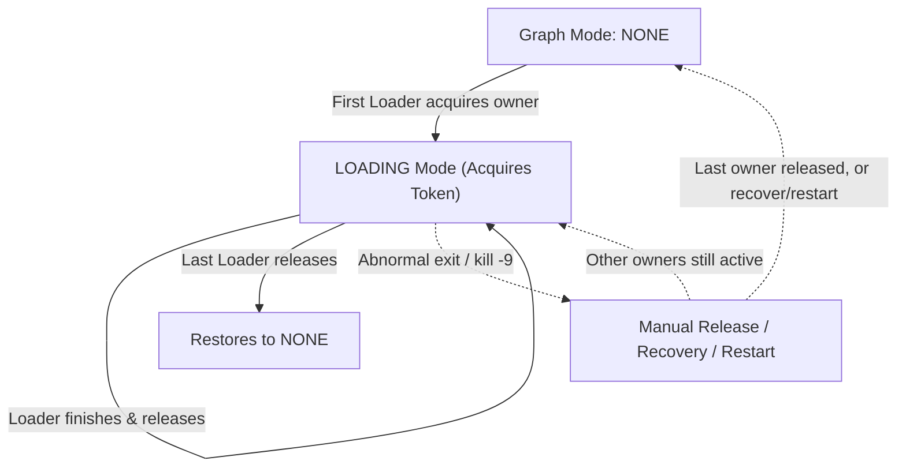

This guide aligns with the Toolchain `master` branch (currently based on 1.8, unreleased). Released packages and Docker `latest` may differ; check your version before using unreleased features.

### Quick start: local file import {#quick-local-file-import}

Walk through a minimal import workflow: import two people and one relationship, then verify the data in Hubble.
First [install Loader](#2-get-hugegraph-loader) and start [HugeGraph Server](/docs/quickstart/hugegraph/hugegraph-server/).
The commands below run from the Loader directory, importing into the default graph `hugegraph`.
For an authenticated Server, append `--username` and `--password` (or `--token`).

1. **Create the data files.**

   These CSV files have no header row. The mapping in the next step supplies the column names.

   ```bash
   mkdir -p demo-loader
   cat > demo-loader/people.csv <<'EOF'
   docs-smoke-alice,29
   docs-smoke-bob,31
   EOF
   cat > demo-loader/knows.csv <<'EOF'
   docs-smoke-alice,docs-smoke-bob
   EOF
   ```

1. **Create the schema and mapping.**

   Dedicated `docs_*` names keep this example separate from the built-in `person` data.
   File paths are relative to the directory where you run Loader.

   ```bash
   cat > demo-loader/schema.groovy <<'EOF'
   schema.propertyKey("docs_name").asText().ifNotExist().create()
   schema.propertyKey("docs_age").asInt().ifNotExist().create()
   schema.vertexLabel("docs_smoke_person").properties("docs_name", "docs_age")
         .primaryKeys("docs_name").ifNotExist().create()
   schema.edgeLabel("docs_smoke_knows").sourceLabel("docs_smoke_person")
         .targetLabel("docs_smoke_person").ifNotExist().create()
   EOF
   cat > demo-loader/struct.json <<'EOF'
   {
     "version": "2.0",
     "structs": [
       {
         "id": "people",
         "input": {
           "type": "FILE",
           "path": "demo-loader/people.csv",
           "format": "CSV",
           "header": ["docs_name", "docs_age"]
         },
         "vertices": [{"label": "docs_smoke_person"}]
       },
       {
         "id": "knows",
         "input": {
           "type": "FILE",
           "path": "demo-loader/knows.csv",
           "format": "CSV",
           "header": ["source_name", "target_name"]
         },
         "edges": [{
           "label": "docs_smoke_knows",
           "source": ["source_name"],
           "target": ["target_name"],
           "field_mapping": {"source_name": "docs_name", "target_name": "docs_name"}
         }]
       }
     ]
   }
   EOF
   ```

1. **Run the import.**

   Keep the same working directory. Change the host and port if Server runs elsewhere.

   ```bash
   bin/hugegraph-loader.sh \
     --graphspace DEFAULT --graph hugegraph \
     --file demo-loader/struct.json --schema demo-loader/schema.groovy \
     --host 127.0.0.1 --port 8080
   ```

   A first successful run imports two vertices and one edge. Check the success and failure counts in the summary.

1. **Query the result in Hubble.**

   Connect Hubble to the same Server and graph, then run these queries separately in the Gremlin workspace.

   ```groovy
   g.V().hasLabel('docs_smoke_person').valueMap('docs_name', 'docs_age')
   g.V().has('docs_smoke_person', 'docs_name', 'docs-smoke-alice')
    .out('docs_smoke_knows').values('docs_name')
   ```

   The first query returns Alice with age `29` and Bob with age `31`. The second returns `docs-smoke-bob`.
{.steps}

For other inputs, continue with the [mapping reference](#33-write-data-source-mapping-file).
The [bundled full example](#4-complete-example) also includes software vertices and edge properties.

### 1 HugeGraph-Loader Overview

HugeGraph-Loader converts source data into graph vertices and edges and imports them into HugeGraph in batches.

Currently supported data sources include:
- Local disk file or directory, supports TEXT, CSV and JSON format files, supports compressed files
- HDFS file or directory supports compressed files
- Mainstream relational databases, such as MySQL, PostgreSQL, Oracle, SQL Server
- Kafka topic
- An existing HugeGraph graph, used to copy data from one graph into another

Local disk files and HDFS files support resumable uploads.

> Note: HugeGraph-Loader requires HugeGraph Server service, please refer to [HugeGraph-Server Quick Start](/docs/quickstart/hugegraph/hugegraph-server) to download and start Server

> **Concurrent imports**: Loader on the master branch supports LOADING owner protection on the same Server instance when the Server's `GET .../mode/owners` returns `protocol: 1`. Servers without this endpoint retain legacy import behavior without this protection; see the compatibility notes below.

> **Testing Guide**: For running HugeGraph-Loader tests locally, please refer to [HugeGraph Toolchain Local Testing Guide](/docs/guides/toolchain-local-test)

### 2 Get HugeGraph-Loader

HugeGraph-Loader is available in the following three ways:

- Use docker image (Convenient for Test/Dev)
- Download the compiled tarball
- Clone source code then compile and install

#### 2.1 Use Docker image (Convenient for Test/Dev)

We can deploy the loader service using `docker run -itd --name loader hugegraph/loader:latest`. For the data that needs to be loaded, it can be copied into the loader container either by mounting `-v /path/to/data/file:/loader/file` or by using `docker cp`.

Alternatively, to start the loader using docker-compose, the command is `docker-compose up -d`. An example of the docker-compose.yml is as follows:

This combination is for local anonymous testing; the Server API is published only on the local host.

```yaml
version: '3'

services:
  server:
    image: hugegraph/hugegraph:latest
    container_name: server
    ports:
      - 127.0.0.1:8080:8080

  loader:
    image: hugegraph/loader:latest
    container_name: loader
    # mount your own data here
    # volumes:
      # - /path/to/data/file:/loader/file
```

The specific data loading process can be referenced under [4.5 User Docker to load data](#45-use-docker-to-load-data) 

> Note: 
> 1. The docker image of hugegraph-loader is a convenience release to start hugegraph-loader quickly, but not **official distribution** artifacts. You can find more details from [ASF Release Distribution Policy](https://infra.apache.org/release-distribution.html#dockerhub).
> 
> 2. Pin a published version tag or image digest in production. `latest` is mutable and does not guarantee alignment with `master`.

#### 2.2 Download the compiled archive

Choose a published Toolchain archive from the [download page](/docs/download/download) and extract it.
A release may not include all `master` functionality; use the source build below for the implementation described here.

#### 2.3 Clone source code to compile and install

Building Loader from the master branch requires Java 17, Maven 3.6.3+, and Python 3.9+. Clone the repository and build:

```bash
git clone --branch master --single-branch https://github.com/apache/hugegraph-toolchain.git
cd hugegraph-toolchain
mvn package -pl hugegraph-client,hugegraph-loader -am -DskipTests -ntp
cd hugegraph-loader/apache-hugegraph-loader-*
```

To build against candidate Server SDKs during development, refer to the [Java 17 migration guide](https://github.com/apache/hugegraph-toolchain/blob/master/docs/java17-migration.md).

For Oracle input, obtain a JDBC driver JAR compatible with your Oracle/JDK versions and place it in the extracted Loader `lib/` directory.
The startup script loads JARs there; installing a driver only in the local Maven repository does not put it on Loader’s runtime classpath.

### 3 How to use
To import a dataset, prepare the schema, data and mapping, then run Loader.
- Write graph schema
- Prepare data files
- Write input source map files
- Execute command import

#### 3.1 Construct graph schema

Define the vertex labels, edge labels and properties needed to represent your data before writing the schema.

The example below uses `person` and `software` vertices, connected by `knows` and `created` edges.
People have names, ages and cities; software has a name and price. Each edge records a date.

<div style="text-align: center;">
  
  <p>graph model example</p>
</div>


Save the schema definitions in `schema.groovy`.

```groovy
// Create some properties
schema.propertyKey("name").asText().ifNotExist().create();
schema.propertyKey("age").asInt().ifNotExist().create();
schema.propertyKey("city").asText().ifNotExist().create();
schema.propertyKey("date").asText().ifNotExist().create();
schema.propertyKey("price").asDouble().ifNotExist().create();

// Create the person vertex type, which has three attributes: name, age, city, and the primary key is name
schema.vertexLabel("person").properties("name", "age", "city").primaryKeys("name").ifNotExist().create();
// Create a software vertex type, which has two properties: name, price, the primary key is name
schema.vertexLabel("software").properties("name", "price").primaryKeys("name").ifNotExist().create();

// Create the knows edge type, which goes from person to person
schema.edgeLabel("knows").sourceLabel("person").targetLabel("person").properties("date").ifNotExist().create();
// Create the created edge type, which points from person to software
schema.edgeLabel("created").sourceLabel("person").targetLabel("software").ifNotExist().create();
```

> See [HugeGraph Client](/docs/clients/hugegraph-client) for the schema API.

#### 3.2 Prepare data

The data sources currently supported by HugeGraph-Loader include:

- local disk file or directory
- HDFS file or directory
- Partial relational database
- Kafka topic
- An existing HugeGraph graph

##### 3.2.1 Data source structure

###### 3.2.1.1 Local disk file or directory

Set the input path to a local file or a directory. A single input source accepts one directory, not a list of directories.

For data split across `part-0`, `part-1` and other files, place those files in one directory and set the mapping's `path` to that directory.

Supported file formats include:

- TEXT
- CSV
- JSON

TEXT uses a configurable delimiter. Each data row represents a record; its columns supply IDs, labels or properties.
Column names can come from a header row or from the mapping's `header` setting.

An example is as follows:

```text
id|name|lang|price|ISBN
1|lop|java|328|ISBN978-7-107-18618-5
2|ripple|java|199|ISBN978-7-100-13678-5
```

CSV is a TEXT file with commas `,` as delimiters. When a column value itself contains a comma, the column value needs to be enclosed in double quotes, for example:

```text
marko,29,Beijing
"li,nary",26,"Wu,han"
```

The JSON file requires that each line is a JSON string, and the format of each line needs to be consistent.

```json
{"source_name": "marko", "target_name": "vadas", "date": "20160110", "weight": 0.5}
{"source_name": "marko", "target_name": "josh", "date": "20130220", "weight": 1.0}
```

###### 3.2.1.2 HDFS file or directory

Users can also specify HDFS files or directories as data sources, all of the above requirements for `local disk files or directories` apply here. In addition, since HDFS usually stores compressed files, loader also provides support for compressed files, and `local disk file or directory` also supports compressed files.

Currently supported compressed file types include: GZIP, BZ2, XZ, LZMA, SNAPPY_RAW, SNAPPY_FRAMED, Z, DEFLATE, LZ4_BLOCK, LZ4_FRAMED, ORC, and PARQUET.

###### 3.2.1.3 Mainstream relational database

The loader also supports some relational databases as data sources, and currently supports MySQL, PostgreSQL, Oracle, and SQL Server.

Loader does not follow foreign keys to query other tables while parsing a row.
Each input row must provide the values needed to construct its graph elements. Prepare any joins in the source query first.

Consider three tables named `person`, `software` and `created`.

```text
// person schema
id | name | age | city
```

```text
// software schema
id | name | lang | price
```

```text
// created schema
id | p_id | s_id | date
```

If `person` and `software` use `PRIMARY_KEY` IDs with `name` as the primary key, each edge needs its endpoints' names.
The `created` table contains only `p_id` and `s_id`; Loader will not query the names from those IDs. Use either of these ID designs.

1. Keep `PRIMARY_KEY` and use each vertex table's `id` column as its primary key property.
   Loader can then build endpoint IDs from `p_id`, `s_id` and the vertex labels.
2. Use custom IDs, taking each vertex table's `id` column as the vertex ID. The edge mapping can use `p_id` and `s_id` directly.

Both designs let edge rows supply endpoint IDs without another lookup.

##### 3.2.2 Prepare vertex and edge data

###### 3.2.2.1 Vertex Data

The vertex data file consists of data line by line. Generally, each line is used as a vertex, and each column is used as a vertex attribute. The following description uses CSV format as an example.

- person vertex data (the data itself does not contain a header)

```csv
Tom,48,Beijing
Jerry,36,Shanghai
```

- software vertex data (the data itself contains the header)

```csv
name,price
Photoshop,999
Office,388
```

###### 3.2.2.2 Edge data

The edge data file consists of data line by line. Generally, each line is used as an edge. Some columns are used as the IDs of the source and target vertices, and other columns are used as edge attributes. The following uses JSON format as an example.

- knows edge data

```json
{"source_name": "Tom", "target_name": "Jerry", "date": "2008-12-12"}
```

- created edge data

```json
{"source_name": "Tom", "target_name": "Photoshop"}
{"source_name": "Tom", "target_name": "Office"}
{"source_name": "Jerry", "target_name": "Office"}
```

#### 3.3 Write data source mapping file

##### 3.3.1 Mapping file overview

The mapping file uses JSON. Each item in `structs` contains one `input` and its `vertices` and `edges` mappings.

`input` describes the data location, format and delimiter. Vertex and edge mappings define labels, IDs, properties and field conversions.

> Loader 0.11.0 introduced mapping format 2.0; earlier mappings use format 1.0. This page uses 2.0 unless stated otherwise.


> [!DETAILS]- Click to expand/collapse the skeleton of the map file for version 2.0
> ```json
> {
>   "version": "2.0",
>   "structs": [
>     {
>       "id": "1",
>       "input": {
>       },
>       "vertices": [
>         {},
>         {}
>       ],
>       "edges": [
>         {},
>         {}
>       ]
>     }
>   ]
> }
> ```
<br/>

Two versions of the mapping file are given directly here (the above graph model and data file are described)

> [!DETAILS]- Click to expand/collapse the mapping file for version 2.0
> ```json
> {
>   "version": "2.0",
>   "structs": [
>     {
>       "id": "1",
>       "skip": false,
>       "input": {
>         "type": "FILE",
>         "path": "vertex_person.csv",
>         "file_filter": {
>           "extensions": [
>             "*"
>           ]
>         },
>         "format": "CSV",
>         "delimiter": ",",
>         "date_format": "yyyy-MM-dd HH:mm:ss",
>         "time_zone": "GMT+8",
>         "skipped_line": {
>           "regex": "(^#|^//).*|"
>         },
>         "compression": "NONE",
>         "header": [
>           "name",
>           "age",
>           "city"
>         ],
>         "charset": "UTF-8",
>         "list_format": {
>           "start_symbol": "[",
>           "elem_delimiter": "|",
>           "end_symbol": "]"
>         }
>       },
>       "vertices": [
>         {
>           "label": "person",
>           "skip": false,
>           "id": null,
>           "unfold": false,
>           "field_mapping": {},
>           "value_mapping": {},
>           "selected": [],
>           "ignored": [],
>           "null_values": [
>             ""
>           ],
>           "update_strategies": {}
>         }
>       ],
>       "edges": []
>     },
>     {
>       "id": "2",
>       "skip": false,
>       "input": {
>         "type": "FILE",
>         "path": "vertex_software.csv",
>         "file_filter": {
>           "extensions": [
>             "*"
>           ]
>         },
>         "format": "CSV",
>         "delimiter": ",",
>         "date_format": "yyyy-MM-dd HH:mm:ss",
>         "time_zone": "GMT+8",
>         "skipped_line": {
>           "regex": "(^#|^//).*|"
>         },
>         "compression": "NONE",
>         "header": null,
>         "charset": "UTF-8",
>         "list_format": {
>           "start_symbol": "",
>           "elem_delimiter": ",",
>           "end_symbol": ""
>         }
>       },
>       "vertices": [
>         {
>           "label": "software",
>           "skip": false,
>           "id": null,
>           "unfold": false,
>           "field_mapping": {},
>           "value_mapping": {},
>           "selected": [],
>           "ignored": [],
>           "null_values": [
>             ""
>           ],
>           "update_strategies": {}
>         }
>       ],
>       "edges": []
>     },
>     {
>       "id": "3",
>       "skip": false,
>       "input": {
>         "type": "FILE",
>         "path": "edge_knows.json",
>         "file_filter": {
>           "extensions": [
>             "*"
>           ]
>         },
>         "format": "JSON",
>         "delimiter": null,
>         "date_format": "yyyy-MM-dd HH:mm:ss",
>         "time_zone": "GMT+8",
>         "skipped_line": {
>           "regex": "(^#|^//).*|"
>         },
>         "compression": "NONE",
>         "header": null,
>         "charset": "UTF-8",
>         "list_format": null
>       },
>       "vertices": [],
>       "edges": [
>         {
>           "label": "knows",
>           "skip": false,
>           "source": [
>             "source_name"
>           ],
>           "unfold_source": false,
>           "target": [
>             "target_name"
>           ],
>           "unfold_target": false,
>           "field_mapping": {
>             "source_name": "name",
>             "target_name": "name"
>           },
>           "value_mapping": {},
>           "selected": [],
>           "ignored": [],
>           "null_values": [
>             ""
>           ],
>           "update_strategies": {}
>         }
>       ]
>     },
>     {
>       "id": "4",
>       "skip": false,
>       "input": {
>         "type": "FILE",
>         "path": "edge_created.json",
>         "file_filter": {
>           "extensions": [
>             "*"
>           ]
>         },
>         "format": "JSON",
>         "delimiter": null,
>         "date_format": "yyyy-MM-dd HH:mm:ss",
>         "time_zone": "GMT+8",
>         "skipped_line": {
>           "regex": "(^#|^//).*|"
>         },
>         "compression": "NONE",
>         "header": null,
>         "charset": "UTF-8",
>         "list_format": null
>       },
>       "vertices": [],
>       "edges": [
>         {
>           "label": "created",
>           "skip": false,
>           "source": [
>             "source_name"
>           ],
>           "unfold_source": false,
>           "target": [
>             "target_name"
>           ],
>           "unfold_target": false,
>           "field_mapping": {
>             "source_name": "name",
>             "target_name": "name"
>           },
>           "value_mapping": {},
>           "selected": [],
>           "ignored": [],
>           "null_values": [
>             ""
>           ],
>           "update_strategies": {}
>         }
>       ]
>     }
>   ]
> }
> ```
<br/>

> [!DETAILS]- Click to expand/collapse the mapping file for version 1.0
> ```json
> {
>   "vertices": [
>     {
>       "label": "person",
>       "input": {
>         "type": "file",
>         "path": "vertex_person.csv",
>         "format": "CSV",
>         "header": ["name", "age", "city"],
>         "charset": "UTF-8"
>       }
>     },
>     {
>       "label": "software",
>       "input": {
>         "type": "file",
>         "path": "vertex_software.csv",
>         "format": "CSV"
>       }
>     }
>   ],
>   "edges": [
>     {
>       "label": "knows",
>       "source": ["source_name"],
>       "target": ["target_name"],
>       "input": {
>         "type": "file",
>         "path": "edge_knows.json",
>         "format": "JSON"
>       },
>       "field_mapping": {
>         "source_name": "name",
>         "target_name": "name"
>       }
>     },
>     {
>       "label": "created",
>       "source": ["source_name"],
>       "target": ["target_name"],
>       "input": {
>         "type": "file",
>         "path": "edge_created.json",
>         "format": "JSON"
>       },
>       "field_mapping": {
>         "source_name": "name",
>         "target_name": "name"
>       }
>     }
>   ]
> }
> ```
<br/>

The 1.0 version of the mapping file is centered on the vertex and edge, and sets the input source; while the 2.0 version is centered on the input source, and sets the vertex and edge mapping. Some input sources (such as a file) can generate both vertices and edges. If you write in the 1.0 format, you need to write an input block in each of the vertex and edge mapping blocks. The two input blocks are exactly the same; and the 2.0 version only needs to write input once. Therefore, compared with version 1.0, version 2.0 can save some repetitive writing of input.

In the bin directory of hugegraph-loader-{version}, there is a script tool `mapping-convert.sh` that can directly convert the mapping file of version 1.0 to version 2.0. The usage is as follows:

```bash
bin/mapping-convert.sh struct.json
```

A struct-v2.json will be generated in the same directory as struct.json.

The bin directory also ships `utf8-bom-to-utf8.sh`, which strips the UTF-8 BOM from a single data file, or from every file under a directory. It is useful when a CSV or TEXT file exported by a Windows tool fails to parse because its first header column carries an invisible BOM:

```bash
bin/utf8-bom-to-utf8.sh /path/to/file-or-dir
```

##### 3.3.2 Input Source

Input sources are currently divided into five categories: FILE, HDFS, JDBC, KAFKA and GRAPH, which are distinguished by the `type` node. We call them local file input sources, HDFS input sources, JDBC input sources, KAFKA input sources and GRAPH input source, which are described below.

###### 3.3.2.1 Local file input source

- id: The id of the input source. This field is used to support some internal functions. It is not required (it will be automatically generated if it is not filled in). It is strongly recommended to write it, which is very helpful for debugging;
- skip: whether to skip the input source, because the JSON file cannot add comments, if you do not want to import an input source during a certain import, but do not want to delete the configuration of the input source, you can set it to true to skip it, the default is false, not required;
- input: input source map block, composite structure
    - type: an input source type, file or FILE must be filled;
    - path: the path of the local file or directory, an absolute path or a path relative to the Loader process working directory (not the mapping file). An absolute path is recommended; required;
    - file_filter: filter files with compound conditions from `path`, compound structure, currently only supports configuration extensions, represented by child node `extensions`, the default is "*", which means to keep all files;
    - format: the format of the local file, the optional values are CSV, TEXT and JSON, which must be uppercase, the default is CSV, optional;               
    - header: column names; if omitted, the first data line supplies them. With an explicit header, an identical first line is still skipped by default
      (see has_header). JSON does not require a header; optional;
    - has_header: for CSV and TEXT, the first line of every file is dropped when it is identical to the header, so a header repeated in each part file of a directory is not imported as data. Set this to `false` to turn that check off when the first line of a file is real data that happens to equal the header, optional;
    - delimiter: The column delimiter of the file line. The default depends on `format`: a comma `","` for CSV and a tab `"\t"` for TEXT; a CSV file accepts no other delimiter. The `JSON` file does not need to be specified, optional;     
    - charset: the encoded character set of the file, the default is `UTF-8`, optional;    
    - date_format: custom date format, the default value is yyyy-MM-dd HH:mm:ss, optional; if the date is presented in the form of a timestamp, this item must be written as `timestamp` (fixed writing);
    - extra_date_formats: a list of fallback date formats, tried when a value does not match `date_format`, empty by default, optional;
    - time_zone: Set which time zone the date data is in, the default value is `GMT+8`, optional;
    - skipped_line: The line to be skipped, compound structure, currently only the regular expression of the line to be skipped can be configured, described by the child node `regex`. The default regex is `(^#|^//).*|`, which skips lines starting with `#` or `//` and empty lines; to keep such lines, set `regex` to a pattern that matches nothing, optional;
    - compression: The compression format of the file, the optional values ​​are NONE, GZIP, BZ2, XZ, LZMA, SNAPPY_RAW, SNAPPY_FRAMED, Z, DEFLATE, LZ4_BLOCK, LZ4_FRAMED, ORC and PARQUET, the default is NONE, which means a non-compressed file, optional; for ORC and PARQUET the header is matched case-insensitively;
    - list_format: When a column of the file (non-JSON) is a collection structure (the Cardinality of the PropertyKey in the corresponding figure is Set or List), you can use this item to set the start character, separator, and end character of the column, compound structure :
        - start_symbol: The start character of the collection structure column (the default value is the empty string `""`, JSON format currently does not support specification)
        - elem_delimiter: the delimiter of the collection structure column (the default value is `|`, and it must differ from `delimiter`; JSON format currently only supports native `,` delimiter)
        - end_symbol: the end character of the collection structure column (the default value is the empty string `""`, the JSON format does not currently support specification)
        - ignored_elems: the elements dropped after the column is split, the default value is `[""]`, so empty elements are ignored

###### 3.3.2.2 HDFS input source

The nodes and meanings of the above `local file input source` are basically applicable here. Only the different and unique nodes of the HDFS input source are listed below.

- type: input source type, must fill in hdfs or HDFS, required;
- path: the path of the HDFS file or directory, it must be the absolute path of HDFS, required;
- core_site_path: the path of the core-site.xml file of the HDFS cluster, the key point is to specify the address of the NameNode (`fs.default.name`) and the implementation of the file system (`fs.hdfs.impl`), required;
- hdfs_site_path: the path of the hdfs-site.xml file of the HDFS cluster, optional;
- dir_filter: when `path` is a directory, decides which sub-directories are walked into, compound structure, optional:
    - include_regex: only directories whose name matches this regular expression are read, empty by default, which places no restriction;
    - exclude_regex: directories whose name matches this regular expression are skipped, empty by default;
- kerberos_config: how to authenticate against a Kerberos-secured HDFS cluster, compound structure, optional:
    - enable: whether to authenticate with Kerberos, the default is false;
    - krb5_conf: the path of the krb5.conf file, required when `enable` is true;
    - principal: the Kerberos principal, required when `enable` is true;
    - keytab: the path of the keytab file, required when `enable` is true;

###### 3.3.2.3 JDBC input source

As mentioned above, it supports multiple relational databases, but because their mapping structures are very similar, they are collectively referred to as JDBC input sources, and then use the `vendor` node to distinguish different databases.

- type: input source type, must fill in jdbc or JDBC, required;
- vendor: database type, optional options are [MySQL, PostgreSQL, Oracle, SQLServer], case-insensitive, required;
- driver: the JDBC driver class, optional; when it is left out, the default driver of the `vendor` listed in the tables below is used;
- url: the url of the database that jdbc wants to connect to, required;
- database: the name of the database to be connected, required;
- schema: The name of the schema to be connected, different databases have different requirements, and the details are explained below;
- table: the name of the table to be connected, at least one of `table` or `custom_sql` is required;
- custom_sql: custom SQL statement, at least one of `table` or `custom_sql` is required;
- username: username to connect to the database, required;
- password: password for connecting to the database, required;
- where: an extra condition appended to the generated `select` statement, written without the `where` keyword, optional;
- batch_size: The size of one page when obtaining table data by page, the default is 500, optional;

**MYSQL**

| Node   | Fixed value or common value |
|--------|-----------------------------|
| vendor | MYSQL                       |
| driver | com.mysql.cj.jdbc.Driver    |
| url    | jdbc:mysql://127.0.0.1:3306 |

schema: nullable, if filled in, it must be the same as the value of database

**POSTGRESQL**

| Node   | Fixed value or common value      |
|--------|----------------------------------|
| vendor | POSTGRESQL                       |
| driver | org.postgresql.Driver            |
| url    | jdbc:postgresql://127.0.0.1:5432 |

schema: nullable, default is "public"

**ORACLE**

| Node   | Fixed value or common value      |
|--------|----------------------------------|
| vendor | ORACLE                           |
| driver | oracle.jdbc.driver.OracleDriver  |
| url    | jdbc:oracle:thin:@127.0.0.1:1521 |

schema: nullable, the default value is the username in upper case

**SQLSERVER**

| Node   | Fixed value or common value                  |
|--------|----------------------------------------------|
| vendor | SQLSERVER                                    |
| driver | com.microsoft.sqlserver.jdbc.SQLServerDriver |
| url    | jdbc:sqlserver://127.0.0.1:1433              |

schema: required

###### 3.3.2.4 Kafka input source

- type: input source type, `kafka` or `KAFKA`, required;
- bootstrap_server: the list of kafka bootstrap servers, required;
- topic: the topic to subscribe to, required;
- group: group of Kafka consumers, required;
- from_beginning: sets `auto.offset.reset` to `earliest` when true, or `latest` when false (default). It applies only when no valid committed offset exists; otherwise consumption resumes from the committed offset. Optional;
- format: format of each message, options are CSV, TEXT and JSON, must be uppercase, required;
- header: column name of each column of a message; no header line is read from the topic, so it has to be given for CSV and TEXT, while JSON messages do not need it;
- delimiter: delimiter of the message columns, used by TEXT only, since CSV always splits on `,`, optional;
- charset: encoding charset of the messages, default is UTF-8, optional;
- date_format: customized date format, default value is yyyy-MM-dd HH:mm:ss, optional; if the date is presented in the form of timestamp, this item must be written as timestamp (fixed);
- extra_date_formats: a customized list of another date formats, empty by default, optional; each item in the list is an alternate date format to the date_format specified date format;
- time_zone: set which time zone the date data is in, default is GMT+8, optional;
- skipped_line: current master `KafkaReader` does not implement this filter. Kafka messages go directly to the parser, so configuring this field does not skip blank or comment messages; preprocess them upstream or in the consumer to avoid parse failures;
- batch_size: the maximum number of records fetched in one poll (`max.poll.records`), default is 500, optional;
- early_stop: the record pulled from Kafka broker at a certain time is empty, stop the task, default is false, only for debugging, optional;

###### 3.3.2.5 GRAPH input Source

The GRAPH input source reads vertices and edges out of another HugeGraph graph, reached through HugeGraph-PD, and writes them into the target graph. When a mapping file contains a GRAPH input source, every input source in it that is not skipped has to be a GRAPH input source as well, and the loader puts the target graph into `RESTORING` mode for the duration of the import.

- type: Data source type; must be filled in as `graph` or `GRAPH` (required);
- graphspace: Source graphSpace name (required);
- graph: Source graph name (required);
- username: HugeGraph username; the `--username` command-line option is used when this is empty;
- password: HugeGraph password; the `--password` command-line option is used when this is empty;
- selected_vertices: the vertex labels to copy, each item written as `{"label": "...", "properties": [...], "query": {...}}`, where `properties` narrows the copied properties and `query` is an optional filter passed to the source graph;
- ignored_vertices: the vertex labels to skip, each item written as `{"label": "...", "properties": [...]}`;
- selected_edges: the edge labels to copy, items have the same shape as in `selected_vertices`;
- ignored_edges: the edge labels to skip, items have the same shape as in `ignored_vertices`;
- pd-peers: HugeGraph-PD node addresses of the source cluster; the `--pd-peers` option is used when this is empty;
- meta-endpoints: Meta service endpoints of the source cluster; the `--meta-endpoints` option is used when this is empty;
- cluster: Source cluster name; the `--cluster` option is used when this is empty;
- batch_size: Batch size for reading data from the source graph; default is 500;

##### 3.3.3 Vertex and Edge Mapping

The nodes of vertex and edge mapping (a key in the JSON file) have a lot of the same parts. The same parts are introduced first, and then the unique nodes of `vertex map` and `edge map` are introduced respectively.

**Nodes of the same section**

- label: `label` to which the vertex/edge data to be imported belongs, required;                                                                                   
- skip: whether to skip this vertex/edge mapping while the input source and the other mappings stay active, the default is false, optional;
- field_mapping: Map the column name of the input source column to the attribute name of the vertex/edge, optional;
- value_mapping: map the data value of the input source to the attribute value of the vertex/edge, optional;
- selected: select some columns to insert, other unselected ones are not inserted, cannot exist at the same time as `ignored`, optional;                                                                           
- ignored: ignore some columns so that they do not participate in insertion, cannot exist at the same time as `selected`, optional;
- null_values: You can specify some strings to represent null values, such as "NULL". If the vertex/edge attribute corresponding to this column is also a nullable attribute, the value of this attribute will not be set when constructing the vertex/edge, optional ;                                                                                
- update_strategies: If the data needs to be **updated** in batches in a specific way, you can specify a specific update strategy for each attribute (see below for details), optional;
- unfold: Whether to unfold the column, each unfolded column will form a row with other columns, which is equivalent to unfolding into multiple rows; for example, the value of a certain column (id column) of the file is `[1,2,3]`, The values ​​of other columns are `18,Beijing`. When unfold is set, this row will become 3 rows, namely: `1,18,Beijing`, `2,18,Beijing` and `3,18, Beijing`. Note that this will only expand the column selected as id. Default false, optional;

**Update strategy** supports 8 types: (requires all uppercase)

1. Value accumulation: `SUM`
2. Take the greater of the two numbers/dates: `BIGGER`
3. Take the smaller of two numbers/dates: `SMALLER`
4. **Set** property takes union: `UNION`
5. **Set** attribute intersection: `INTERSECTION`
6. **List** attribute append element: `APPEND`
7. **List/Set** attribute delete element: `ELIMINATE`
8. Override an existing property: `OVERRIDE`

**Note:** If the newly imported attribute value is empty, the existing old data will be used instead of the empty value. For the effect, please refer to the following example

```json
// The update strategy is specified in the JSON file as follows
{
  "vertices": [
    {
      "label": "person",
      "update_strategies": {
        "age": "SMALLER",
        "set": "UNION"
      },
      "input": {
        "type": "file",
        "path": "vertex_person.txt",
        "format": "TEXT",
        "header": ["name", "age", "set"]
      }
    }
  ]
}

// 1. Write a line of data with the OVERRIDE update strategy (null means empty here)
'a b null null'

// 2. Write another line
'null null c d'

// 3. Finally we can get
'a b c d'   

// If there is no update strategy, you will get
'null null c d'
```

> **Note** : After adopting the batch update strategy, the number of disk read requests will increase significantly, and the import speed will be several times slower than that of pure write coverage (at this time HDD disk [IOPS](https://en.wikipedia .org/wiki/IOPS) will be the bottleneck, SSD is recommended for speed)

**Unique Nodes for Vertex Maps**

- id: Specify a column as the id column of the vertex. When the vertex id policy is `CUSTOMIZE`, it is required; when the id policy is `PRIMARY_KEY`, it must be empty;

**Unique Nodes for Edge Maps**
                                                                                                                                                         
- source: Select certain columns of the input source as the id column of **source vertex**. When the id policy of the source vertex is `CUSTOMIZE`, a certain column must be specified as the id column of the vertex; when the id policy of the source vertex is ` When PRIMARY_KEY`, one or more columns must be specified for splicing the id of the generated vertex, that is, no matter which id strategy is used, this item is required;
- target: Specify certain columns as the id columns of **target vertex**, similar to source, so I won't repeat them;
- unfold_source: Whether to unfold the source column of the file, the effect is similar to that in the vertex map, and will not be repeated;
- unfold_target: Whether to unfold the target column of the file, the effect is similar to that in the vertex mapping, and will not be repeated;

#### 3.4 Execute command import

With the schema, data and mapping ready, run Loader with the options below.

##### 3.4.1 Parameter description

| Parameter                                | Default value | Required or not | Description                                                                                                                                                                               |
|------------------------------------------|---------------|-----------------|-------------------------------------------------------------------------------------------------------------------------------------------------------------------------------------------|
| `-f` or `--file`                         |               | Y               | Path to configure script                                                                                                                                                                  |
| `-g` or `--graph`                        | hugegraph     |                 | Graph name                                                                                                                                                                                |
| `--graphspace`                           | DEFAULT       |                 | Graph space name                                                                                                                                                                          |
| `-s` or `--schema`                       |               |                 | Schema file path; optional when the Schema already exists                                                                                                                                 |
| `-h` or `--host` or `-i`                 | localhost     |                 | Address of HugeGraphServer                                                                                                                                                                |
| `-p` or `--port`                         | 8080          |                 | Port number of HugeGraphServer                                                                                                                                                            |
| `--username`                             | null          |                 | When HugeGraphServer enables permission authentication, the username of the current graph                                                                                                 |
| `--password`                             | null          |                 | When HugeGraphServer enables permission authentication, the password of the current graph                                                                                                 |
| `--create-graph`                         | false         |                 | Whether to automatically create the graph if it does not exist                                                                                                                            |
| `--token`                                | null          |                 | When HugeGraphServer has enabled authorization authentication, the token of the current graph                                                                                             |
| `--protocol`                             | http          |                 | Protocol for sending requests to the server, optional http or https                                                                                                                       |
| `--pd-peers`                             |               |                 | PD service node addresses                                                                                                                                                                 |
| `--pd-token`                             |               |                 | Token for accessing PD service                                                                                                                                                            |
| `--meta-endpoints`                       |               |                 | Meta information storage service addresses                                                                                                                                                |
| `--direct`                               | false         |                 | Store direct mode is disabled in current master; imports still use Server API. Keep the default                                                                                                                                            |
| `--route-type`                           | NODE_PORT     |                 | Route selection method (optional values: NODE_PORT / DDS / BOTH)                                                                                                                          |
| `--cluster`                              | hg            |                 | Cluster name                                                                                                                                                                              |
| `--trust-store-file`                     |               |                 | When the request protocol is https, the client's certificate file path                                                                                                                    |
| `--trust-store-password`                 |               |                 | When the request protocol is https, the client certificate password                                                                                                                       |
| `--clear-all-data`                       | false         |                 | Whether to clear the original data on the server before importing data                                                                                                                    |
| `--clear-timeout`                        | 240           |                 | Timeout for clearing the original data on the server before importing data                                                                                                                |
| `--incremental-mode`                     | false         |                 | Whether to use the breakpoint resume mode; only input sources FILE and HDFS support this mode. Enabling this mode allows starting the import from where the last import stopped          |
| `--failure-mode`                         | false         |                 | When failure mode is true, previously failed data will be imported. Generally, the failed data file needs to be manually corrected and edited before re-importing                        |
| `--batch-insert-threads`                 | CPUs          |                 | Batch insert thread pool size (CPUs is the number of **logical cores** available to the current OS)                                                                                       |
| `--single-insert-threads`                | 8             |                 | Size of single insert thread pool                                                                                                                                                         |
| `--max-conn`                             | 4 * CPUs      |                 | The maximum number of HTTP connections between HugeClient and HugeGraphServer; while it is left at its default, it is raised automatically to 4 * `--batch-insert-threads`               |
| `--max-conn-per-route`                   | 2 * CPUs      |                 | The maximum number of HTTP connections for each route between HugeClient and HugeGraphServer; while it is left at its default, it is raised automatically to 2 * `--batch-insert-threads` |
| `--batch-size`                           | 500           |                 | The number of data items in each batch when importing data                                                                                                                                |
| `--max-parse-errors`                     | 1             |                 | The maximum number of data parsing errors allowed (per line); the program exits when this value is reached                                                                                |
| `--max-insert-errors`                    | 500           |                 | The maximum number of data insertion errors allowed (per row); the program exits when this value is reached                                                                               |
| `--timeout`                              | 60            |                 | Timeout (seconds) for insert result return                                                                                                                                                |
| `--shutdown-timeout`                     | 10            |                 | Waiting time for multithreading to stop (seconds)                                                                                                                                         |
| `--retry-times`                          | 3             |                 | Maximum number of retries after a timeout                                                                                                                                                 |
| `--retry-interval`                       | 10            |                 | Interval before retry (seconds)                                                                                                                                                           |
| `--check-vertex`                         | false         |                 | Whether to check if the vertices connected by the edge exist when inserting the edge                                                                                                      |
| `--print-progress`                       | true          |                 | Whether to print the number of imported items in real time on the console                                                                                                                 |
| `--dry-run`                              | false         |                 | Enable this mode to only parse data without importing; usually used for testing                                                                                                           |
| `--help` or `-help`                      | false         |                 | Print help information                                                                                                     |
| `--parser-threads` or `--parallel-count` | max(2,CPUs/2) |      | Number of parallel read pipelines; `--parallel-count` is deprecated    |
| `--start-file`                           | 0           |      | Start file index for partial loading                               |
| `--end-file`                             | -1          |      | End file index for partial loading                                 |
| `--scatter-sources`                      | false       |      | Scatter multiple sources for I/O optimization                      |
| `--cdc-flush-interval`                   | 30000       |      | The flush interval for Flink CDC                                   |
| `--cdc-sink-parallelism`                 | 1           |      | The sink parallelism for Flink CDC                                 |
| `--max-read-errors`                      | 1           |      | The maximum number of read error lines before exiting              |
| `--max-read-lines`                       | -1L         |      | The maximum number of read lines, task stops when reached          |
| `--test-mode`                            | false       |      | Whether the loader works in test mode                              |
| `--use-prefilter`                        | false       |      | Whether to filter vertex in advance                                |
| `--short-id`                             |             |      | Map a customized vertex ID to a shorter generated ID, written as `label:field:type`, where `type` is one of boolean, byte, int, long, float, double, text, blob, date and uuid; repeat the option to cover several labels |
| `--vertex-edge-limit`                    | -1L         |      | The maximum number of vertex's edges                               |
| `--sink-type`                            | true        |      | `spark-loader` only: true writes through the HugeGraph server API, false generates HFiles and bulk-loads them into HBase |
| `--vertex-partitions`                    | 64          |      | The number of partitions of the HBase vertex table, used with `--sink-type false` |
| `--edge-partitions`                      | 64          |      | The number of partitions of the HBase edge table, used with `--sink-type false` |
| `--vertex-table-name`                    |             |      | HBase vertex table name, used with `--sink-type false` |
| `--edge-table-name`                      |             |      | HBase edge table name, used with `--sink-type false` |
| `--hbase-zk-quorum`                      |             |      | HBase ZooKeeper quorum, used with `--sink-type false` |
| `--hbase-zk-port`                        |             |      | HBase ZooKeeper port, used with `--sink-type false` |
| `--hbase-zk-parent`                      |             |      | HBase ZooKeeper parent, used with `--sink-type false` |
| `--restore`                              | false       |      | Set graph mode to RESTORING                                        |
| `--backend`                              | hstore      |      | The backend store type when creating graph if not exists           |
| `--serializer`                           | binary      |      | The serializer type when creating graph if not exists              |
| `--scheduler-type`                       | distributed |      | The task scheduler type when creating graph if not exists          |
| `--batch-failure-fallback`               | true        |      | Whether to fallback to single insert when batch insert fails       |
{.td-table--wide}

The mapping file option `--file` (`-f`) is required; other options use their defaults. A valid minimal invocation is:

```bash
bin/hugegraph-loader.sh --file struct.json
```

The launcher also accepts JCommander's native `@file` syntax. Put each option and value on separate lines in `loader.args`:

```text
--file
struct.json
```

```bash
bin/hugegraph-loader.sh @loader.args
```

This is equivalent to the minimal invocation above. Relative path values resolve from the Loader process working directory.
If the argument file contains credentials, restrict it to mode `0600` with `chmod 0600 loader.args`.
The `@file` form keeps credential values out of process arguments.
Loader must be able to create and write the mapping-prefix directory used for progress output.
Copy a mapping mounted from a read-only Kubernetes ConfigMap to a writable volume before running Loader.

##### 3.4.2 Breakpoint Continuation Mode

For a long import, use a progress file to resume after an interruption.

Set `--incremental-mode` to `true` to resume from a progress file. Loader records progress when it closes normally after a successful import
or a normal stop; an unexpected failure may prevent this write.
The progress file is in `${struct}` and named `load-progress_${timestamp}`, where `${struct}` is the mapping-file prefix and `${timestamp}` is the
import start time, formatted as `yyyyMMdd-HHmmss`. For example, an import started at `2019-10-10 12:30:30` with mapping file `struct-example.json`
writes `struct-example/load-progress_20191010-123030`. When the directory holds several progress files, the resumed import reads the last one in name
order, which is the most recent one.

> Note: A progress file is written after a successful import or a normal stop (including an error limit), regardless of `--incremental-mode`
> or `--print-progress`. An import aborted by an unexpected failure may not write one.

After stopping an import with `Ctrl+C` or `kill`, set `--incremental-mode true` to continue from the recorded position.
A forced stop with `kill -9` cannot save progress.

Invalid data or connection failures can exhaust `--max-read-errors`, `--max-parse-errors` or `--max-insert-errors`.
Correct the rows in the failure files, then use `--failure-mode true` to retry them. This leaves the original data files unchanged.
Rows that still fail are recorded again and deduplicated when the failure file closes. Failure mode lifts these three limits and scans the entire file.

Each input source, that is each item of `structs` in the mapping file, gets its own failure file. The file is named after the `id` of that input source with the suffix `.error` and is stored in the `${struct}/failure-data` directory.
Every failed line is written as a pair of lines: a tip line starting with `#### READ ERROR:`, `#### PARSE ERROR:` or `#### INSERT ERROR:`, followed by the original data line. When the input source has a header, that header is written as JSON to a sibling `${id}.header` file, so the failure file can be read back with the right columns.
For example, if the mapping file has an input source with id `1` holding a vertex mapping person and an input source with id `3` holding an edge mapping knows, each of which has some error lines, you will see the following files in the `${struct}/failure-data` directory when the Loader exits:

- 1.error: the failed lines of input source 1, each preceded by its tip line
- 1.header: the header of input source 1, written only when that input source has a header
- 3.error: the failed lines of input source 3
- 3.header: the header of input source 3

> A `.error` file that turns out to be empty is deleted when the Loader exits, so only the input sources that really had failed lines leave a file behind. In incremental mode new failures are appended to the existing file, otherwise the file is rewritten from scratch.

##### 3.4.3 logs directory file description

The log and error data during program execution will be written into the hugegraph-loader.log file.

##### 3.4.4 Execute command

Run bin/hugegraph-loader.sh and pass in parameters

```bash
bin/hugegraph-loader.sh -g {GRAPH_NAME} -f ${INPUT_DESC_FILE} -s ${SCHEMA_FILE} -h {HOST} -p {PORT}
```

The script runs the JVM under `JAVA_HOME` when that variable is set, and `java` from the `PATH` otherwise. It passes the contents of the `JVM_OPTS` environment variable, then `-Xmx10g` and the class path built from `lib/`, to that JVM, so `JVM_OPTS` is the place to add JVM flags. Logging is configured by `conf/log4j2.xml`.

#### 3.4.5 Minimal Local-File Import

Follow the [local-file import steps](#quick-local-file-import) at the start of this page.

#### 3.4.6 Concurrent imports and LOADING ownership {#loading-ownership}

In the `master` branch, Loader implements a LOADING ownership protocol coordinated with Server's `/mode/owners` endpoint.
When the deployed Server provides this endpoint and returns `protocol: 1`, Loader enables ownership protection automatically; released Server 1.7.0 and older versions continue using the legacy mode switching flow.



1. **Probe and Acquire**: Loader probes `/mode/owners`. The first Loader obtains an ownership handle (`instance/epoch/token`),
   transitioning graph mode from `NONE` to `LOADING`; concurrent Loaders can join.
2. **Data Import**: Loaders holding valid handles execute concurrent imports while preserving `LOADING` mode.
3. **Graceful Release**: When an import completes, Loader drains its workers and releases its handle. When the last owner releases,
   graph mode automatically returns to `NONE`.
4. **Failure Recovery**: If abnormal exit (e.g. `kill -9`) leaves an orphaned owner, stop and drain all related imports and graph writes,
   then perform administrator recovery via the [RESTful API recovery endpoint](/docs/clients/restful-api/graphs/#loading-ownership) or
   restart the Server. Manual `release` applies only when the caller still holds its token (e.g. a direct REST client).
{.steps}

> [!NOTE]
> **Compatibility and Operational Notes**
> - **Legacy Compatibility**: During ordinary imports, only an unsupported-route `404` status on `/mode/owners` falls back to the legacy enum
>   `LOADING`/`NONE` flow (maintains compatibility with Server 1.7, without multi-loader protection).
>   Network or permission errors, or a `404` for a missing graph, do not trigger fallback.
> - **Restore and Graph Source Imports**: Retain the `RESTORING` flow without ownership probes or automatic resets. After a restore import completes,
>   manually reset graph mode to `NONE` before starting ordinary imports.
>   Do not run restore, graph-source, Spark connector, or older Loader imports while owned imports are active.
> - **Scope & Lifecycle**: Ownership is bound to the target Server instance without cross-node synchronization or automatic lease expiry.
>   For embedded programmatic integrations, callers must invoke `HugeGraphLoader.shutdown()` to attempt a single graceful release. If release
>   fails, the handle is not retried; the owner may remain active on the Server, and the administrator recovery step above may be required.

### 4 Complete example

The Loader distribution includes this dataset in `example/file/`.
See the [source files](https://github.com/apache/hugegraph-toolchain/tree/master/hugegraph-loader/assembly/static/example/file).

#### 4.1 Prepare data

Vertex file: `example/file/vertex_person.csv`

```csv
marko,29,Beijing
vadas,27,Hongkong
josh,32,Beijing
peter,35,Shanghai
"li,nary",26,"Wu,han"
tom,null,NULL
```

Vertex file: `example/file/vertex_software.txt`

```text
id|name|lang|price|ISBN
1|lop|java|328|ISBN978-7-107-18618-5
2|ripple|java|199|ISBN978-7-100-13678-5
```

Edge file: `example/file/edge_knows.json`

```json
{"source_name": "marko", "target_name": "vadas", "date": "20160110", "weight": 0.5}
{"source_name": "marko", "target_name": "josh", "date": "20130220", "weight": 1.0}
```

Edge file: `example/file/edge_created.json`

```json
{"source_name": "marko", "target_id": 1, "date": "2017-12-10", "weight": 0.4}
{"source_name": "josh", "target_id": 1, "date": "2009-11-11", "weight": 0.4}
{"source_name": "josh", "target_id": 2, "date": "2017-12-10", "weight": 1.0}
{"source_name": "peter", "target_id": 1, "date": "2017-03-24", "weight": 0.2}
```

#### 4.2 Write schema

> [!DETAILS]- Click to expand/collapse the schema file: example/file/schema.groovy
> ```groovy
> schema.propertyKey("name").asText().ifNotExist().create();
> schema.propertyKey("age").asInt().ifNotExist().create();
> schema.propertyKey("city").asText().ifNotExist().create();
> schema.propertyKey("weight").asDouble().ifNotExist().create();
> schema.propertyKey("lang").asText().ifNotExist().create();
> schema.propertyKey("date").asText().ifNotExist().create();
> schema.propertyKey("price").asDouble().ifNotExist().create();
>
> schema.vertexLabel("person").properties("name", "age", "city").primaryKeys("name").nullableKeys("age", "city").ifNotExist().create();
> schema.vertexLabel("software").useCustomizeNumberId().properties("name", "lang", "price").ifNotExist().create();
>
> schema.indexLabel("personByAge").onV("person").by("age").range().ifNotExist().create();
> schema.indexLabel("personByCity").onV("person").by("city").secondary().ifNotExist().create();
> schema.indexLabel("personByAgeAndCity").onV("person").by("age", "city").secondary().ifNotExist().create();
> schema.indexLabel("softwareByPrice").onV("software").by("price").range().ifNotExist().create();
>
> schema.edgeLabel("knows").sourceLabel("person").targetLabel("person").properties("date", "weight").ifNotExist().create();
> schema.edgeLabel("created").sourceLabel("person").targetLabel("software").properties("date", "weight").ifNotExist().create();
>
> schema.indexLabel("createdByDate").onE("created").by("date").secondary().ifNotExist().create();
> schema.indexLabel("createdByWeight").onE("created").by("weight").range().ifNotExist().create();
> schema.indexLabel("knowsByWeight").onE("knows").by("weight").range().ifNotExist().create();
> ```

`person` uses `name` as its primary key. Tom’s `age` and `city` are removed by `null_values`, so both properties must be nullable.
`software` uses custom numeric IDs: mapping `id` supplies the vertex ID and `created.target_id` supplies the edge’s target ID.
Run this example in an empty graph without these schema labels; `ifNotExist()` does not replace incompatible existing definitions.

#### 4.3 Write the input source mapping file `example/file/struct.json`

> [!DETAILS]- Click to expand/collapse the input source mapping file example/file/struct.json
> ```json
> {
>   "vertices": [
>     {
>       "label": "person",
>       "input": {
>         "type": "file",
>         "path": "example/file/vertex_person.csv",
>         "format": "CSV",
>         "header": ["name", "age", "city"],
>         "charset": "UTF-8",
>         "skipped_line": {
>           "regex": "(^#|^//).*"
>         }
>       },
>       "null_values": ["NULL", "null", ""]
>     },
>     {
>       "label": "software",
>       "input": {
>         "type": "file",
>         "path": "example/file/vertex_software.txt",
>         "format": "TEXT",
>         "delimiter": "|",
>         "charset": "GBK"
>       },
>       "id": "id",
>       "ignored": ["ISBN"]
>     }
>   ],
>   "edges": [
>     {
>       "label": "knows",
>       "source": ["source_name"],
>       "target": ["target_name"],
>       "input": {
>         "type": "file",
>         "path": "example/file/edge_knows.json",
>         "format": "JSON",
>         "date_format": "yyyyMMdd"
>       },
>       "field_mapping": {
>         "source_name": "name",
>         "target_name": "name"
>       }
>     },
>     {
>       "label": "created",
>       "source": ["source_name"],
>       "target": ["target_id"],
>       "input": {
>         "type": "file",
>         "path": "example/file/edge_created.json",
>         "format": "JSON",
>         "date_format": "yyyy-MM-dd"
>       },
>       "field_mapping": {
>         "source_name": "name"
>       }
>     }
>   ]
> }
> ```

#### 4.4 Command to import

```bash
sh bin/hugegraph-loader.sh -g hugegraph -f example/file/struct.json -s example/file/schema.groovy
```

After the import is complete, statistics similar to the following will appear:

```bash
vertices/edges has been loaded this time : 8/6
--------------------------------------------------
count metrics
     input read success            : 14
     input read failure            : 0
     vertex parse success          : 8
     vertex parse failure          : 0
     vertex insert success         : 8
     vertex insert failure         : 0
     edge parse success            : 6
     edge parse failure            : 0
     edge insert success           : 6
     edge insert failure           : 0
```

#### 4.5 Use Docker to load data

##### 4.5.1 Use docker exec to load data directly

###### 4.5.1.1 Prepare data

For a first import, use the built-in example dataset.

For custom data, first copy the files into the Loader container.

Prepare the data, schema and mapping as described in [sections 4.1 to 4.3](#41-prepare-data), then copy them with `docker cp`.

The following example stores the files in `hugegraph-dataset`.

```bash
tree -f hugegraph-dataset/

hugegraph-dataset
├── hugegraph-dataset/edge_created.json
├── hugegraph-dataset/edge_knows.json
├── hugegraph-dataset/schema.groovy
├── hugegraph-dataset/struct.json
├── hugegraph-dataset/vertex_person.csv
└── hugegraph-dataset/vertex_software.txt
```

Copy the files into the container.

```bash
docker cp hugegraph-dataset loader:/loader/dataset
docker exec -it loader ls /loader/dataset

edge_created.json  edge_knows.json  schema.groovy  struct.json  vertex_person.csv  vertex_software.txt
```

###### 4.5.1.2 Data loading

Run this command to import the built-in dataset.

For custom data, set `-f` to your mapping file and `-s` to your schema file.

You can refer to [3.4.1-Parameter description](#341-parameter-description) for the rest of the parameters.

```bash
docker exec -it loader bin/hugegraph-loader.sh -g hugegraph -f example/file/struct.json -s example/file/schema.groovy -h server -p 8080
```

If loading a custom dataset, following the previous example, you would use:

```bash
docker exec -it loader bin/hugegraph-loader.sh -g hugegraph -f /loader/dataset/struct.json -s /loader/dataset/schema.groovy -h server -p 8080
```

Also update every `input.path` in the custom `struct.json` to its actual container path, such as `/loader/dataset/vertex_person.csv`.
Changing only `-f` and `-s` does not change where Loader looks for data files.

> If `loader` and `server` are in the same Docker network, you can specify `-h {server_container_name}`; otherwise, you need to specify the IP of the `server` host (in our example, `server_container_name` is `server`).

Then we can see the result:

```bash
HugeGraphLoader worked in NORMAL MODE
vertices/edges loaded this time : 8/6
--------------------------------------------------
count metrics
    input read success            : 14                  
    input read failure            : 0                   
    vertex parse success          : 8                   
    vertex parse failure          : 0                   
    vertex insert success         : 8                   
    vertex insert failure         : 0                   
    edge parse success            : 6                   
    edge parse failure            : 0                   
    edge insert success           : 6                   
    edge insert failure           : 0                   
--------------------------------------------------
meter metrics
    total time                    : 0.199s              
    read time                     : 0.046s              
    load time                     : 0.153s              
    vertex load time              : 0.077s              
    vertex load rate(vertices/s)  : 103                 
    edge load time                : 0.112s              
    edge load rate(edges/s)       : 53   
```

Query the imported data with Hubble or `curl`.

These requests use the GraphSpace-aware Server API. For an older Server, omit `/graphspaces/DEFAULT` from the path.

```bash
curl --compressed "http://localhost:8080/graphspaces/DEFAULT/graphs/hugegraph/graph/vertices"
{"vertices":[{"id":1,"label":"software","type":"vertex","properties":{"name":"lop","lang":"java","price":328.0}},{"id":2,"label":"software","type":"vertex","properties":{"name":"ripple","lang":"java","price":199.0}},{"id":"1:tom","label":"person","type":"vertex","properties":{"name":"tom"}},{"id":"1:josh","label":"person","type":"vertex","properties":{"name":"josh","age":32,"city":"Beijing"}},{"id":"1:marko","label":"person","type":"vertex","properties":{"name":"marko","age":29,"city":"Beijing"}},{"id":"1:peter","label":"person","type":"vertex","properties":{"name":"peter","age":35,"city":"Shanghai"}},{"id":"1:vadas","label":"person","type":"vertex","properties":{"name":"vadas","age":27,"city":"Hongkong"}},{"id":"1:li,nary","label":"person","type":"vertex","properties":{"name":"li,nary","age":26,"city":"Wu,han"}}]}
```

If you want to check the import result of edges, you can use `curl --compressed "http://localhost:8080/graphspaces/DEFAULT/graphs/hugegraph/graph/edges"`.

##### 4.5.2 Enter the docker container to load data

You can also open a shell in the container and run the same import commands.

Open the shell with `docker exec -it loader bash`, then run the import.

```bash
sh bin/hugegraph-loader.sh -g hugegraph -f example/file/struct.json -s example/file/schema.groovy -h server -p 8080
```

The results of the execution will be similar to those shown in [4.5.1](#451-use-docker-exec-to-load-data-directly).

#### 4.6 Import data by spark-loader

The current `master` API sink uses Spark `3.5.8`, Scala `2.12` and Java 17 on the driver and executors.
The POM's Spark `3.2.2` dependency supplies compile-time APIs; it is not the runtime engine.
Set `SPARK_HOME` and `JAVA_HOME`, then use the distribution's shaded Loader JAR with its launcher.

Create the schema first and make data files readable by the executors. CSV and TEXT inputs need headerless UTF-8 data and an explicit mapping `header`.
Other charsets and `has_header: true` are rejected. Load vertex data before edge data when the edges depend on those vertices.
Replace the mapping path below with your prepared vertex mapping.

```bash
bin/hugegraph-spark-loader.sh \
  --master 'local[2]' --driver-memory 1g \
  --file /path/to/vertex-mapping.json \
  --host 127.0.0.1 --port 8080 --graph hugegraph --sink-type true
```

Pass Spark options such as `--master`, `--conf` and `--jars` to the launcher alongside Loader options.
Additional JDBC drivers need explicit `--jars`; copying them into `lib/` does not distribute them to executors.
Query the target graph to verify counts and properties; the API sink's insertion counters do not report distributed writes.

This path rejects `--incremental-mode true` and `--failure-mode true`. Standalone Spark supports client deployment only.
HBase bulkload (`--sink-type false`) is unsupported on Spark 3.5.8 / Java 17; keep an existing bulkload deployment on its separately validated
released Loader/JVM/Spark/HBase environment.
For details, see the [Spark migration guide](https://github.com/apache/hugegraph-toolchain/blob/master/hugegraph-loader/docs/spark-java17.md).

#### 4.7 Import data by flink-cdc-loader

The current `master` integration targets Flink `2.2.1`, MySQL CDC `3.6.0-2.2` and Java 17.
Older examples using Flink 1.13.5 and CDC 2.2.1 belong to the previous implementation.
Set `FLINK_HOME`; the submission JVM, JobManager and TaskManager must all use Java 17.
Keep Flink's module-access options and exactly one shaded Loader JAR in the distribution's `lib/`.

Each mapping needs a MySQL JDBC input with `url`, `database`, `table`, `username` and `password`.
Set MySQL `binlog_row_image=FULL`. UPDATE events require explicit, nonempty `update_strategies` and unchanged graph IDs;
changes to vertex IDs, edge endpoints or sort keys are rejected. CDC also rejects `--dry-run true` and `--use-prefilter true`.

Without a separator, all arguments go to Loader. To set Flink options, put them before `--` and Loader options after it.
For a prepared mapping at `mysql-cdc.json`, submit with one sink writer.

```bash
bin/hugegraph-flinkcdc-loader.sh -p 1 -- \
  --file ./mysql-cdc.json --host 127.0.0.1 --port 8080 \
  --graph hugegraph --cdc-sink-parallelism 1
```

Each mapping uses a single source reader and sink writer. `--cdc-sink-parallelism` defaults to `1`; other values are rejected.
After `--`, Loader's `-p` means the Server port. Checkpoint flushing does not provide transactional graph writes or an exactly-once guarantee.
Validate edge CDC and broader mappings in your test environment before deploying to production.
For more details, see the [Flink CDC documentation](https://github.com/apache/hugegraph-toolchain/blob/master/hugegraph-loader/docs/flink-cdc-java17.md).
