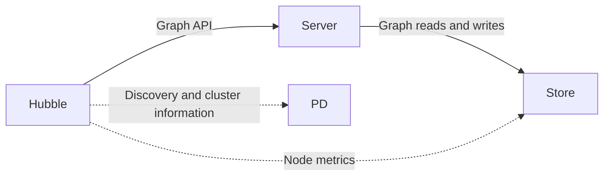

This guide highlights the key differences between HStore + PD distributed deployments and standalone RocksDB.
For general graph modeling, data import, and query workflows, see the [Hubble standalone guide](/docs/quickstart/toolchain/hugegraph-hubble/).
Content aligns with the Toolchain, Server, PD, and Store `master` branches (all currently `1.8.0`).

The main repository's [docker/docker-compose-hstore.yml](https://github.com/apache/hugegraph/blob/master/docker/docker-compose-hstore.yml)
provides complete orchestration for PD, Store, Server, and Hubble. Follow the adjacent
[Docker README](https://github.com/apache/hugegraph/blob/master/docker/README.md) to prepare `.env` and generate the local Hubble configuration,
then launch services from `docker/` without maintaining separate Compose files.
The guidance below focuses on connectivity and operations; ensure prerequisite credentials and service readiness from the README are met.
Docker `latest` is a moving tag. Screenshots assist in UI navigation; verify deployed versions via image digests and build details.
Metrics and permission APIs vary by version.

The screenshots show the HugeGraph Hubble interface in action; features and workflows are identical in both English and Chinese.

## Connect to a distributed cluster

Hubble still manages graph data through the **Server graph API**. In distributed mode, it discovers Servers through PD
and collects cluster information from PD and Store. Hubble does not read or write graph data directly in Store.



1. **Generate Hubble configuration.** Prepare `.env` in the main repository's `docker/` directory following the Docker README.

   ```bash
   set -a
   . ./.env
   set +a
   ./set-hubble-pd-password.sh hstore
   ```

   The script reads `HG_PD_AUTH_SECRET_KEY` from `.env` and writes its value as `operations.pd.password` into the generated file
   `docker/conf/hubble/hstore.local.properties`. Edit this generated file to adjust connection or operations settings (do not overwrite
   the tracked `.example` template), ensuring `operations.pd.password` matches the PD secret. Compose mounts this file read-only into
   the container; do not edit inside the container. Both `.env` and the generated file contain secrets and should not be committed to Git.
   Re-running the script overwrites the generated file, requiring custom settings to be reapplied.

1. **Start the services.** Use the same `docker/` directory and confirm Server registration and Store readiness.

   ```bash
   docker compose -f docker-compose-hstore.yml up -d --wait
   ```
{.steps}

For separately deployed services, follow the [PD deployment guide](/docs/quickstart/hugegraph/hugegraph-pd/) and
[HStore deployment guide](/docs/quickstart/hugegraph/hugegraph-hstore/). A source or binary Hubble deployment instead uses the package's
`conf/hugegraph-hubble.properties`. These settings match the official minimal topology; use backend-reachable addresses for other deployments:

```properties
pd.enabled=true
cluster=hg
pd.peers=pd:8686
pd.server=pd:8620
```

| Setting | Purpose | Bundled value |
|---|---|---|
| `pd.enabled` | Explicitly enable PD mode; `server.direct_url` is not used in this mode. | `false` |
| `cluster` | Cluster name used for Server discovery; it must match the registration. | `hg` |
| `pd.peers` | PD **gRPC** addresses, separated by commas. | `127.0.0.1:8686` |
| `pd.server` | PD **REST** address for cluster operations, not a list of gRPC peers. | `127.0.0.1:8620` |

Distinguish between the two ports: `8686` is for gRPC and `8620` is for REST. Do not interchange them, and use container service names or reachable IPs
rather than `127.0.0.1` for cross-container traffic.
The bundled package sets `pd.enabled=false`. If omitted, the fallback default is `true`, so declare this setting explicitly in both standalone and distributed
setups.
After editing configuration: restart the Hubble process for source or binary deployments; for Docker Compose, recreate the Hubble container from `docker/`
to reload the mounted configuration (retaining the project name and all `-f` arguments):

```bash
docker compose -f docker-compose-hstore.yml up -d --force-recreate hubble
```

In the Hubble UI, you do not need to configure a Server host and port for each graph.

## Organize graphs and permissions with GraphSpaces

A GraphSpace groups graphs, Schema templates, and access permissions. For example, create `sales` and `research` spaces
so each team can work with its own graphs. Modeling, importing, and querying within a space follow the standalone guide.

### Create and adjust a GraphSpace

With Server authentication enabled, creating, editing, and deleting GraphSpaces require super administrator access.
Start with a globally unique GraphSpace name, an optional display alias, and the maximum graph count.
For example, use `research` as the API identifier and “Research_graph” as the display alias.
The name cannot change after creation. The alias and description can change; aliases do not participate in URLs or permission matching.
Choose GraphSpace administrators from existing accounts.

“Advanced deployment and resource limits” includes CPU and memory limits for graph query/write services and asynchronous compute tasks,
plus the storage capacity limit. These deployment quotas neither report current usage nor resize existing containers.

> [!DETAILS]- Advanced deployment defaults
>
> Defaults are 100 graphs, 64 CPU cores and 128 GB of memory for each of the graph and compute services, and 1000000 GB of storage.
> Keep the defaults for a container trial. Configure Kubernetes namespaces, Operator images, and algorithm images only for the corresponding deployment
> or compute use.

Select a space before opening a graph. Check the current graph after switching spaces, especially when spaces contain identically named graphs.
The list reflects account access. If a space is missing, check membership permissions before creating more graphs.


{width="1600" height="1000"}

### Reuse Schema templates

**User-defined Schema templates require PD mode** and persist reusable Groovy Schema within a GraphSpace.
When several business graphs share vertex labels, edge labels, and indexes, save the model as a template and select it when creating subsequent graphs.
For example, a user template in `research` can be reused for new graphs in that space. After switching spaces, select a template belonging to the new space.

User templates differ from the built-in sample templates in the main guide: built-in templates help explore preset models,
while user templates preserve your own models for future use. A template is not an import of data; loading sample data is a separate graph creation choice.
With Server authentication enabled, creating a user template requires write access to its space.
Updating or deleting it also requires ownership or the corresponding administrative permission.
Anonymous mode does not enforce per-user permissions or template ownership checks.
Standalone mode does not provide user template management.

## Assign access to a GraphSpace

For account creation, login, and personal details, see the [standalone guide](/docs/quickstart/toolchain/hugegraph-hubble/).
Distributed mode adds “Manage GraphSpace members” to assign permissions between existing accounts and selected spaces.
Servers supporting permission presets provide these common choices:

| Preset | Intended user | Scope |
|---|---|---|
| GraphSpace read-only | Users who inspect and query graph data | Selected spaces. |
| GraphSpace read-write | Users who model, import, and maintain graph data | Selected spaces. |
| GraphSpace administrator | Owners managing a space's members and graph resources | Selected spaces; does not grant GraphSpace creation/editing or cluster operations access. |
| Super administrator | Operators managing accounts, GraphSpaces, and the cluster | Global; assign according to responsibilities. |

An account may have different access in different spaces, such as read-write in `research` and read-only in `sales`.
Accounts and space memberships are managed separately; removing a member does not delete the global account.
After creating an account, continue directly to assigning space access. When changing an existing membership, check the selected space and preset
and preserve permissions still needed in other spaces. Enabling `pd.enabled` grants no permissions;
legacy custom roles on older Servers are not interchangeable with these presets.
See [Server authentication and authorization](/docs/config/config-authentication/).


{width="1600" height="1000"}

## Locate problems through the cluster overview

The overview presents **Server → PD → Store** in one topology. Switch to the node list to filter by type, status, or name.
PD Leader, online Store count, graphs, partitions, replicas, and data size help identify cluster scale and nodes requiring attention.
Partitions and replicas describe data distribution. Data size is observed usage, distinct from a GraphSpace's configured storage limit.

Start with cluster and source status, then inspect an affected node. `UP` indicates a successful collection from the source;
`DEGRADED` indicates a cluster or partial source issue, and `DOWN` indicates that the corresponding probe failed.
Graphs may remain queryable when topology is available but some metrics are missing.
The UI distinguishes unsupported, unavailable, stale, and failed collections and includes observation times.
An empty value is not zero, and an older value is not a current observation.

### Read node details

| Node | Main observations | Use |
|---|---|---|
| Server | Availability, JVM/CPU/memory, and backend metrics | Check the query/write entrypoint and resource pressure. |
| PD | Leader/Follower role, status, and runtime metrics supplied upstream | Check the metadata/scheduling entrypoint; do not infer a role when Leader information is absent. |
| Store | Partition and Leader partition counts, system/disk metrics, Raft group and enabled group counts | Inspect storage nodes and replica service and compare distribution across nodes. |
{.td-table--wide}

```gallery
 # Start with cluster health and affected sources
 # Inspect the affected Store node
```

The PD Leader and Store Leader partitions serve different purposes: PD coordinates cluster metadata, while a Store leads the respective data partition's Raft
group.
Hubble displays upstream observations and does not replace a full Raft replica consistency check. Available metrics vary by component version.

With Server authentication enabled, cluster operations require a super administrator (`ADMIN` level).
GraphSpace administrators and ordinary members do not inherit cluster access.
Use container isolation, a trusted HTTPS entrypoint, Server authentication, and network allowlists; avoid publishing Hubble or component ports directly.

### Configure operations access

Hubble's **backend** uses the PD/Store operations credentials, separately from the Server account used to log in through the browser.
For Compose, edit the generated host file `docker/conf/hubble/hstore.local.properties`; other deployments use the Hubble package configuration.
The script-generated PD password must match the secret in `.env`. Configure the Store service account when Store authentication is enabled.
Do not include passwords in documentation, screenshots, or committed configuration:

| Setting | Bundled default | Configuration |
|---|---|---|
| `operations.pd.username` / `operations.pd.password` | Username `hubble`, empty password | Match PD operations REST authentication. |
| `operations.store.username` / `operations.store.password` | Username `hubble`, empty password | Set the service account when upstream Store REST authentication is enabled. |
| `operations.store.allowed_targets` | `[http://127.0.0.1:8520,http://[::1]:8520]` | List trusted Store metric origins. |
{.td-table--wide}

For example, when a containerized Store advertises `store:8520`, set:

```properties
operations.store.allowed_targets=[http://store:8520]
```

For multi-node clusters, list every trusted target origin. Each entry must use `http` or `https` with an explicit port and no path, credentials, or wildcard,
matching the Store metric target returned by PD. Adding an origin here only authorizes access—it does not register or discover nodes.

If topology renders but node metrics are missing, check Hubble backend connectivity and credentials to PD REST, verify the Store REST and metric addresses
returned by PD, and ensure targets are in `operations.store.allowed_targets`. A partially available overview indicates metrics collection was blocked for
specific sources, not that graph APIs are down.
